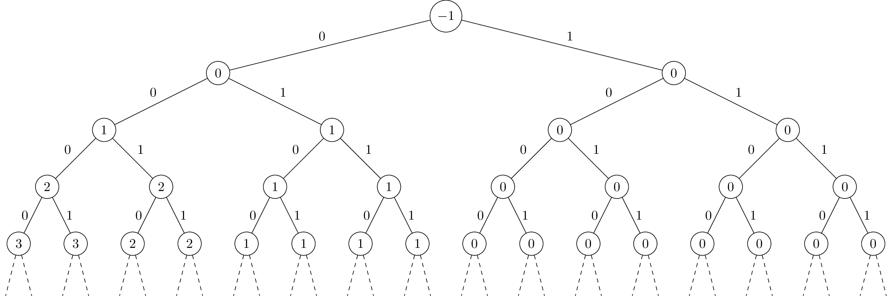
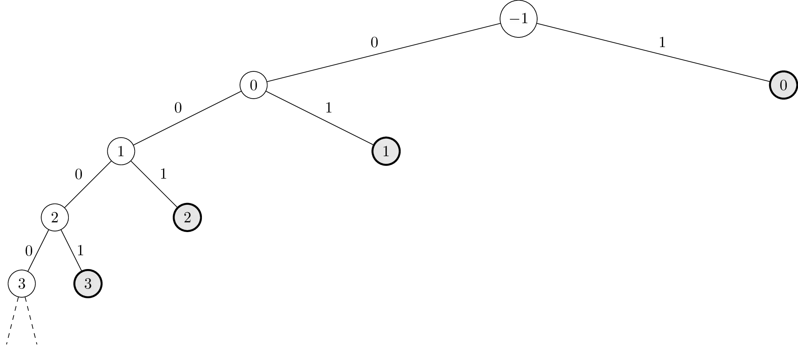
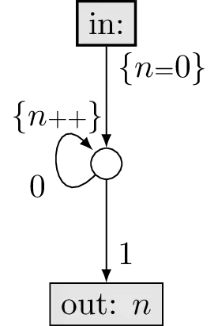
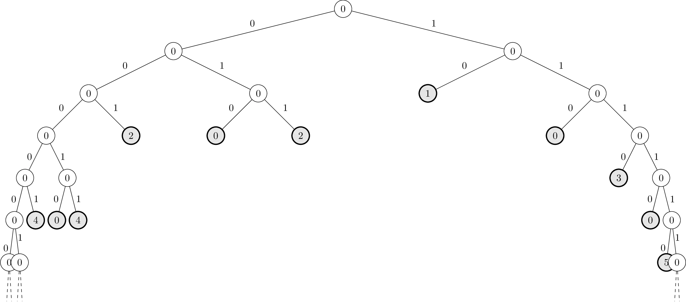
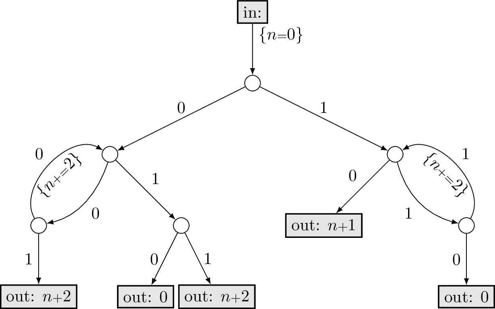
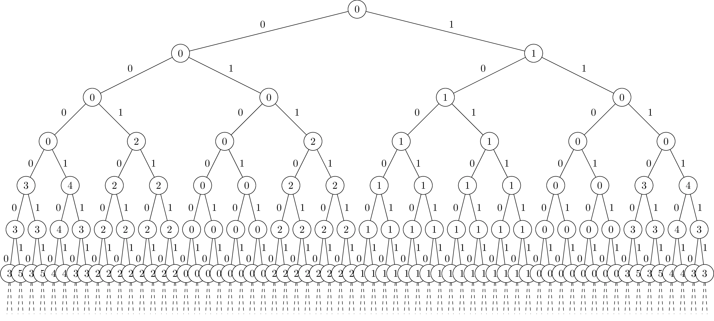
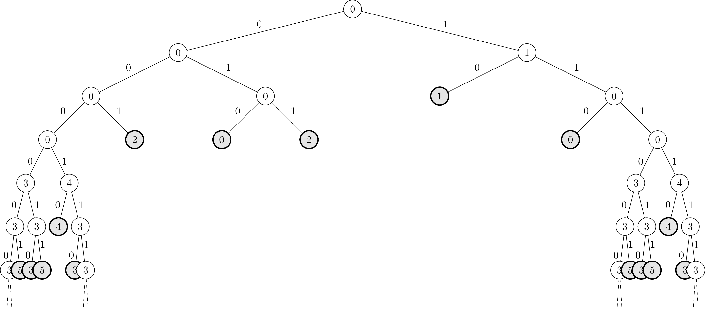
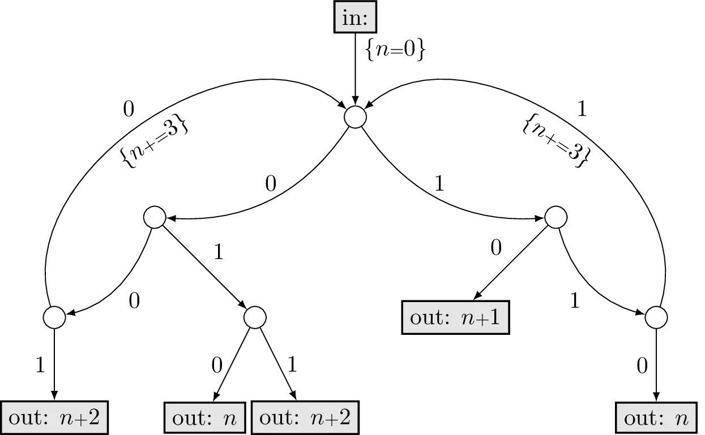

> Countably infinitely many hats (picture: *Team Fortress 2*, © Valve Corporation)

This is the last in a series of three _exercices de style_ to show some interesting aspects of the _game of hats_: a puzzle which was initially proposed by Lionel Levine.

- [First exercice](../2020-08-30-tower-of-hats/)
- [Second exercice](../2020-09-05-hats-calculator/)

Here we look at case where each player has a tower of countably infinitely many hats on their head and try constructing efficient strategies from the results of the first exercice.

## Definitions and notations

### Towers and strategies

We use notations inspired by (Kechris, 2012).

Let $\mathbb{T}_{<\mathbb{N}}$ denote the set of all towers of finite height and $\mathbb{T}_{\mathbb{N}}$ the set of towers of countably infinite height.

$$
\begin{align}
\mathbb{T}_{<\mathbb{N}}
&\stackrel{\text{def}}{=}\bigcup_{n\in\mathbb{N}} \mathbb{T}_n\\
\mathbb{T}_{\mathbb{N}}
&\stackrel{\text{def}}{=}[2]^{\mathbb{N}}
\end{align}
$$

$\mathbb{T}_{<\mathbb{N}}$ is countable but $\mathbb{T}_{\mathbb{N}}$ has the cardinality of the real line. $\mathbb{T}_{\mathbb{N}}$ is also known as the _Cantor space_.

Let $\mathbb{S}_{\mathbb{N}}$ denote the set of strategies for the game of hats with towers of countably infinite height. A (symmetric) strategy maps a tower to a chosen position:

$$
\begin{align}
\mathbb{S}_{\mathbb{N}}
&\stackrel{\text{def}}{=}{\mathbb{Z}}^{\mathbb{T}_{\mathbb{N}}}
\end{align}
$$

$\mathbb{S}_{\mathbb{N}}$ has cardinality strictly greater than the real line.

### Hit set and win rate

With infinite towers we can still use $\eta_{t,u}(s)$ to denote the outcome of applying strategy $s\in\mathbb{S}_{\mathbb{N}}$ to the configuration $(t,u)$, however it is no longer possible to calculate the hit score as a sum and the win rate as a mean value.

We substitute with $\eta(s)$, the _hit set_ of strategy $s$:

$$
\begin{equation}
\eta(s)\stackrel{\text{def}}{=}\{(t,u)\in\mathbb{T}_{\mathbb{N}}\times\mathbb{T}_{\mathbb{N}}\mid\eta_{t,u}(s)=1\},
\end{equation}
$$

and write $\mu(s)$ for the _win rate_ of strategy $s$, defined as the Baire/Borel measure of $\eta(s)$ in the space $\mathbb{T}_{\mathbb{N}}\times\mathbb{T}_{\mathbb{N}}$ (when it is measurable).

$$
\begin{equation}
\mu(s)\stackrel{\text{def}}{=}\mu(\eta(s)).
\end{equation}
$$

### Embedding

For convenience we identify the towers in $\mathbb{T}_n$ with towers in $\mathbb{T}_{\mathbb{N}}$ (by completing with black hats) and the strategies in $s\in\mathbb{S}_n$ with strategies in $s\in\mathbb{S}_{\mathbb{N}}$ (by discarding hats at position $n$ and beyond).

Thus we loosely write $s(t)$ and $eta_{t,u}(s)$ even when $s$, $t$ and $u$ are a mix of finite/infinite strategies and towers.

$$
\begin{align}
\forall i<j, \;\;
\left\{
\begin{array}{l}
\mathbb{T}_i
\subset \mathbb{T}_j
\subset \mathbb{T}_{<\mathbb{N}}
\subset \mathbb{T}_{\mathbb{N}}\\
\mathbb{S}_i
\subset \mathbb{S}_j
\subset \mathbb{S}_{\mathbb{N}}\\
\end{array}
\right.
\end{align}
$$

## Limits

### Infinite towers as limits of finite towers

Every tower $t\in\mathbb{T}_{\mathbb{N}}$ is the limit of a sequence of towers in $\mathbb{T}_{<\mathbb{N}}$ (with the topology of the Cantor space).

Proof: if $s\!\mid\!k$ denotes the initial segment of $s$ of size $k\in\mathbb{N}$, then:

$$
\begin{equation}
s = \lim_{n\to\infty} s\!\mid\!n
\end{equation}
$$

In fact, we can view $t\in\mathbb{T}_{\mathbb{N}}$ as the Cauchy completion of $t\in\mathbb{T}_{<\mathbb{N}}$.

### Finite strategies are continuous

A finite strategy $s\in\mathbb{S}_n$, embedded into $\mathbb{S}_{\mathbb{N}}$ as a mapping $s: \mathbb{T}_{\mathbb{N}} \to \mathbb{Z}$, is _continuous_.

### Limits of strategies

Here we allow strategies as functions $s: \mathbb{T}_{\mathbb{N}} \to \mathbb{Z}$ with _partial domain_.

Given a sequence $s_n\in\mathbb{S}_{\mathbb{N}}$ we define its _pointwise limit_:

$$
\begin{align}
\lim (s_n):\; &\big\{t\mid \lim_{n\to\infty} s_n(t)\text{ exists}\big\} \to \mathbb{Z}\\
&\;t \mapsto \lim_{n\to\infty} s_n(t) \nonumber
\end{align}
$$

It is natural to try constructing efficient infinite strategies as limits of finite strategies.

|  | Type | Win rate | Domain | Computable |
|---|---|---|---|---|
| $0_\omega$ | Constant | $1 \over 4$ | $\mathbb{T}_{\mathbb{N}}$ | on $\mathbb{T}_{\mathbb{N}}$ |
| $\mathbf{W}_\omega$ | Lowest white | $1 \over 3$ | $\mathbb{T}_{\mathbb{N}}\setminus\{(0,0,\cdots)\}$ | on its domain |
| $\mathbf{B}_\omega$ | Lowest black | $1 \over 3$ | $\mathbb{T}_{\mathbb{N}}\setminus\{(1,1,\cdots)\}$ | on its domain |
| $\mathbf{C}_\omega$ | Carter | $7 \over 20$ | $\mathbb{T}_{\mathbb{N}}$ | on $\mathbb{T}_{\mathbb{N}}\setminus$ $\{(0,0,\cdots),$ $(1,1,\cdots)\}$ |
| $\mathbf{R}_\omega$ | Reyes | $7 \over 20$ | $\big\{t\in\mathbb{T}_{\mathbb{N}}\mid\exists k,$ $\text{ card}\{t_{3k},t_{3k+1},$ $\:t_{3k+2}\}\neq1\big\}$ | on its domain |

> Sample of infinite strategies

## Infinite lowest-white strategy

Consider the infinite lowest-white strategy $\mathbf{W}_\omega$:

$$
\begin{equation}
\mathbf{W}_\omega \stackrel{\text{def}}{=} \lim_{n\to\infty} \mathbf{W}_n
\end{equation}
$$

$\mathbf{W}_\omega$ has win rate $1\over3$.

### Proof

Considering all towers in $\mathbb{T}_{\mathbb{N}}$, let's represent the combined output of the $\mathbf{W}_n$ strategies as a tree, as shown in the picture below:

> Output of the $\mathbf{W}_n$ strategies

Let's denote in gray the points where the pointwise limit is reached:

> Pointwise limit of the $\mathbf{W}_n$ strategies

We see that $\mathbf{W}_\omega=\lim(\mathbf{W}_n)$ is defined almost everywhere[^1] with respect to the Baire/Borel measure, and we can squeeze its hit set the following way:

$$
\begin{equation}
I_k \subset \eta(\mathbf{W}_\omega) \subset S_k
\end{equation}
$$

where:

$$
\left\{
\begin{array}{l}
I_k = \eta(\mathbf{W}_k) \setminus U_k\\
S_k = \eta(\mathbf{W}_k) \cup U_k\\
U_k = \big\{(t,u)\mid \text{ card}\bigcup_{i\geq k}\{\mathbf{W}_i(t)\}\neq1
\text{ or card}\bigcup_{i\geq k}\{\mathbf{W}_i(u)\}\neq1\big\}
\end{array}
\right.
$$

$I_k$ is an increasing sequence of sets and $S_k$ is a decreasing sequence, with $\lim_{k\to\infty} \mu(U_k) = 0$, $\lim_{k\to\infty} \mu(I_k) = 1/3$, $\lim_{k\to\infty} \mu(S_k) = 1/3$, hence $\mu(\mathbf{W}_\omega) = 1/3$. $\quad \Box$

Note (as shown in the picture below) that $\mathbf{W}_\omega$ is a computable function and can be written as a finite automaton that processes the _stream_ of hats from $t\in\mathbb{T}_{\mathbb{N}}$:

> $\mathbf{W}_\omega$ as a finite automaton

## Infinite Carter strategy

Consider the infinite Carter strategy $\mathbf{C}_\omega$:

$$
\begin{equation}
\mathbf{C}_\omega \stackrel{\text{def}}{=} \lim_{n\to\infty}
\mathbf{X}_n,
\end{equation}
$$

where:

$$
\left\{
\begin{array}{l}
\mathbf{X}_{2k-1} = \mathbf{C}_k\!\mid\!(2k-1)\\
\mathbf{X}_{2k} = \mathbf{C}_k\!\mid\!(2k)
\end{array}
\right.
$$

$\mathbf{W}_\omega$ has win rate $7\over20$.

### Proof

Considering all towers in $\mathbb{T}_{\mathbb{N}}$, let's represent the combined output of the $\mathbf{X}_n$ strategies as a tree, as shown in the picture below:

> Output of the Carter $\mathbf{X}_n$ strategies

Let's denote in gray the points where the pointwise limit is reached:

> Pointwise limit of the Carter $\mathbf{X}_n$ strategies

We see that $\mathbf{C}_\omega=\lim(\mathbf{X}_n)$ is defined everywhere, and we can squeeze its hit set the following way:

$$
\begin{equation}
I_k \subset \eta(\mathbf{C}_\omega) \subset S_k
\end{equation}
$$

where:

$$
\left\{
\begin{array}{l}
I_k = \eta(\mathbf{X}_k) \setminus U_k\\
S_k = \eta(\mathbf{X}_k) \cup U_k\\
U_k = \big\{(t,u)\mid \text{ card}\bigcup_{i\geq k}\{\mathbf{X}_i(t)\}\neq1
\text{ or card}\bigcup_{i\geq k}\{\mathbf{X}_i(u)\}\neq1\big\}
\end{array}
\right.
$$

$I_k$ is an increasing sequence of sets and $S_k$ is a decreasing sequence, with $\lim_{k\to\infty} \mu(U_k) = 0$, $\lim_{k\to\infty} \mu(I_k) = 7/20$, $\lim_{k\to\infty} \mu(S_k) = 7/20$, hence $\mu(\mathbf{C}_\omega) = 7/20$. $\quad \Box$

Note (as shown in the picture below) that $\mathbf{C}_\omega$ is a computable function almost everywhere[^2] and can be written as a finite automaton that processes the _stream_ of hats from $t\in\mathbb{T}_{\mathbb{N}}$:

> $\mathbf{C}_\omega$ as a finite automaton

## Infinite Reyes strategy

Consider the infinite Reyes strategy $\mathbf{R}_\omega$:

$$
\begin{equation}
\mathbf{R}_\omega \stackrel{\text{def}}{=} \lim_{n\to\infty}
\mathbf{X}_n,
\end{equation}
$$

where:

$$
\left\{
\begin{array}{ll}
\mathbf{X}_{3k-2} &= \mathbf{C}_k\!\mid\!(3k-2)\\
\mathbf{X}_{3k-1} &= \mathbf{C}_k\!\mid\!(3k-1)\\
\mathbf{X}_{3k} &= \mathbf{C}_k\!\mid\!(3k)
\end{array}
\right.
$$

$\mathbf{W}_\omega$ has win rate $7\over20$.

### Proof

Considering all towers in $\mathbb{T}_{\mathbb{N}}$, let's represent the combined output of the $\mathbf{X}_n$ strategies as a tree, as shown in the picture below:

> Output of the Reyes $\mathbf{X}_n$ strategies

Let's denote in gray the points where the pointwise limit is reached:

> Pointwise limit of the Reyes $\mathbf{X}_n$ strategies

We see that $\mathbf{R}_\omega=\lim(\mathbf{X}_n)$ is defined almost everywhere[^3], and we can squeeze its hit set the following way:

$$
\begin{equation}
I_k \subset \eta(\mathbf{C}_\omega) \subset S_k
\end{equation}
$$

where:

$$
\left\{
\begin{array}{l}
I_k = \eta(\mathbf{X}_k) \setminus U_k\\
S_k = \eta(\mathbf{X}_k) \cup U_k\\
U_k = \big\{(t,u)\mid \text{ card}\bigcup_{i\geq k}\{\mathbf{X}_i(t)\}\neq1
\text{ or card}\bigcup_{i\geq k}\{\mathbf{X}_i(u)\}\neq1\big\}
\end{array}
\right.
$$

$I_k$ is an increasing sequence of sets and $S_k$ is a decreasing sequence, with $\lim_{k\to\infty} \mu(U_k) = 0$, $\lim_{k\to\infty} \mu(I_k) = 7/20$, $\lim_{k\to\infty} \mu(S_k) = 7/20$, hence $\mu(\mathbf{R}_\omega) = 7/20$. $\quad \Box$

Note (as shown in the picture below) that $\mathbf{R}_\omega$ is a computable function on its definition domain and can be written as a finite automaton that processes the _stream_ of hats from $t\in\mathbb{T}_{\mathbb{N}}$:

> $\mathbf{R}_\omega$ as a finite automaton

## References

- Kechris, A. S. (2012). *Classical descriptive set theory.* Springer.

[^1]: In fact $\mathbf{W}_\omega$ is defined everywhere except at $(0, 0, \cdots)$

[^2]: $\mathbf{W}_\omega$ is not computable only at points $(0,0,\cdots)$ and $(1,1,\cdots)$

[^3]: $\mathbf{R}_\omega$ is defined for all $t$ such that $\exists k, \text{ card}\{t_{3k},t_{3k+1},t_{3k+2}\}\neq1$
