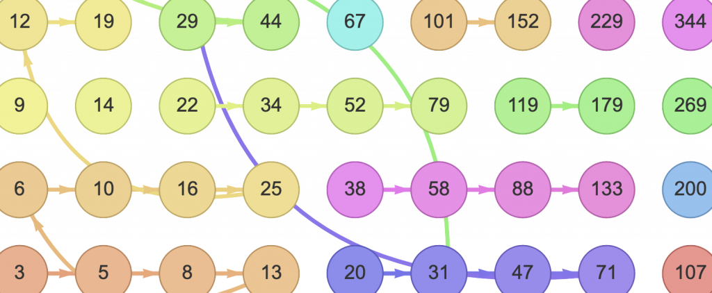
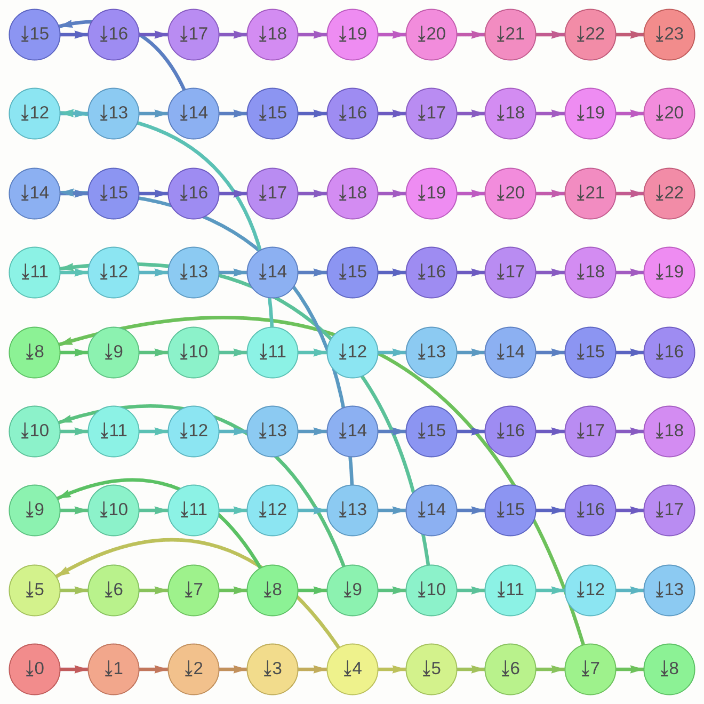
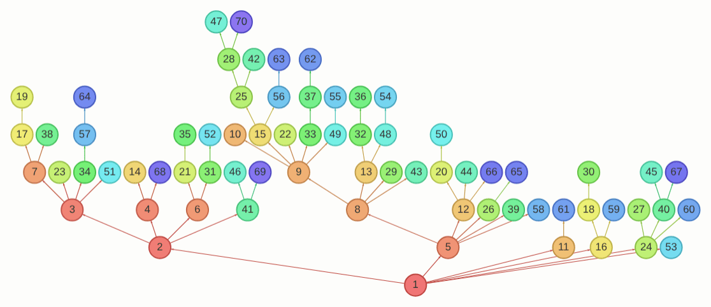
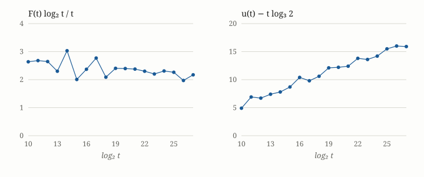

> **Work in progress.** The beads of this paper are being renumbered from
> $1$ instead of $0$. Until this notice disappears, the parts not yet
> converted (see the headings below) still count from $0$.



> Reluctant Jane at work (a detail of Figure 8).

Jane owns a special rosary. It has a single end and is made of infinitely many
black and white beads. Starting from the end, the beads are numbered
$n = 1, 2, 3, \ldots$ and each carries a label $L(n) = 1, 1, 2, 2, 3, 3, \ldots$
Every third bead, starting with bead $1$, is black; the other beads are white.

[](https://blog.atlant.is/figures/jane-s-rosary/rosary.html?n=10&labels=position&arrows=none&interactive=yes&first=1)

> Figure 1: the rosary. Each bead shows its position; every third bead is black. Up is to the right, down to the left ([live version](https://blog.atlant.is/figures/jane-s-rosary/rosary.html?n=10&labels=position&arrows=none&interactive=yes&first=1)).

Jane tells the beads of her rosary in a special way. She always starts at bead
$1$. Each time she is done with a bead $n$, she moves on, either *up* to bead
$n + L(n)$ or *down* to bead $n - L(n)$.

[](https://blog.atlant.is/figures/jane-s-rosary/rosary.html?n=10&labels=label&arrows=both&interactive=yes&first=1)

> Figure 2: telling the beads. Each bead shows its label, and its two arrows, one up (to the right) and one down (to the left), reach as many places away as the label says ([live version](https://blog.atlant.is/figures/jane-s-rosary/rosary.html?n=10&labels=label&arrows=both&interactive=yes&first=1)).

**Can Jane tell every bead of her rosary?** Yes, and easily: every bead can be
reached from bead $1$. The fun starts with two finer questions.

**How fast?** The least number of moves needed to reach bead $n$ is its
*height*. Bead $4$, only three beads away from bead $1$, has height $5$: Jane
must go up four times, to bead $8$, before one move down brings her to it.
*Theorem 1* says what shortest recitations look like, bead by bead, and turns
into a program that computes the height of bead $n$ in about $\log n$ steps,
without searching.

**What if Jane is reluctant?** Suppose she always moves down, unless the bead
below has already been told, in which case, and only then, she moves up. She
looks no further than one bead ahead. Her recitation starts

$$1,\ 2,\ 3,\ 5,\ 8,\ 4,\ 6,\ 9,\ 14,\ 7,\ 11,\ 17,\ 26,\ 13,\ \ldots$$

and nothing in her rule seems to prevent her from painting herself into a
corner, with told beads both below and above, or from leaving some bead behind
forever. Neither happens:

- *Theorem 2*: she never gets stuck;
- **Theorem 3: she tells every bead, exactly once**;
- *Theorem 5*: in the long run she moves up with frequency exactly
  $\log_3 2 \approx 0.6309$, a little less than two moves out of three;
- *Theorem 6*: bead $m$ gets its turn after at most polynomially many moves.

Theorem 3 was a conjecture in the first version of this note (see the history
above), and it is the conjecture recorded in the OEIS entries below.

**Why it works, in one breath.** A down move halves the position of the bead
(rounding down), and an up move multiplies it by $3/2$ (rounding up). So
Jane's rule plays the powers of $2$
against the powers of $3$, and because no power of $2$ is a power of $3$, that
is, because $\log_2 3$ is irrational, she cannot fall into a routine: on a
logarithmic scale each up move turns her around a circle by very nearly the
same irrational angle, down moves do not turn her at all, and such a rotation
sooner or later visits every arc of the circle. Section 8 makes this precise.

Along the way the black beads turn out to carry a tree of their own, the
*onyx rosary*, in which every bead has infinitely many children (*Theorem 4*).

**Where this comes from.** The rosary is [Jane Street](https://www.janestreet.com/)'s
puzzle [Traversing the Infinite Sidewalk](https://www.janestreet.com/numberphile/)
in disguise, and three entries of the
[On-Line Encyclopedia of Integer Sequences](https://oeis.org/) record it
(more on the rosary's [relatives](#relatives-of-the-rosary) at the end):

| Here | On the sidewalk | OEIS |
|---|---|---|
| bead $n$, moves up and down | square $n$, jumps forward and backward | counted from $0$: slab $n - 1$ |
| height $h(n)$ | minimum number of jumps from the first square to square $n$ | [A358838](https://oeis.org/A358838), at $n - 1$ |
| reluctant recitation $\rho$ | the greedy walk | [A359005](https://oeis.org/A359005), plus one |
| the move at which bead $m$ is told, $\rho^{-1}(m)$ | the inverse mapping of the greedy walk | [A359008](https://oeis.org/A359008), at $m - 1$ |

Like Jane Street's page, this paper counts from $1$. The OEIS entries count
the slabs from $0$, as the earlier versions of this paper counted the beads
(see the history above): their slab $n - 1$ is our bead $n$.

**And what is still open.** Plenty; Section 12 has seven questions. A
favorite: look at each of Jane's down moves and count the up moves that
came just before it. After $2^{27}$ moves, the count is exactly one in
$49.993\%$ of the cases. Is the true proportion one half?

## How to read this paper

The paper has four parts and a coda. They lean on each other less than their
order suggests:

$$
\begin{CD}
\textbf{I} @>\text{Lemma 1}>> \textbf{II} @>\text{Theorem 3}>> \textbf{IV}\\
@V\text{Theorem 1}VV @VV\text{Theorem 3}V\\
\textbf{III} @>>> \text{Corollary 3}
\end{CD}
$$

- **Part I, shortest recitations** (Sections 1 to 5): the names, the height,
  Theorem 1 and the fast algorithm. It needs nothing.
- **Part II, the reluctant recitation** (Sections 6 to 8): Theorems 2 and 3.
  From Part I it needs the names (Section 1 and the first lines of Section 4)
  and one elementary lemma (Lemma 1, in Section 3). It does not use
  Theorem 1: a reader in a hurry to see why reluctant Jane tells every bead
  can read Section 1 and Lemma 1, and jump to Section 6.
- **Part III, the onyx rosary** (Sections 9 and 10): Theorem 4. It is built
  on Theorem 1; only its last corollary, on Jane's foraging sequence, uses
  Theorem 3.
- **Part IV, the pace of the recitation** (Section 11): Theorems 5 and 6. It
  continues Part II and uses neither Theorem 1 nor Part III.
- **Coda**: the rosary's relatives (the sidewalk, the powers of $3/2$, the
  $3x+1$ problem), and what is still open (Section 12).

Theorems, lemmas and conjectures keep the numbers they had in the previous
version of this paper. Every name used in the paper is listed in a
[table at the end](#names-at-a-glance), with the section where it is defined.

## Part I. Shortest recitations

*Sections 1 to 5.* The names of things, the height of a bead, and what a
shortest recitation looks like: always one step up from $n\lambda$ to reach a
white bead $n$ (Lemma 2), and, to reach a black bead, a choice between two
ways that Theorem 1 settles. The part ends with the fast algorithm for the
height.

### 1. Prelude: names

> To weave the magic of a thing, you see, one must find its true name out.
>
> Ursula K. Le Guin, *A Wizard of Earthsea*

Throughout, $\mathbb{N} = \{0, 1, 2, \ldots\}$ and
$\mathbb{N}^* = \{1, 2, 3, \ldots\}$. Moves are written *after* the
bead they apply to, and read from left to right: $nUD$ means "go up from $n$,
then down". This way a recitation reads in the order in which Jane tells it:
$1\,UUUUD$ is bead $1$, four moves up, one move down, and that is bead $4$.

Only seven names are needed to begin with. Bead $8$ will serve as an example
throughout.

- **Bead**: a positive integer $n$ (the position of the bead in the rosary,
  counted from its end).
- **Black bead**: a bead $n \equiv 1 \pmod 3$, that is $1, 4, 7, 10, \ldots$
  **White bead**: any other bead. Bead $8$ is white.
- **Label**: $L(n) = \lceil n/2 \rceil$. The label of bead $8$ is $4$.
- **Up**: $U : \mathbb{N}^* \to \mathbb{N}^*$, $\; nU = n + L(n) = \lceil 3n/2 \rceil$.
  From bead $8$, up leads to $8U = 12$.
- **Down**: $D : \mathbb{N}^*\setminus\{1\} \to \mathbb{N}^*$, $\; nD = n - L(n) = \lfloor n/2 \rfloor$.
  From bead $8$, down leads to $8D = 4$.

The next three run the moves backwards: they say where Jane may have come
from.

- **Lambda**: $n\lambda = \lfloor 2n/3 \rfloor$ for a white bead $n$,
  the bead from which an up move leads to $n$. Jane comes up
  to bead $8$ from $8\lambda = 5$.
- **Mu** and **nu**: $n\mu = 2n$ and $n\nu = 2n+1$, the two beads from which
  a down move leads to $n$. Jane comes down to bead $8$ from $8\mu = 16$ or
  from $8\nu = 17$.

Black beads are also counted among themselves, and this count is written in
bold: the black bead number $\boldsymbol{n}$ is the bead

$$\boldsymbol{n}^\bullet = 3\boldsymbol{n} - 2, \qquad\text{so that}\quad \mathbf{1}^\bullet = 1,\quad \mathbf{2}^\bullet = 4,\quad \mathbf{3}^\bullet = 7 .$$

The bullet is one more map written after its argument. A bold number or
letter always counts black beads; a plain one is a position in the rosary.

$U$, $\lambda$, $\mu$, $\nu$ are strictly increasing and $D$ is non-decreasing.
That $\lambda$, $\mu$, $\nu$ are the inverse branches of $U$ and $D$ is the
content of:

**Fact 1.**

1. $U$ is injective and its image is exactly the set of white beads:
   $(2j-1)U = 3j-1$ and $(2j)U = 3j$. Hence $n\lambda U = n$ for every white
   $n$, and $nU\lambda = n$ for every $n$. *A black bead can never be reached by
   an up move.*
2. For every $n$, the beads that go down to $n$ are exactly the even bead $n\mu$
   and the odd bead $n\nu$: $n\mu D = n\nu D = n$.

So a white bead such as $8$ can be reached in three ways (up from $5$, down
from $16$ or from $17$), and a black bead such as $4$ in two ways only, both
from above (down from $8$ or from $9$). Much of Part I is about which way is
shortest.

Three more names, for sequences of moves:

- **Recitation**: a finite or infinite sequence $(a_i)$ of beads with
  $a_{i+1} \in \{a_iU, a_iD\}$. Its **length** is its number of moves.
- **Minimal recitation** from $n$ to $m$: a recitation of minimal length.
  Unless stated otherwise, a minimal recitation *to* $m$ starts at bead $1$.
- **Height**: $h(n)$ is the length of a minimal recitation to $n$. The
  recitation $1, 2, 3, 5, 8$ shows that $h(8) \leq 4$ (in fact $h(8) = 4$,
  by Lemma 2 below).

**The binary tree.** Down halves, and $\mu$, $\nu$ double: *the rosary is
the infinite binary tree in heap order*. Moving down means moving to the
parent, i.e. erasing the last binary digit of $n$, and $n\mu$, $n\nu$ are
the two children of $n$. Bead $8$ is $1000$ in binary: its parent is bead
$4$ and its children are beads $16$ and $17$. Moving up is the map
$n \mapsto \lceil 3n/2 \rceil$ studied by Odlyzko and Wilf in connection with
the Josephus problem [OW91]. Most of what follows is an interplay between
this binary structure (down) and the multiplication by $3/2$ (up).

### 2. The height of a bead

By definition $h(1) = 0$.

[](https://blog.atlant.is/figures/jane-s-rosary/rosary.html?n=10&labels=label&arrows=to3&interactive=yes&first=1)

> Figure 3: the height of bead $4$ is $5$. Beads show their labels and the arrows are numbered in the order of the moves: four up, then one down onto bead $4$, the fourth from the left ([live version](https://blog.atlant.is/figures/jane-s-rosary/rosary.html?n=10&labels=label&arrows=to3&interactive=yes&first=1)).

**Proposition 1.** Every bead has a finite height. Moreover, for all $n \geq 2$,

$$\log_{3/2}\frac{n+1}{2} \;\leq\; h(n) \;\leq\; \min\Big(\frac{4n-1}{3},\;\; 12 + 3\,\frac{\ln n}{\ln(9/8)}\Big).$$

*Proof.* Let $n > 1$.

- If $n$ is white, then $n = mU$ with $m = n\lambda = \lfloor 2n/3 \rfloor < n$.
- If $n$ is black and $n \not\equiv 1 \pmod 9$, then $n = mU^2D$ with
  $m = n\mu\lambda^2 = \lfloor 8n/9 \rfloor < n$.
- If $n \equiv 1 \pmod 9$, then $n = mU^2D$ with
  $m = n\nu\lambda^2 = \lceil 8n/9 \rceil < n$.

By induction on $n$, every bead has a finite height, and $h(n) \leq 3 + h(m)$
with $m - 7 \leq \frac{8}{9}(n-7)$ in all three cases. Both upper bounds follow
by induction, the finitely many small cases being checked directly
($h(n) = 0, 1, 2, 5, 3, 6, 9, 4, 7, 10, 10, \ldots$ for $n = 1, 2, 3, \ldots$;
equality in $h(n) \le (4n-1)/3$ holds for $n = 4$ and $n = 7$).

For the lower bound, note that $nU + 1 \leq \frac{3}{2}(n+1)$ and $nD < n$, so a
recitation of length $h$ starting at $1$ ends at a bead $n$ with
$n + 1 \leq 2\,(3/2)^h$. $\quad\Box$

The logarithmic upper bound was suggested by
[Jianing Song](https://oeis.org/wiki/User:Jianing_Song). (Numerically,
$h(n) \leq 1 + 3\ln n/\ln(9/8)$ for all $2 \le n \le 10^6$.) The lower bound is
asymptotically attained along the recitation that only moves up, so
$\liminf h(n)/\ln n = 1/\ln(3/2) \approx 2.466$. See Section 12 for what
$h(n)/\ln n$ does for a typical $n$.

#### Computing the height by exploration

```python
import itertools

def height(n: int) -> int:
    if n < 1: raise ValueError("n must be a positive integer")
    if n == 1: return 0
    if n == 2: return 1
    visited = {1, 2}     # the beads we have visited so far
    rings = [{1}, {2}]   # the beads grouped by height
    for h in itertools.count(2):
        new_ring = set()
        for bead in rings[h - 1]:
            label = (bead + 1) >> 1
            for next_bead in {bead - label, bead + label}:
                if next_bead not in visited:
                    if next_bead == n: return h
                    visited.add(next_bead)
                    new_ring.add(next_bead)
        rings.append(new_ring)
```

[](https://blog.atlant.is/figures/jane-s-rosary/height-plot.html?n=10000&first=1 "live")

> Figure 4: the heights of the first $10\,000$ beads, with positions on a logarithmic scale. Look at the horizontal dashes: long runs of neighboring beads share the same height. Click the picture to explore it ([live version](https://blog.atlant.is/figures/jane-s-rosary/height-plot.html?n=10000&first=1)).

### 3. Minimal recitations

Everything in this section, and Theorem 2 later on, rests on one elementary
observation about the beads sitting "above" a white bead.

**Lemma 1 (commutation).** Let $w$ be a white bead.

1. Exactly one of $w\mu$, $w\nu$ is white. Call it $\hat{w}$. Then $\hat{w}\lambda D = w\lambda$.
2. The other one, call it $b$, is black. Both $b\mu$ and $b\nu$ are white, and
   $b\mu\lambda DD = b\nu\lambda DD = w\lambda$.

**How to read the diagrams.** All the diagrams of this paper are read in the
same way. An arrow carries the name of a move ($U$, $D$) or of a move run
backwards ($\lambda$, $\mu$, $\nu$), and leads from a bead to the bead that
this name gives. A diagram *commutes* when two routes that follow its arrows
from one bead to another always arrive at the same bead; when the arrows go
round in a loop, this means that the loop closes.

Both statements of Lemma 1 say that a loop closes. Start from $w$, in the
bottom right corner: go up the right-hand side, across the top, and down the
left-hand side; you arrive at $w\lambda$, from which one up move leads back
to $w$. With $w = 8$ in the first diagram: up to $\hat{w} = 17$, across to
$17\lambda = 11$, down to $11D = 5$, and $5U = 8$. Here $x$ and $y$ stand for
$\mu$ or $\nu$:

$$
\begin{CD}
\hat{w}\lambda @<\lambda<< \hat{w}\\
@VVDV @AAxA\\
w\lambda @>U>> w
\end{CD}
\qquad\qquad
\begin{CD}
by\lambda @<\lambda<< by\\
@VVDV @AAyA\\
by\lambda D @. b\\
@VVDV @AAxA\\
w\lambda @>U>> w
\end{CD}
$$

*Proof.* Direct computation. If $w = 3k+2$, then $w\lambda = 2k+1$, the white
bead is $\hat{w} = w\nu = 6k+5$ and the black bead is $b = w\mu = 6k+4$:

$$
\begin{CD}
4k+3 @<\lambda<< 6k+5\\
@VVDV @AA\nu A\\
2k+1 @>U>> 3k+2
\end{CD}
\qquad
\begin{CD}
8k+5 @<\lambda<< 12k+8\\
@VVDV @AA\mu A\\
4k+2 @. 6k+4\\
@VVDV @AA\mu A\\
2k+1 @>U>> 3k+2
\end{CD}
\qquad
\begin{CD}
8k+6 @<\lambda<< 12k+9\\
@VVDV @AA\nu A\\
4k+3 @. 6k+4\\
@VVDV @AA\mu A\\
2k+1 @>U>> 3k+2
\end{CD}
$$

If $w = 3k$, then $w\lambda = 2k$, the white bead is $\hat{w} = w\mu = 6k$
and the black bead is $b = w\nu = 6k+1$:

$$
\begin{CD}
4k @<\lambda<< 6k\\
@VVDV @AA\mu A\\
2k @>U>> 3k
\end{CD}
\qquad
\begin{CD}
8k+1 @<\lambda<< 12k+2\\
@VVDV @AA\mu A\\
4k @. 6k+1\\
@VVDV @AA\nu A\\
2k @>U>> 3k
\end{CD}
\qquad
\begin{CD}
8k+2 @<\lambda<< 12k+3\\
@VVDV @AA\nu A\\
4k+1 @. 6k+1\\
@VVDV @AA\nu A\\
2k @>U>> 3k
\end{CD}
$$

Each arrow of these six diagrams is one line of arithmetic; in the first one,
for instance, $(6k+5)\lambda = \lfloor (12k+10)/3 \rfloor = 4k+3$ and
$(4k+3)D = 2k+1$. In all six the loop closes: the left-hand side comes down
onto the very bead, $w\lambda$, from which the bottom arrow leads up to $w$.
This is statement 1 for the small diagrams and statement 2 for the tall
ones. $\quad\Box$

**Lemma 2 (white beads).** For every white bead $w$ there is a minimal
recitation to $w$ that ends with an up move. Equivalently,
$h(w) = h(w\lambda) + 1$.

*Proof.* By strong induction on $h = h(w)$. Take a minimal recitation
$\mathcal{R}$ to $w$ and assume that it ends with a down move, from a bead
$p \in \{w\mu, w\nu\}$ of height $h - 1$. We exhibit a recitation to
$w\lambda$ of length at most $h - 1$; appending one up move then gives a
recitation to $w$ of length at most $h$ that ends with an up move.

- If $p$ is the white bead $\hat{w}$ of Lemma 1: by induction
  $h(\hat{w}\lambda) = h - 2$, and $\hat{w}\lambda D = w\lambda$, so
  $h(w\lambda) \leq h - 1$.
- If $p$ is the black bead $b$ of Lemma 1: by Fact 1, $\mathcal{R}$ reaches
  $b$ by a down move from a white bead $p' \in \{b\mu, b\nu\}$ of height
  $h - 2$. By induction $h(p'\lambda) = h - 3$, and $p'\lambda DD = w\lambda$,
  so $h(w\lambda) \leq h - 1$. $\quad\Box$

**Corollary 1 (black beads).** For every black bead $b > 1$,
$h(b) = 1 + \min\big(h(b\mu), h(b\nu)\big)$, and there is a minimal recitation
to $b$ that ends with *up*-*down*.

*Proof.* A black bead can only be reached by a down move (Fact 1), from $b\mu$
or $b\nu$, which are both white; apply Lemma 2. $\quad\Box$

For $b = \boldsymbol{n}^\bullet$ the two candidates are:

$$
\begin{CD}
4\boldsymbol{n}-3 @<\lambda<< 6\boldsymbol{n}-4\\
@. @AA\mu A\\
{} @. \boldsymbol{n}^\bullet
\end{CD}
\qquad\qquad
\begin{CD}
4\boldsymbol{n}-2 @<\lambda<< 6\boldsymbol{n}-3\\
@. @AA\nu A\\
{} @. \boldsymbol{n}^\bullet
\end{CD}
$$

So a minimal recitation can be built backwards: from a white bead apply
$\lambda$; from a black bead choose between $\mu$ and $\nu$. Theorem 1 says
which one to choose.

### 4. Interlude: more names

> Hey, Louie. The man is dry. Give him one on the house, okay?
>
> Ridley Scott, *Blade Runner* (1982)

Theorem 1 compares two beads by looking at where they come from when one
only moves up. This takes four names; bead $8$ is the example again.

- **Up-chain**: $\uparrow\!(n) = \{nU^i \mid i \in \mathbb{N}\}$, what Jane tells
  if she starts at $n$ and only moves up:
  $\uparrow\!(8) = \{8, 12, 18, 27, \ldots\}$.
- **Down-chain**: $\downarrow\!(n) = \{nD^i \mid i \geq 0,\ nD^i \text{ defined}\}$,
  what she tells if she only moves down; it is finite and ends in $1$:
  $\downarrow\!(8) = \{8, 4, 2, 1\}$.
- **Seed**: $\sigma(n)$ is the unique black bead from which $n$ is reached by up
  moves only. **Lambex** (for "$\lambda$-exponent"): $\Lambda(n)$ is the number
  of those up moves. In other words $n = \sigma(n)U^{\Lambda(n)}$ and
  $\sigma(n) = n\lambda^{\Lambda(n)}$, which is where the name comes from.
  Going back from bead $8$ by $\lambda$ gives $5, 3, 2, 1$, and $1$ is black:
  $\sigma(8) = 1$ and $\Lambda(8) = 4$. Its neighbor $9$ goes back to $6$ and
  then to the black bead $4$: $\sigma(9) = 4$ and $\Lambda(9) = 2$.

By Fact 1, the up-chains of the black beads partition the rosary,
$\mathbb{N}^* = \biguplus_{\boldsymbol{n}} \uparrow\!(\boldsymbol{n}^\bullet)$. So a bead is known
by the number of its seed and by its lambex:

$$\gamma(n) = \big(\boldsymbol{k},\ \Lambda(n)\big) \quad\text{where}\quad \sigma(n) = \boldsymbol{k}^\bullet$$

is a bijection between $\mathbb{N}^*$ and $\mathbb{N}^*\times\mathbb{N}$. For
instance $\gamma(8) = (\mathbf{1}, 4)$ and $\gamma(9) = (\mathbf{2}, 2)$.

[](https://blog.atlant.is/figures/jane-s-rosary/deconstructed.html?n=0&width=9&height=9&ordering=none&label=position&color=none&arrows=none&interactive=yes&first=1)

> Figure 5: the rosary deconstructed. Each row is an up-chain and starts from a black bead, on the left: an up move is a step to the right, and $\lambda$ is a step to the left. Bead $8$ sits in the bottom row, four steps from its seed $1$ ([live version](https://blog.atlant.is/figures/jane-s-rosary/deconstructed.html?n=0&width=9&height=9&ordering=none&label=position&color=none&arrows=none&interactive=yes&first=1)).

[](https://blog.atlant.is/figures/jane-s-rosary/deconstructed.html?n=0&width=9&height=9&ordering=canonic&label=height&color=height&arrows=yes&interactive=yes&first=1)

> Figure 6: the same, with heights in place of positions. Each arrow leads to a bead from the one before it on a shortest recitation: white beads are reached from their left (Lemma 2), black beads from one of the two beads above them in the binary tree ([live version](https://blog.atlant.is/figures/jane-s-rosary/deconstructed.html?n=0&width=9&height=9&ordering=canonic&label=height&color=height&arrows=yes&interactive=yes&first=1)).

The up-chain of bead $1$ reads $1, 2, 3, 5, 8, 12, 18, 27, 41,
\ldots$ ([A061419](https://oeis.org/A061419)); by [OW91] every up-chain grows
like $K\cdot(3/2)^i$ for a constant $K$ depending on the chain.

**Remark (neighbors of black beads have lower seeds).** Since
$\sigma(n) \leq n\lambda$ for white $n$, the two neighbors of a black bead
$\boldsymbol{n}^\bullet > 1$ have small seeds:
$\sigma(\boldsymbol{n}^\bullet - 1) \leq 2\boldsymbol{n}-2$ and $\sigma(\boldsymbol{n}^\bullet + 1) \leq 2\boldsymbol{n}-1$.
(This was "Conjecture 3" in the very first version of this note.)

### 5. Theorem 1: minimal recitations ending in a black bead

Let $\boldsymbol{n}^\bullet > 1$ be a black bead. Write

$$2\boldsymbol{n} - 1 = 3^e q \quad\text{with } 3 \nmid q, \qquad\text{and}\qquad
  b_i = \Big(\frac{2}{3}\Big)^i (6\boldsymbol{n}-3) = 2^i\,3^{e+1-i}\,q, \quad a_i = b_i - 1
  \qquad (0 \leq i \leq e+1).$$

**Theorem 1.** With these notations:

1. $a_0 = \boldsymbol{n}^\bullet\mu$, $b_0 = \boldsymbol{n}^\bullet\nu$, and $a_i = \boldsymbol{n}^\bullet\mu\lambda^i$,
   $b_i = \boldsymbol{n}^\bullet\nu\lambda^i$ for all $i \leq e+1$. For $i \leq e$ both $a_i$ and
   $b_i$ are white; exactly one of $a_{e+1}$, $b_{e+1}$ is black.
2. If $2^{e+1}q \equiv 1 \pmod 3$ then $b_{e+1} = 2^{e+1}q$ is black and
   $\Lambda(\boldsymbol{n}^\bullet\mu) > \Lambda(\boldsymbol{n}^\bullet\nu) = e+1$; we say that *$\mu$ wins*.
   If $2^{e+1}q \equiv 2 \pmod 3$ then $a_{e+1}$ is black and
   $\Lambda(\boldsymbol{n}^\bullet\nu) > \Lambda(\boldsymbol{n}^\bullet\mu) = e+1$; we say that *$\nu$ wins*.
3. In particular $\Lambda(\boldsymbol{n}^\bullet\mu) \neq \Lambda(\boldsymbol{n}^\bullet\nu)$,
   $\sigma(\boldsymbol{n}^\bullet\mu) \neq \sigma(\boldsymbol{n}^\bullet\nu)$, and
   $$\Lambda(\boldsymbol{n}^\bullet\mu) > \Lambda(\boldsymbol{n}^\bullet\nu) \iff \sigma(\boldsymbol{n}^\bullet\mu) < \sigma(\boldsymbol{n}^\bullet\nu).$$
4. $h(\boldsymbol{n}^\bullet) \geq h(\boldsymbol{n}^\bullet-1)$ and $h(\boldsymbol{n}^\bullet) \geq h(\boldsymbol{n}^\bullet+1)$.
5. Let $w$ be the winner ($w = \boldsymbol{n}^\bullet\mu$ if $\mu$ wins, $w = \boldsymbol{n}^\bullet\nu$ if $\nu$ wins).
   Then $h(\boldsymbol{n}^\bullet) = h(\sigma(w)) + \Lambda(w) + 1$: there is a minimal recitation
   to $\boldsymbol{n}^\bullet$ ending in $\sigma(w)\,U^{\Lambda(w)}D$.

In words: of the two beads $\boldsymbol{n}^\bullet\mu$ and $\boldsymbol{n}^\bullet\nu$ above a black bead, *the one
with the larger lambex, equivalently the smaller seed, lies on a minimal
recitation*; and which one it is can be read off the base-3 expansion of
$2\boldsymbol{n}-1$. Above the black bead $4 = \mathbf{2}^\bullet$, for instance, $2\boldsymbol{n} - 1 = 3$,
so $e = 1$, $q = 1$ and $b_2 = 4$ is black: $\mu$ wins, and indeed
$4\mu = 8$ has lambex $4$ while $4\nu = 9$ has lambex $2$.

[](https://blog.atlant.is/figures/jane-s-rosary/deconstructed.html?n=0&width=9&height=9&ordering=back&label=position&color=position&arrows=yes&interactive=yes&first=1)

> Figure 7: when in doubt, choose the predecessor with the larger lambex. Each arrow points to where a shortest recitation comes from. White beads point one step to the left. A black bead, in the left column, has two candidates: the solid arrow points to the winner, the dashed one to the loser, and the winner is always the one further to the right in its row ([live version](https://blog.atlant.is/figures/jane-s-rosary/deconstructed.html?n=0&width=9&height=9&ordering=back&label=position&color=position&arrows=yes&interactive=yes&first=1)).

*The idea.* Follow the two candidates $a_0 = \boldsymbol{n}^\bullet\mu$ and $b_0 = \boldsymbol{n}^\bullet\nu$
backwards along their up-chains. They are neighbors, and they stay neighbors,
$b_i = a_i + 1$, for $e + 1$ steps back. All the beads met on the way are
white, except one of the last two, $a = a_{e+1}$ and $b = b_{e+1}$: that one
is a seed, and the other candidate goes on further back. This is (1), (2)
and (3), and it is plain arithmetic modulo $3$.

For the heights, look one row down. The beads $c_i = a_iD$ and $d_i = b_iD$
below the two candidates' chains turn out to be the chains of the two
neighbors of our black bead, $\boldsymbol{n}^\bullet - 1$ and $\boldsymbol{n}^\bullet + 1$:

$$
\begin{CD}
\boldsymbol{n}^\bullet @<D<< a_0 @>\lambda>> a_1 @>\lambda>> \cdots @>\lambda>> a\\
@. @. @VVDV @. @VVDV\\
{} @. \boldsymbol{n}^\bullet-1 @>\lambda>> c_1 @>\lambda>> \cdots @>\lambda>> c
\end{CD}
$$

$$
\begin{CD}
\boldsymbol{n}^\bullet @<D<< b_0 @>\lambda>> b_1 @>\lambda>> \cdots @>\lambda>> b\\
@. @. @VVDV @. @VVDV\\
{} @. \boldsymbol{n}^\bullet+1 @>\lambda>> d_1 @>\lambda>> \cdots @>\lambda>> d
\end{CD}
$$

By Lemma 2, walking along a row costs one move per arrow. So the heights of
$\boldsymbol{n}^\bullet$, $\boldsymbol{n}^\bullet - 1$ and $\boldsymbol{n}^\bullet + 1$ are read off the four beads at the right-hand
ends, $a$, $b$, $c = c_{e+1}$ and $d = d_{e+1}$. Exactly two of these four are
black, and comparing them comes down to statement (4) for a smaller black
bead: this is the induction.

*Proof.* **(1) and (2).** We have $a_0 = 6\boldsymbol{n}-4$ and $b_0 = 6\boldsymbol{n}-3$. For
$i \leq e$, $b_i = 2^i 3^{e+1-i} q$ is divisible by $3$, so
$b_i \equiv 0$ and $a_i \equiv 2 \pmod 3$: both are white, and one checks
$b_i\lambda = \frac{2}{3}b_i = b_{i+1}$ and
$a_i\lambda = \lfloor \frac{2}{3}(b_i - 1) \rfloor = b_{i+1} - 1 = a_{i+1}$.
Finally $b_{e+1} = 2^{e+1}q$ is not
divisible by $3$: if it is $\equiv 1$ then $b_{e+1}$ is black and
$a_{e+1} \equiv 0$ is white, and if it is $\equiv 2$ then $b_{e+1}$ is white
and $a_{e+1} \equiv 1$ is black. The lambex of the bead that turned black is
$e+1$; the other one is larger.

**(3).** The loser's seed is the black bead $s \in \{a_{e+1}, b_{e+1}\}$, and
$s \geq 4$ (indeed $s = 1$ would mean $b_{e+1} = 2$, which forces $\boldsymbol{n} = \mathbf{1}$).
The winner's seed is at
most $(s \pm 1)\lambda \leq \frac{2}{3}(s+1) < s$.

**(4) and (5).** For $1 \le i \le e+1$ put $d_i = b_iD = b_i/2$ and
$c_i = a_iD = d_i - 1$. The same computation as above gives
$c_i = (\boldsymbol{n}^\bullet-1)\lambda^i$ and $d_i = (\boldsymbol{n}^\bullet+1)\lambda^i$, with $c_i$ and $d_i$ white
for $i \leq e$. Write $a, b, c, d$ for $a_{e+1}, b_{e+1}, c_{e+1}, d_{e+1}$.
So the two ladders drawn above commute. Every bead from which a $\lambda$
arrow starts is white, so by Lemma 2 it
is one higher than the bead the arrow points to. Reading the rows from right
to left, and using Corollary 1 for the step down to $\boldsymbol{n}^\bullet$,

$$h(\boldsymbol{n}^\bullet) = \min\big(h(a), h(b)\big) + e + 2, \qquad
  h(\boldsymbol{n}^\bullet-1) = h(c) + e + 1, \qquad h(\boldsymbol{n}^\bullet+1) = h(d) + e + 1. \tag{$\ast$}$$

Modulo $3$ there are only two configurations:

| | $a$ | $b = a+1$ | $c = aD$ | $d = bD = c+1$ |
|---|---|---|---|---|
| $\mu$ wins | white | **black** | **black** | white |
| $\nu$ wins | **black** | white | white | **black** |

We prove (4) and (5) by strong induction on $h(\boldsymbol{n}^\bullet)$. The bead $\mathbf{2}^\bullet = 4$ is
checked directly ($h(3) = 2$, $h(4) = 5$, $h(5) = 3$, and
$1\,U^4 D = 4$ with $\sigma(4\mu) = \sigma(8) = 1$). It is the only case in
which $c = 1$, so from now on $c > 1$.

*Case "$\mu$ wins".* If we had $h(b) < h(a)$, then by $(\ast)$
$h(b) < h(\boldsymbol{n}^\bullet)$, and the induction hypothesis (4) applied to the black bead
$b$ would give $h(b) \geq h(b-1) = h(a)$, a contradiction. Hence
$h(\boldsymbol{n}^\bullet) = h(a) + e + 2$, and since $a = \sigma(\boldsymbol{n}^\bullet\mu)U^{\Lambda(\boldsymbol{n}^\bullet\mu)-e-1}$,
Lemma 2 gives (5). Next, $c = aD$ yields
$h(\boldsymbol{n}^\bullet-1) = h(c) + e + 1 \leq h(a) + e + 2 = h(\boldsymbol{n}^\bullet)$. Finally $c$ is black with
$h(c) \leq h(a) + 1 < h(\boldsymbol{n}^\bullet)$, so by induction $h(d) = h(c+1) \leq h(c)$ and
$h(\boldsymbol{n}^\bullet+1) = h(d) + e + 1 \leq h(\boldsymbol{n}^\bullet)$.

*Case "$\nu$ wins".* Symmetric: if $h(a) < h(b)$, the induction hypothesis on
the black bead $a$ gives $h(a) \geq h(a+1) = h(b)$, a contradiction; hence
$h(\boldsymbol{n}^\bullet) = h(b) + e + 2$, which gives (5). Then $d = bD$ yields
$h(\boldsymbol{n}^\bullet+1) \leq h(\boldsymbol{n}^\bullet)$, and $d$ is black with $h(d) < h(\boldsymbol{n}^\bullet)$, so
$h(c) = h(d-1) \leq h(d)$ and $h(\boldsymbol{n}^\bullet-1) \leq h(\boldsymbol{n}^\bullet)$. $\quad\Box$

*Used:* Lemma 2 and Corollary 1.

#### Computing the height in logarithmic time

Lemma 2 and Theorem 1 give an algorithm that computes $h(n)$ in $O(\log n)$
arithmetic operations and constant space:

```python
def height(n: int) -> int:
    if n < 1: raise ValueError("n must be a positive integer")
    h = 0
    while n > 1:
        if n % 3 != 1:            # white bead: one up move from n.lambda
            n = (2*n)//3
            h += 1
        else:                     # black bead: n becomes b_1 = (2/3)(2n + 1)
            n = (4*n + 2)//3
            h += 2                # one down move + one up move
            while n % 3 == 0:     # a_i = b_i - 1 and b_i are both white
                n = (2*n)//3
                h += 1
            if n % 3 == 1:        # b_i is black: mu wins, continue from a_i
                n -= 1
    return h
```

(It agrees with the exploration algorithm for all $n < 60000$.)

## Part II. The reluctant recitation

> I would prefer not to.
>
> Herman Melville, *Bartleby, the Scrivener* (1853)

*Sections 6 to 8.* Jane's reluctant rule, the proof that it never leaves her
stuck (Theorem 2) and the proof that it leads her to every bead (Theorem 3).
From Part I this part uses the names and Lemma 1, nothing more.

### 6. Jane's reluctant recitation

The reluctant recitation was suggested by
[Neal Gersh Tolunsky](https://oeis.org/wiki/User:Neal_Gersh_Tolunsky). Jane
starts at bead $1$ and always prefers to move *down*; only when the bead below
has already been told (or when she is at bead $1$) does she reluctantly move
*up*.

We write $\rho(i)$ for the bead reached after $i$ moves and
$V_i = \{\rho(0), \ldots, \rho(i)\}$ for the set of beads told so far. For
instance $\rho(0), \rho(1), \ldots = 1, 2, 3, 5, 8, 4, 6, 9, 14, 7, 11, 17, 26,
13, \ldots$, so $\rho(5) = 4$ and $\rho(12) = 26$. Time is counted from $0$:
$\rho(i)$ comes after $i$ moves.

[](https://blog.atlant.is/figures/jane-s-rosary/deconstructed.html?n=0&width=9&height=9&ordering=reluctant&label=position&color=reluctant_inv&arrows=labelled&interactive=yes&first=1)

> Figure 8: Jane's reluctant recitation on the deconstructed rosary. Each arrow carries the number of the move, and the beads are colored in the order in which they are told, from red to violet. An up move is a step to the right; a down move jumps to another row ([live version](https://blog.atlant.is/figures/jane-s-rosary/deconstructed.html?n=0&width=9&height=9&ordering=reluctant&label=position&color=reluctant_inv&arrows=labelled&interactive=yes&first=1)).

```python
def rho(i: int) -> int:
    if i < 0: raise ValueError("argument must be nonnegative")
    visited = {1}
    bead = 1
    for _ in range(i):
        label = (bead + 1)//2
        if bead > 1 and bead - label not in visited:
            bead -= label         # moving down
        else:
            bead += label         # moving up
        visited.add(bead)
    return bead
```

A priori the definition could break down: Jane might find that both the bead
below and the bead above have already been told. Theorem 2 says that this
never happens.

**Lemma 3 (down-closure).** As long as the recitation is defined: if
$n \in V_i$, $n > 1$ and $n \neq \rho(i)$, then $nD \in V_i$.

*Proof.* Say $n = \rho(j)$ with $j < i$. At that moment either $nD$ had been
told already, or Jane moved to it: $\rho(j+1) = nD$. $\quad\Box$

So *Jane never leaves a bead before the bead below it has been told.* In the
binary tree: the set of told beads is always a subtree containing the root,
except possibly for the path Jane is currently descending.

### 7. Theorem 2: Jane's reluctant recitation never halts

**Theorem 2.** The reluctant recitation is well defined for all times, $\rho$
is injective, and it never creates a gap in an up-chain: for every $i$ and
every white bead $w \in V_i$, we have $w\lambda \in V_i$.

[](https://blog.atlant.is/figures/jane-s-rosary/deconstructed.html?n=31&width=9&height=9&ordering=reluctant&label=position&color=reluctant_inv&arrows=labelled&interactive=yes&first=1)

> Figure 9: the same after $31$ moves. The beads told so far, in color, fill every row from the left without leaving a hole: this is the no-gap property of Theorem 2 ([live version](https://blog.atlant.is/figures/jane-s-rosary/deconstructed.html?n=31&width=9&height=9&ordering=reluctant&label=position&color=reluctant_inv&arrows=labelled&interactive=yes&first=1)).

*The idea.* Jane is stuck if the bead below her and the bead above her have
both been told. Suppose she stands on $n$, wants to go up, and finds $nU$
already told. Then $nU$, a white bead, was told at a time when the bead
before it in its up-chain, $nU\lambda = n$, was not: a *gap* in the up-chain.
So it is enough to show that Jane never creates a gap, and this is what the
two diagrams of Lemma 1 are for: whichever way Jane comes down onto a white
bead $w$, they show that $w\lambda$ lies below a bead she has told before,
and Lemma 3 says that she has then told $w\lambda$ too.

*Proof.* By induction on $i$ we prove: (a) $\rho(0), \ldots, \rho(i)$ are
defined and distinct; (b) the no-gap property holds at all times $j \leq i$.
Both are clear for $i = 0$.

*Jane can move at time $i$.* Let $n = \rho(i)$. If $n > 1$ and
$nD \notin V_i$, she moves down to a new bead. Otherwise she wants to move up
to $nU$, and we must show $nU \notin V_i$. If $nU = \rho(j)$ for some
$j \le i$, then $j < i$ and, $nU$ being white, (b) at time $j$ gives
$n = nU\lambda \in V_j$, contradicting (a). So (a) holds at time $i+1$.

*No gap at time $i+1$.* Let $w = \rho(i+1)$ be white and suppose
$g = w\lambda \notin V_{i+1}$. The last move was not an up move (it would have
come from $g$), so $\rho(i) \in \{w\mu, w\nu\}$. We use Lemma 1 and its two
diagrams: Jane arrived at $w$ down the right-hand side, and the left-hand
side shows that $g$ had been told before.

- If $\rho(i)$ is the white bead $\hat{w}$: by (b), $\hat{w}\lambda \in V_i$,
  and $\hat{w}\lambda \neq \rho(i)$, so Lemma 3 gives
  $g = \hat{w}\lambda D \in V_i$.
- If $\rho(i)$ is the black bead $b$: a black bead is never reached by an up
  move, so $\rho(i-1) = p$ for some $p \in \{b\mu, b\nu\}$, which is white.
  By (b), $p\lambda \in V_{i-1}$. Applying Lemma 3 twice (to $p\lambda$ and
  then to $p\lambda D$, neither of which is the current bead $p$) gives
  $g = p\lambda DD \in V_{i-1}$.

Both cases contradict $g \notin V_{i+1}$. $\quad\Box$

*Used:* Fact 1, Lemma 1 and Lemma 3.

### 8. Theorem 3: Jane's reluctant recitation tells all beads

**Theorem 3.** $\rho$ is a permutation of $\mathbb{N}^*$: the reluctant
recitation tells every bead exactly once.

(The January 2023 version of this note stated this as a conjecture, checked
by computer for the first $7\,884\,654$ beads.)

That Jane tells no bead twice is Theorem 2. What remains is that she leaves
no bead out.

*The idea.* Suppose some bead $m$ is never told.

1. Then Jane stays out of the whole *cone* of $m$, that is, of everything
   above $m$ in the binary tree: had she told a bead up there, she would have
   come down to $m$ (Lemma 3).
2. The cone of $m$ is easy to recognize: its beads are those whose position
   $n$, written in binary, starts with the digits of $m$. On a logarithmic
   scale this is a condition on the fractional part
   of $\log_2 n$ alone, the *phase* of the bead: it must fall in a fixed arc
   of the circle (Lemma 4).
3. A down move erases the last binary digit of $n$ and leaves the leading
   ones alone: the phase hardly moves. An up move multiplies $n$ by $3/2$, or
   very nearly: the phase turns by $\alpha = \log_2(3/2)$ (Lemma 5).
4. So Jane's phase goes round the circle in steps of $\alpha$, and $\alpha$ is
   irrational: the steps never close up, and they visit every arc (Figure
   11). Sooner or later the phase falls in the arc of $m$: Jane is in the
   cone, which she was supposed to avoid.

The "hardly" and "very nearly" hide errors of size about $1/n$. They do no
harm once Jane is far up, and she does go far up, for want of fresh beads
lower down.

**Lemma 4 (binary prefixes).** $\downarrow\!(n)$ consists of the beads $m$ whose
binary expansion is a prefix of that of $n$:

$$m \in\ \downarrow\!(n) \iff \exists k \geq 0,\ \ m = \Big\lfloor \frac{n}{2^k} \Big\rfloor \geq 1 .$$

*Proof.* $nD = \lfloor n/2 \rfloor$, and
$\lfloor \lfloor n/2^j \rfloor / 2 \rfloor = \lfloor n/2^{j+1} \rfloor$. $\quad\Box$

Define the **cone** of a bead $m$ as the set of beads $n$ with
$m \in\ \downarrow\!(n)$, and the **phase** of a bead $n$ as

$$\theta(n) = \log_2 n \bmod 1 \ \in \mathbb{R}/\mathbb{Z}.$$

The cone of $m$ is everything above $m$ in the binary tree: the cone of bead
$4$ is $\{4,\ 8, 9,\ 16, 17, 18, 19,\ \ldots\}$. If Jane tells one of these
beads, she tells bead $4$ as well: by Lemma 3 she cannot leave a bead for good
before the bead below it is told. The
phase forgets how high a bead is in the tree and remembers only where it
stands within its level: bead $8$, the first of its level, has phase $0$.


> Figure 10: the binary tree of the rosary, each bead placed above its phase;
> the root, bead $1$, is at the bottom. The cone of bead $4$ is the shaded
> strip. A down move follows a gray line to the parent, which is straight
> below, or nearly so as soon as the beads are large. An up move (the arrows,
> drawn from the beads of the cone) carries a bead to the right by about
> $\alpha \approx 0.585$ of the width, wrapping around: it leaves the strip,
> and the question is when Jane's phase will come back to it.

By Lemma 4, $n$ is in the cone of $m$ if and only if $n \geq m$ and
$\theta(n)$ lies in the arc
$A_m = \big[\log_2 m,\ \log_2(m+1)\big) \bmod 1$, whose length is
$w_m = \log_2\big(1 + \frac{1}{m}\big) \ge \frac{1}{m}$. Let

$$\alpha = \log_2\frac{3}{2} = \log_2 3 - 1 .$$

**Lemma 5 (phases).** Let $n \geq 1$.

1. $\log_2(nU) = \log_2 n + \alpha + \varepsilon$ with
   $0 \leq \varepsilon < \dfrac{1}{2n}$.
2. If $m = nD^k$, then
   $\log_2 m = \log_2 n - k - \varepsilon'$ with
   $0 \leq \varepsilon' < \dfrac{3}{2m}$.

*Proof.* (1) $nU = \lceil 3n/2 \rceil \in \{3n/2,\ (3n+1)/2\}$ and
$\log_2(1 + \frac{1}{3n}) < \frac{1}{2n}$. (2) By Lemma 4,
$m \leq n/2^k < m+1$ and $\log_2(1 + \frac{1}{m}) < \frac{3}{2m}$. $\quad\Box$

[](https://blog.atlant.is/figures/jane-s-rosary/irrational-log2-3.html?n=40&interactive=yes)

> Figure 11: the first $40$ multiples of $\log_2 3$ on a circle of length $1$, which are also those of $\alpha$. No two of them coincide, and the gaps between them keep shrinking ([live version](https://blog.atlant.is/figures/jane-s-rosary/irrational-log2-3.html?n=40&interactive=yes)).

*Proof of Theorem 3.* Fix a bead $m$ and suppose that $m$ is never told.

*Step 1: Jane never enters the cone of $m$.* By Lemma 3, whenever Jane leaves a
bead $n > 1$, the bead $nD$ has been told. So every bead of
$\downarrow\!(n)$ is eventually told, for every told bead $n$. Hence no bead of
the cone of $m$ is ever told.

*Step 2: Jane drifts away.* Since $\rho$ is injective, for every $N$ there is a
time $T_N$ after which all beads told are larger than $N$.

*Step 3: Jane makes infinitely many up moves*, since she never halts (Theorem
2) and a run of down moves is finite.

*Step 4: rotation.* Since $\log_2 3$ is irrational, so is $\alpha$, and the
rotation of the circle by $\alpha$ is minimal: there is an integer $J$ such
that any $J$ consecutive points $\theta_0, \theta_0 + \alpha, \ldots,
\theta_0 + (J-1)\alpha$ of any orbit contain a point in the middle third of
the arc $A_m$. Choose $N \ge m$ such that $2J/N < w_m/3$, and look at Jane
after time $T_N$. Let $n_0$ be her position at some time after $T_N$ and let
$n_j$ be her position right after her $j$-th subsequent up move. Between
$n_{j-1}$ and $n_j$ she makes a (possibly empty) run of down moves followed by
one up move, all the beads involved being larger than $N$. By Lemma 5,

$$\theta(n_j) = \theta(n_0) + j\alpha + \delta_j, \qquad
  |\delta_j| \leq j\Big(\frac{3}{2N} + \frac{1}{2N}\Big) = \frac{2j}{N} .$$

Pick $j < J$ such that $\theta(n_0) + j\alpha$ lies in the middle third of
$A_m$. Since $|\delta_j| < w_m/3$, the phase $\theta(n_j)$ lies in $A_m$, and
$n_j > N \geq m$: the told bead $n_j$ belongs to the cone of $m$. This
contradicts Step 1. $\quad\Box$

**Remarks.**

1. The proof uses very little about the reluctant rule: it applies to *any*
   injective recitation that makes infinitely many up moves and never leaves a
   bead before the bead below it has been told.
2. The argument is not effective because of Step 2. Section 11 makes it
   effective.

## Part III. The onyx rosary

*Sections 9 and 10.* Shortest recitations, followed backwards, hop from black
bead to black bead. Keeping only the black beads gives a tree, the onyx
rosary, in which every bead has infinitely many children (Theorem 4). This
part rests on Theorem 1.

### 9. Interlude: for a few names more

> **Colonnello Mortimer**: Che succede ragazzo?
> **Il Monco**: No, niente vecchio, non mi tornavano i conti. Ne mancava uno.
>
> Sergio Leone, *Per qualche dollaro in più* (1965)

Bold letters are for the onyx rosary, which lives on the black beads only.
The example is the black bead $3$, reached through our bead $7$.

- **Canonical recitation** $\boldsymbol{C}(n)$: the recitation
  $0 = a_0, a_1, \ldots, a_{h(n)} = n$ defined backwards by
  $a_{i-1} = a_i\lambda$ if $a_i$ is white, and $a_{i-1} =$ the winner among
  $a_i\mu$, $a_i\nu$ (the one with the larger lambex) if $a_i$ is black. By
  Lemma 2 and Theorem 1 it is a minimal recitation to $n$. For the black
  bead $3$ the candidates are $3\mu = 7$, with lambex $4$, and $3\nu = 8$,
  with lambex $2$: bead $7$ wins, and
  $\boldsymbol{C}(3) = 0, 1, 2, 4, 7, 3$.
- **Onyx rosary**: the rosary obtained by removing all white beads. **Onyx
  bead** $n$ is the black bead $3n$.
- **Onyx predecessor**: for an onyx bead $n > 0$,
  $\boldsymbol{\pi}(n) = \frac{1}{3}\sigma(w)$ where $w$ is the winner among
  $3n\mu$, $3n\nu$. The black beads met by the canonical recitation to $3n$
  are exactly $3n, 3\boldsymbol{\pi}(n), 3\boldsymbol{\pi}^2(n), \ldots, 0$.
  For onyx bead $1$ (the black bead $3$) the winner is $7$, whose seed is
  $0$: $\boldsymbol{\pi}(1) = 0$.
- **Onyx ordering**: $m \boldsymbol{\preceq} n$ if and only if $3m$ appears in
  the canonical recitation to $3n$, i.e. $m = \boldsymbol{\pi}^j(n)$ for some
  $j \geq 0$.
- **Onyx height**: $\boldsymbol{h}(n)$ is the number of black beads in
  $\boldsymbol{C}(3n)$, minus one; i.e. $\boldsymbol{\pi}^{\boldsymbol{h}(n)}(n) = 0$.
- **Onyx mu, nu**: $\boldsymbol{\mu}(n) = \frac{1}{3}\sigma(3n\mu)$ and
  $\boldsymbol{\nu}(n) = \frac{1}{3}\sigma(3n\nu)$, so that
  $\boldsymbol{\pi}(n) = \min(\boldsymbol{\mu}(n), \boldsymbol{\nu}(n))$ by
  Theorem 1.

### 10. Jane's onyx rosary

#### Onyx ordering

**Proposition 2.** For every onyx bead $n > 0$,
$\boldsymbol{\pi}(n) \leq 8n/9 < n$. Consequently the onyx ordering is a
well-founded partial order with least element $0$, it is embedded in
$(\mathbb{N}, \leq)$, i.e. $m \boldsymbol{\preceq} n \implies m \leq n$, and its
Hasse diagram is a tree rooted at $0$ in which $n$ is at distance
$\boldsymbol{h}(n)$ from the root.

*Proof.* With the notations of Theorem 1, the winner's seed is at most
$b_{e+1}\lambda = \frac{2}{3}a_{e+1}$ if $\nu$ wins, and at most
$a_{e+1}\lambda \le \frac{2}{3}a_{e+1}$ if $\mu$ wins. Since
$a_{e+1} \leq a_1 = 4n$, this gives $\sigma(w) \leq \frac{8n}{3}$. $\quad\Box$

[](https://blog.atlant.is/figures/jane-s-rosary/onyx-ordering.html?n=1000&interactive=yes "live")

> Figure 12: the onyx tree on the first $70$ onyx beads, with its root, bead $0$, at the bottom. Each bead hangs from its onyx predecessor. Bead $0$ already has six children here ($1$, $4$, $10$, $15$, $23$ and $52$), and Theorem 4 says that more will keep coming, for every bead. Click the picture for the tree on $1\,000$ beads ([live version](https://blog.atlant.is/figures/jane-s-rosary/onyx-ordering.html?n=1000&interactive=yes)).

We say that $n$ **covers** $m$ when $\boldsymbol{\pi}(n) = m$.

#### Theorem 4: every onyx bead has infinitely many covers

*The idea.* The covers of the onyx bead $m$ are found along the up-chain of
the black bead $3m$. Whenever a bead $k$ of that chain sits just above a
black bead, $kD = 3n$, it is one of the two candidates for the last step down
to $3n$; and if it wins, $n$ covers $m$. Two things are needed. First, that
the chain passes just above a black bead infinitely often: this happens each
time the parity changes along the chain (Lemma 6), and it changes forever
(Lemma 7). Second, that $k$ loses only finitely often. By Theorem 1, $k$ can
only lose to a neighbor $k \pm 1$ with a smaller seed: our chain would then
run side by side with one of the finitely many chains that start lower. And
two up-chains run side by side only finitely many times (Lemma 8).

**Lemma 6 (parity).** For every bead $n$: $\ 3 \mid nUD$ if and only if $n$ and
$nU$ have *different* parities.

*Proof.* Check the four classes of $n$ modulo $4$:
$(4j)UD = 3j$, $(4j+1)UD = 3j$, $(4j+2)UD = 3j+1$, $(4j+3)UD = 3j+2$, while
$(4j)U = 6j+1$, $(4j+1)U = 6j+2$, $(4j+2)U = 6j+4$, $(4j+3)U = 6j+5$. $\quad\Box$

**Lemma 7 (parity changes).** Along any up-chain $n, nU, nU^2, \ldots$ the
parity changes infinitely often. More precisely, $n, nU, \ldots, nU^{r-1}$ are
all even if and only if $2^r \mid n+2$, and all odd if and only if
$2^r \mid n+1$.

*Proof.* If $n$ is even then $nU + 2 = \frac{3}{2}(n+2)$; if $n$ is odd then
$nU + 1 = \frac{3}{2}(n+1)$. Iterate. $\quad\Box$

**Lemma 8 (neighboring up-chains).** Let $\uparrow\!(m)$ and $\uparrow\!(n)$ be
two disjoint up-chains. Then $\uparrow\!(n) \cap (\uparrow\!(m) + 1)$ is finite.
More precisely, if it is non-empty and $a$ is the least element of
$\uparrow\!(m)$ such that $a + 1 \in\ \uparrow\!(n)$, then it has exactly
$1 + v_2(a+2)$ elements, where $v_2$ is the 2-adic valuation.

*Proof.* Put $a_r = aU^r$ and $b_r = (a+1)U^r$. Since the chains are disjoint,
$a \geq 2$ (otherwise $a + 1 = aU$), hence $a < a+1 < aU$ and, $U$ being
strictly increasing, $a_r < b_r < a_{r+1}$ for all $r$. So the only element of
$\uparrow\!(m) + 1$ that $b_r$ can be equal to is $a_r + 1$. Now
$b_{r+1} - a_{r+1} = (b_r - a_r) + L(b_r) - L(a_r)$ is non-decreasing in $r$,
and when $b_r - a_r = 1$ it remains equal to $1$ if and only if $a_r$ is even.
By Lemma 7 this happens exactly for $r \leq v_2(a+2)$. $\quad\Box$

(Two up-chains can keep each other company for a while:
$\uparrow\!(255) \cap (\uparrow\!(21) + 1)$ has 9 elements,
$255, 383, 575, \ldots, 6560$. Only finiteness matters below.)

**Theorem 4.** Every onyx bead has infinitely many covers.

*Proof.* Fix an onyx bead $m$ and let

$$S_m = \{k \in\ \uparrow\!(3m) \mid kD \text{ is black and } kD > 0\}.$$

By Lemmas 6 and 7, $S_m$ is infinite. For $k \in S_m$, write $kD = 3n$; then
$\{k, k'\} = \{3n\mu, 3n\nu\}$ where the *sibling* $k' = k \pm 1$ is white. By
Theorem 1, $k$ is the winner (so that $\boldsymbol{\pi}(n) = m$) if and only if
$\sigma(k') > \sigma(k) = 3m$. Suppose not: then $k' \in\ \uparrow\!(3j)$ for
some $j < m$, and therefore

$$k \in\ \uparrow\!(3m) \cap \big((\uparrow\!(3j) + 1) \cup (\uparrow\!(3j) - 1)\big).$$

By Lemma 8 (applied twice, exchanging the roles of the two chains for the
"$-1$" part), this set is finite for each of the finitely many $j < m$. So all
but finitely many $k \in S_m$ are winners, and distinct $k$ give distinct
onyx beads $n = kD/3$ covering $m$. $\quad\Box$

*Used:* Theorem 1 and Lemmas 6, 7 and 8.

#### Corollary: the canonical onyx mapping

Order the covers of each onyx bead increasingly and number them from $0$: let
$\boldsymbol{s}_n(k)$ be the $k$-th cover of $n$, and for $n > 0$ let
$\boldsymbol{\iota}(n)$ be the index of $n$ among the covers of
$\boldsymbol{\pi}(n)$. For instance $\boldsymbol{s}_0(2) = 10$,
$\boldsymbol{s}_1(2) = 5$ and $\boldsymbol{\iota}(38) = 3$ (the covers of $0$
are $1, 4, 10, 15, 23, 52, \ldots$, those of $1$ are $2, 3, 5, 40, 91, \ldots$,
and those of $4$ are $7, 11, 25, 38, \ldots$).

The **canonical onyx mapping** sends $n$ to its address in the tree, read from
the root:

$$C(n) = \Big(\boldsymbol{\iota}\big(\boldsymbol{\pi}^{\boldsymbol{h}(n)-1}(n)\big),\ \ldots,\ \boldsymbol{\iota}\big(\boldsymbol{\pi}(n)\big),\ \boldsymbol{\iota}(n)\Big) \in \mathbb{N}^{<\omega}.$$

**Corollary 2.** $C$ is a bijection from $\mathbb{N}$ onto the set
$\mathbb{N}^{<\omega}$ of finite sequences of natural numbers, and
$m \boldsymbol{\preceq} n$ if and only if $C(m)$ is a prefix of $C(n)$. In
other words, the onyx ordering is isomorphic to the full infinitely branching
tree.

*Proof.* Injectivity and the prefix property hold in any rooted tree;
surjectivity is Theorem 4. $\quad\Box$

| $n$ | 0 | 1 | 2 | 3 | 4 | 5 | 6 | 7 | 8 | 9 | 10 |
|---|---|---|---|---|---|---|---|---|---|---|---|
| $C(n)$ | $()$ | $(0)$ | $(0,0)$ | $(0,1)$ | $(1)$ | $(0,2)$ | $(0,0,0)$ | $(1,0)$ | $(1,0,0)$ | $(1,0,0,0)$ | $(2)$ |

#### Jane's foraging sequence

Jane's foraging sequence $(\boldsymbol{\Phi}(i))_{i \ge 0}$ is the sequence of
onyx beads obtained from the reluctant recitation by replacing each $\rho(i)$
with $\frac{1}{3}\sigma(\rho(i))$ and then removing direct repetitions:

$$0, 1, 2, 4, 3, 13, 4, 7, 5, 0, 10, 40, 30, 4, 11, 8, 6, 16, 12, 9, 1, 5, 20, 15, \ldots$$

**Corollary 3.** The foraging sequence is infinite and takes every value
infinitely often.

*Proof.* By Theorem 3 Jane tells every bead of every up-chain, so she is in
$\uparrow\!(3m)$ at infinitely many times, and she is outside of it at
infinitely many times. Hence $\frac{1}{3}\sigma(\rho(i))$ takes the value $m$
on infinitely many maximal runs. $\quad\Box$

```python
import itertools

def Phi(n: int) -> int:
    if n < 0: raise ValueError("argument must be nonnegative")
    visited = {0}
    bead = 0
    res = 0
    for _ in itertools.count():
        if n == 0: return res
        label = 1 + bead//2
        if bead > 0 and bead - label not in visited:
            bead -= label         # moving down
        else:
            bead += label         # moving up
        visited.add(bead)
        nxt = bead
        while nxt % 3: nxt = (2*nxt)//3   # compute the seed
        nxt //= 3
        if nxt != res:
            res = nxt
            n -= 1
```

## Part IV. The pace of the recitation

> **Scavenger**: Where'd you come from? What are you doing out here?
> **Killy**: From below. Over 5,000 floors below.
> **Scavenger**: Five thousand floors. That can't be right! It doesn't even go
> down that far.
>
> Tsutomu Nihei, *Blame!* (freely translated)

*Section 11.* Theorem 3 says that every bead gets its turn; this part says
how Jane spends her time (Theorem 5) and how long a bead may have to wait
(Theorem 6). It continues Part II and uses neither Theorem 1 nor Part III.

### 11. How reluctant is Jane?

This section makes Theorem 3 quantitative. Let $u(t)$ be the number of up
moves among Jane's first $t$ moves, and let

$$F(t) = \min\big(\mathbb{N}\setminus V_t\big)$$

be the smallest bead that has not been told after $t$ moves (the *frontier*).
Trivially $F(t) \leq t + 1$.

#### Theorem 5: Jane moves up with frequency $\log_3 2$

**Theorem 5.**

1. For all $t \ge 1$:
   $\ \big|\,u(t)\log_2 3 - t - \log_2(\rho(t)+1)\,\big| \leq \frac{3}{2}(1 + \ln t)$.
2. $\log_2(\rho(t)+1) \leq 2\sqrt{t} + O(\log t)$.
3. Consequently
   $$\frac{u(t)}{t} = \log_3 2 + O\big(t^{-1/2}\big) \approx 0.63093 .$$

*Why $\log_3 2$.* In heap coordinates an up move multiplies $x$ by $3/2$ and
a down move divides it by $2$, give or take the rounding. After $t$ moves,
$u$ of them up, Jane is therefore near

$$x \approx \frac{(3/2)^u}{2^{\,t-u}} = \frac{3^u}{2^t} .$$

If she is neither astronomically far nor, which is impossible, below $1$,
then $3^u$ and $2^t$ must be of the same order: $u/t \approx \log_3 2$.

Part (1) keeps the books of the rounding errors. They add up to no more than
a logarithm, because Jane never tells a bead twice. Part (2) says how far
Jane can be: after $t$ moves her bead has at most about $2\sqrt{t}$ binary
digits. The reason is the rotation of Theorem 3 once more: a walker who is
very far up has, on her way, entered many different branches of the tree, and
each of them had to be told all the way down (Lemma 3); with only $t$ beads
told, there is a limit to that.

The proof of (2) is the most technical passage of the paper. It can be
skipped: nothing later depends on its details.

*Proof.* (1) Sum the identities of Lemma 5 over the first $t$ moves (each down
move being a run of length $1$): with $x_t = \rho(t) + 1$,

$$\log_2 x_t = u(t)\,\alpha - (t - u(t)) + E_t, \qquad
  E_t = \sum_{\text{up}} \varepsilon - \sum_{\text{down}} \varepsilon' .$$

Each up move contributes less than $\frac{1}{2x}$ where $x - 1$ is the bead it
leaves, and each down move less than $\frac{3}{2y}$ where $y - 1$ is the bead
it reaches. Since $\rho$ is injective, both sums are bounded by
$\frac{3}{2}\sum_{x=1}^{t}\frac{1}{x}$, and they have opposite signs. Finally
$1 + \alpha = \log_2 3$.

(2) Call *depth* of a bead $n$ the integer $\lfloor \log_2(n+1) \rfloor$: a
down move decreases the depth by exactly $1$ and an up move increases it by
$0$ or $1$. Let $t$ be a time at which Jane is about to move up, and let $E$
be the depth of $\rho(t)$. By Lemma 3, $V_t$ is then closed under $D$: it is a
subtree with $t + 1$ nodes.

Fix an integer $K \geq 2$ and let
$\eta_K = \min_{1 \leq q < K} \lVert q\alpha \rVert > 0$, where
$\lVert\cdot\rVert$ is the distance to the nearest integer. Let
$e_K = \lceil \log_2(2K/\eta_K) \rceil$ and
$d_K = \lceil \log_2(3/\eta_K) \rceil \le e_K$, and assume $E \geq K + e_K$. Put
$e = E - K$ and consider the last time $s < t$ at which Jane was at depth at
most $e$. After time $s$ she stays at depth at least $e + 1$, i.e. on beads
with $x \geq 2^{e+1}$, and she makes at least $K - 1$ further up moves before
time $t$. Let $n_0 = \rho(s+1)$ and let $n_1, \ldots, n_{K-1}$ be her
positions right after the next $K - 1$ up moves. As in the proof of Theorem 3,
for $0 \le i < j < K$,

$$\theta(n_j) - \theta(n_i) = (j - i)\alpha + \delta, \qquad
  |\delta| \leq \frac{2(j-i)}{2^{e+1}} \leq \frac{\eta_K}{2},$$

so the phases of $n_0, \ldots, n_{K-1}$ are pairwise at distance at least
$\eta_K/2$ on the circle. Two beads at depth larger than $d$ whose phases
differ by at least $2^{-d}/\ln 2$ have distinct ancestors at depth $d$ (their
"mantissas" $x/2^{\lfloor\log_2 x\rfloor} \in [1,2)$ differ by at least
$2^{-d}$). Hence for every $d$ with $d_K \leq d \leq e$, the beads
$n_0, \ldots, n_{K-1}$ have $K$ distinct ancestors at depth $d$, all of which
belong to $V_t$. Counting, $t + 1 \geq K(E - K - d_K + 1)$, that is,

$$E \leq \frac{t+1}{K} + K + d_K \qquad\text{whenever } E \ge K + e_K. \tag{$\ast\ast$}$$

For fixed $K$ this already gives $\limsup E/t \leq 1/K$, hence $E = o(t)$,
using nothing but the irrationality of $\alpha$. To get the stated bound, use
the fact that $\log_2 3$ has a finite irrationality exponent (Baker's theorem;
see Theorem 6 below): $\eta_K \geq cK^{-\nu}$ for some constants $c, \nu > 0$,
so $d_K, e_K = O(\log K)$, and $(\ast\ast)$ with $K = \lceil\sqrt{t}\,\rceil$
gives $E \leq 2\sqrt{t} + O(\log t)$. Finally, at a time when Jane is not about
to move up she is inside a run of down moves, which started just after an up
move; and an up move increases $\log_2(n+1)$ by at most $1$.

(3) follows from (1) and (2). $\quad\Box$

*Used:* Theorem 2, Lemma 3, Lemma 5, and, for the square root in (2), the
irrationality exponent of $\log_2 3$ introduced below.

The square root in (2) is certainly far from the truth: numerically
$\rho(t)$ grows polynomially (see Conjecture B), in which case
$u(t) = t\log_3 2 + O(\log t)$.

#### Theorem 6: bead $m$ is told in polynomial time

Let $\mu_0$ be an *irrationality exponent* of $\log_2 3$: a real number such
that $|\log_2 3 - p/q| \geq c\,q^{-\mu_0}$ for some $c > 0$ and all integers
$p$ and $q \ge 1$. Baker's theory of linear forms in logarithms [Ba75] shows
that such a $\mu_0$ exists; Rhin's measure [Rh87] gives $\mu_0 \leq 8.616$.

**Lemma 9 (covering time of a rotation).** Let $\nu = \mu_0 - 1$, so that
$\lVert q\alpha \rVert \geq c\,q^{-\nu}$ for all $q \geq 1$. For every
$0 < w < 1$, any $J = \lfloor (2/w)^{\nu}/c \rfloor$ consecutive points of an
orbit of the rotation by $\alpha$ meet every arc of length $w$.

*Proof.* Let $(q_k)$ be the denominators of the convergents of $\alpha$ and let
$k$ be minimal with $q_k \geq 2/w$. By the three-distance theorem [Sós58], the
gaps left on the circle by $q_k$ consecutive points of an orbit have length at
most $\lVert q_{k-1}\alpha \rVert + \lVert q_k\alpha \rVert < 2/q_k \leq w$. And
$q_k < 1/\lVert q_{k-1}\alpha \rVert \leq q_{k-1}^{\nu}/c < (2/w)^{\nu}/c$.
$\quad\Box$

**Theorem 6.** There is a constant $\kappa$ such that for every bead $m$,

$$\rho^{-1}(m) \leq \kappa\,(m+1)^{2\mu_0 - 1},
  \qquad\text{hence}\qquad
  F(t) \geq (t/\kappa)^{1/(2\mu_0 - 1)} - 1 .$$

In words: every bead is told after a number of moves bounded by a fixed power
of its position; and after $t$ moves, all the beads up to a fixed (small)
power of $t$ have been told.

*The idea.* The proof of Theorem 3 has one step that gives no bound: "wait
until Jane has left the beads below $N$ for good". Counting replaces waiting.
There are only $N + 1$ beads up to $N$, so Jane makes at most $N + 2$
excursions above $N$; and an excursion that lasts long enough enters the cone
of $m$. "Long enough" is Lemma 9, and this is where the arithmetic of
$\log_2 3$ comes in: the rotation by $\alpha$ reaches every arc of length $w$
within a number of steps that is a power of $1/w$, because $\log_2 3$ is not
too well approximated by fractions.

*Proof.* We rerun the proof of Theorem 3 with a clock. Let $z = m + 1$, so
that $w_m \geq 1/z$. Let $J$ be given by Lemma 9 for arcs of length $w_m/3$,
so $J \leq (6z)^{\nu}/c$, and let $N = 6Jz$, so that $2J/N \leq w_m/3$ and
$N \ge m$.

Consider the moves made before Jane enters the cone of $m$. At most $N + 1$
of the beads told are $\leq N$ (they are distinct), so the remaining times
form at most $N + 2$ maximal blocks during which Jane stays above $N$. By
Step 4 of the proof of Theorem 3, a block contains fewer than $J$ up moves
after its first bead. Counting the up move that enters each block and the up
moves that reach a bead $\leq N$, Jane makes at most
$(N+2)J + N + 1$ up moves before entering the cone of $m$.

Once she is in the cone of $m$, she moves straight down to $m$ (Step 1).
Finally, an up move at most doubles $n + 1$ and a down move at least halves
it, so at any time the number of down moves is at most the number of up
moves. Altogether
$\rho^{-1}(m) \leq 2\big((N+2)J + N + 1\big) \leq 30\,J^2 z
\leq \kappa\, z^{2\nu + 1}$. The bound on $F$ follows since the right-hand
side is increasing in $m$. $\quad\Box$

*Used:* the proof of Theorem 3, Lemma 9, and the irrationality exponent of
$\log_2 3$.

With Rhin's exponent, $2\mu_0 - 1 \le 16.24$. This is a proof of concept
rather than a sharp estimate: the truth seems to be $\rho^{-1}(m) \approx m\log m$
(Conjecture A).

#### Numerical data

The first $2^{27}$ moves of the reluctant recitation were run by computer.
Within these moves Jane tells every bead below $10\,801\,813$, and the
proportion of her up moves agrees with $\log_3 2 = 0.6309297\ldots$ to six
decimal places. Figure 13 shows two of the quantities measured; all of them
are in the [table of the appendix](#appendix-numerical-data).



> Figure 13: two columns of the table of the appendix, for every power of two
> from $2^{10}$
> to $2^{27}$. On the left, $F(t)\log_2 t / t$ wanders between $2$ and $3$
> without drifting: the frontier advances like $t/\log t$ (Conjecture A). On
> the right, the excess of up moves over $t\log_3 2$ grows like a straight
> line in $\log t$, far below the $\sqrt{t}$ that Theorem 5 allows
> (Conjecture B).

## Coda

> **Killy**: Anyone here have terminal genes?
>
> Tsutomu Nihei, *Blame!* (freely translated)

### Relatives of the rosary

Now that the names are in place, here is where the rosary sits among better
known things.

**The sidewalk.** Jane Street published *Traversing the Infinite Sidewalk*
[JS22] in 2022, as the puzzle page that goes with a Numberphile video they
sponsored (Neil Sloane on the inventory sequence, November 2022). The page
asks for the minimal number of jumps to each square, lists 500 values, points
at their long runs of repeated values, and ends with questions: explain these
behaviors, bound the sequence above and below, find another proof that every
square can be reached, try variants. Part I answers some of them:
Proposition 1 for the bounds and for reachability, Lemma 2 and Theorem 1 for
what shortest paths look like. It does not explain the runs. The reluctant
recitation is one of the variants; it was suggested by Neal Gersh Tolunsky.

**The sequences.** The heights are [A358838](https://oeis.org/A358838) in
the OEIS, the reluctant recitation is [A359005](https://oeis.org/A359005) and
its inverse is [A359008](https://oeis.org/A359008); the author entered them
in December 2022. The last two record as a conjecture what is Theorem 3
here. Other sidewalks, with other labels, have since entered the OEIS
(A360593 to A360595 by S. Brunner and A360744 to A360746 by N. G. Tolunsky,
2023).

**Powers of $3/2$.** In heap coordinates an up move is
$x \mapsto \lceil 3x/2 \rceil$. This is the map that Mahler introduced to
study his $Z$-numbers [Ma68], and the one that Odlyzko and Wilf iterate in
connection with the Josephus problem [OW91]; the up-chain of bead $0$, shifted
by one, is the sequence [A061419](https://oeis.org/A061419), which the OEIS
files with both. Those works
follow one orbit of the map, forever upward. The rosary adds the possibility
of stepping down the binary tree between two applications.

**The $3x+1$ problem.** There is a closer relative. The $3x+1$ map sends an
odd $x$ to $(3x+1)/2$ and an even $x$ to $x/2$: in heap coordinates, that is
an up move and a down move. So the $3x+1$ map is a way of telling the rosary,
*up from the even beads and down from the odd ones*, and the famous
conjecture says that a Jane who follows this rule ends up, wherever she
starts, going back and forth between beads $0$ and $1$. Reluctant Jane follows
another rule, about which everything can be proved. The two meet in one
number: the frequency $\log_3 2$ of Theorem 5 is also the proportion of up
moves that a cycle of the $3x+1$ map through large numbers would have to
approach, for the same reason, $3^u \approx 2^t$. The resemblance stops
there, and nothing in this paper
bears on the $3x+1$ problem.

**Music.** The same number rules the tuning of scales, where twelve fifths
miss seven octaves by a comma because $3^{12}$ is close to $2^{19}$ but not
equal to it [Ca12]. The denominators $12$ and $53$ of the good approximations
of $\log_2 3$, familiar to musicians, are among those that measure, in
Lemma 9, how fast Jane's phase covers the circle.

**What is new.** A search of the literature in November 2026 found nothing
on the sidewalk beyond the puzzle page and the OEIS entries. As far as we
know, Theorems 1 to 6 are new, and Theorem 3 settles the conjecture recorded
in A359005 and A359008.

### 12. Conjectures and open questions

Seven questions, in the order of the paper. For the reader who would like to
pick one:

- *Question C* is the easiest to state and the most teasing: is a certain
  proportion exactly one half?
- *Conjectures A and B* would replace the rough bounds of Part IV by the
  truth, and the numbers leave little doubt about what the truth is.
- *Conjecture D* comes with an explicit constant and a heuristic that one may
  try to make rigorous; *Question E* asks for the extremes.
- *Conjecture F* is probably out of reach: it is of the same kind as Mahler's
  problem on the powers of $3/2$.
- *Question G* is an invitation to play with other rules.

**Conjecture A (the frontier).** $F(t) = \Theta(t/\log t)$; equivalently the
largest index $\max_{m' \le m}\rho^{-1}(m')$ is of order $m\log m$. Numerically
$F(t)\log_2 t / t$ stays between $1.9$ and $3.1$ for
$2^{10} \leq t \leq 2^{27}$. In the binary tree picture: at time $t$ the told
beads fill the tree completely up to depth $\log_2 F(t)$, and above that they
seem to occupy $\Theta(\log t)$ further levels, each only partially.

**Conjecture B (Jane does not wander far).** $\rho(t) \leq t^{C}$ for some
constant $C$ and all $t \ge 2$ (numerically
$\max_{i \le t}\rho(i) \leq t^{3/2}$ for $t = 2^5, \ldots, 2^{27}$). By
Theorem 5 this would give $u(t) = t\log_3 2 + O(\log t)$, in agreement with
Figure 13.

**Question C (runs).** Among Jane's first $t$ down moves, let $p_r(t)$ be the
proportion of those that are preceded by exactly $r$ consecutive up moves. Do
the limits $p_r = \lim p_r(t)$ exist? After $2^{27}$ moves,

$$(p_0, p_1, p_2, \ldots) \approx (0.1012,\ 0.4999,\ 0.1552,\ 0.1429,\ 0.0565,\ 0.0296,\ 0.0088,\ 0.0040,\ 0.0011, \ldots)$$

with necessarily $\sum_r r\,p_r = 1/\log_2(3/2) \approx 1.7095$ (Theorem 5). Is
$p_1 = 1/2$ exactly? (The observed value is $0.49993$ with a statistical error
of about $10^{-4}$.)

**Conjecture D (typical heights).** For almost all $n$ (in the sense of
natural density),

$$\frac{h(n)}{\ln n} \longrightarrow \frac{11}{\ln(3^9/2^{11})} = \frac{11}{9\ln 3 - 11\ln 2} \approx 4.861,$$

with Gaussian fluctuations of order $\sqrt{\ln n}$. Heuristic: follow the
canonical recitation backwards and assume that residues modulo $3$ are
equidistributed. A white bead (probability $2/3$) costs one move and multiplies
the position by $2/3$. A black bead $3n$ (probability $1/3$) costs
$e + 2$ moves, where $e = v_3(2n+1)$ has mean $1/2$, multiplies the position
by $2\cdot(2/3)^{e+1}$, and is always followed by a white bead. Per cycle this
makes $11/6$ moves for a logarithmic decrease of
$\frac{3}{2}\ln\frac{3}{2} - \frac{1}{3}\ln 2 = \frac{1}{6}\ln\frac{3^9}{2^{11}}$.
Numerically the mean of $h(n)/\ln n$ over random $n$ of $64$, $256$ and $1024$
bits is $4.720$, $4.824$ and $4.849$, and the standard deviation of $h(n)$ is
about $2.4\sqrt{\ln n}$.

**Question E (extreme heights).** We have
$\liminf h(n)/\ln n = 1/\ln(3/2) \approx 2.466$ (Proposition 1). What is
$\limsup h(n)/\ln n$? Proposition 1 gives at most $3/\ln(9/8) \approx 25.5$;
the largest value observed for $10^3 \leq n < 10^6$ is about $7.7$.

**Conjecture F (growth of the onyx tree).** The $k$-th cover of any onyx bead
$m$ satisfies $\boldsymbol{s}_m(k)^{1/k} \to 9/4$; equivalently $m$ has
$\sim \frac{1}{2}\log_{3/2} N$ covers below $N$. By the proof of Theorem 4
this is equivalent to saying that the parity changes with asymptotic frequency
$1/2$ along the up-chain $\uparrow\!(3m)$. This is a statement of the same
nature as Mahler's $3/2$ problem [Ma68] on the distribution of
$(3/2)^k \bmod 1$, and is presumably very hard. A more accessible question:
describe the distribution of the onyx height $\boldsymbol{h}(n)$.

**Question G (other walks).** By Remark 1 after Theorem 3, the proof of
surjectivity only uses down-closure, injectivity and the irrationality of
$\log_2 3$. Which other natural rules ("up unless...", random tie-breaking,
sidewalks with labels $1 + \lfloor n/k \rfloor$, ...) produce permutations of
$\mathbb{N}$?

## Checked by computer

The proofs above stand on their own. Still, whatever could be tested was
tested, by programs that are kept with the sources of this site, in
[`research/jane-s-rosary`](https://github.com/douzebis/blog.atlant.is/tree/main/research/jane-s-rosary);
one command runs all but the long one.

| What | Tested on | Program |
|---|---|---|
| The two ways of computing the height agree | beads below $60\,000$ | `check_shortest.py` |
| Proposition 1 | beads below $10^6$ | `check_shortest.py` |
| Lemma 2, Corollary 1, Theorem 1 (parts 2 to 5) | beads below $60\,000$ | `check_shortest.py` |
| Theorem 2: never stuck, no bead told twice, no gap | $300\,000$ moves | `check_reluctant.py` |
| Theorem 2: never stuck. Theorem 3: all beads below $10\,801\,813$ told | $2^{27}$ moves | `walk.c` |
| Lemmas 4 and 5 | beads below $5\,000$ and $20\,000$ | `check_reluctant.py` |
| Theorem 5, part 1 | $300\,000$ moves | `check_reluctant.py` |
| Proposition 2, Lemmas 6 and 7, the computation behind Lemma 8, the table of $C(n)$ | onyx beads below $20\,000$ | `check_onyx.py` |
| The four programs printed in this paper | against the programs above | `check_paper_code.py` |
| The numbers quoted with the open questions | see Section 12 | `walk.c`, `height_statistics.py` |

Theorems 4 and 6 and the corollaries of Theorem 4 are statements about
infinitely many beads at once, and were not tested as such. One caution about
heights: the exploration that serves as a reference only visits the beads up
to a bound, so what it finds are lengths of actual recitations, that is, upper
bounds for the heights; that it agrees with the fast algorithm is strong
evidence, and the proof is Lemma 2 and Theorem 1.

## Names at a glance

| Name | Notation | In short | Defined in |
|---|---|---|---|
| bead; black, white | $n$ | a natural number; black if divisible by $3$ | [Section 1](#1-prelude-names) |
| label | $L(n)$ | $1 + \lfloor n/2 \rfloor$, the length of Jane's step at $n$ | [Section 1](#1-prelude-names) |
| up, down | $nU$, $nD$ | $n + L(n)$ and $n - L(n)$ | [Section 1](#1-prelude-names) |
| lambda | $n\lambda$ | the bead from which up leads to the white bead $n$ | [Section 1](#1-prelude-names) |
| mu, nu | $n\mu$, $n\nu$ | the two beads from which down leads to $n$ | [Section 1](#1-prelude-names) |
| recitation, minimal recitation | | a sequence of moves; one of least length | [Section 1](#1-prelude-names) |
| height | $h(n)$ | the least number of moves from bead $0$ to $n$ | [Section 1](#1-prelude-names) |
| heap coordinate | $x = n + 1$ | the position shifted by one: down halves it | [Section 1](#1-prelude-names) |
| up-chain, down-chain | $\uparrow\!(n)$, $\downarrow\!(n)$ | the beads reached from $n$ by up moves only, by down moves only | [Section 4](#4-interlude-more-names) |
| seed, lambex | $\sigma(n)$, $\Lambda(n)$ | the black bead at the start of the up-chain through $n$; the number of up moves from it to $n$ (the "$\lambda$-exponent") | [Section 4](#4-interlude-more-names) |
| winner | "$\mu$ wins", "$\nu$ wins" | of $3n\mu$ and $3n\nu$, the one with the larger lambex | [Section 5](#5-theorem-1-minimal-recitations-ending-in-a-black-bead) |
| reluctant recitation | $\rho(i)$, $V_i$ | Jane's $i$-th bead when she moves down whenever she can; the beads told so far | [Section 6](#6-janes-reluctant-recitation) |
| cone | | the beads above $m$ in the binary tree | [Section 8](#8-theorem-3-janes-reluctant-recitation-tells-all-beads) |
| phase | $\theta(n)$ | $\log_2(n+1)$ modulo $1$ | [Section 8](#8-theorem-3-janes-reluctant-recitation-tells-all-beads) |
| the angle | $\alpha$ | $\log_2(3/2)$, by which an up move turns the phase | [Section 8](#8-theorem-3-janes-reluctant-recitation-tells-all-beads) |
| canonical recitation | $\boldsymbol{C}(n)$ | the minimal recitation that always takes the winner | [Section 9](#9-interlude-for-a-few-names-more) |
| onyx bead | $n$ | the black bead $3n$ | [Section 9](#9-interlude-for-a-few-names-more) |
| onyx predecessor, ordering, height | $\boldsymbol{\pi}(n)$, $\boldsymbol{\preceq}$, $\boldsymbol{h}(n)$ | the previous black bead on the canonical recitation; the order and the depth it defines | [Section 9](#9-interlude-for-a-few-names-more) |
| cover, canonical onyx mapping | $\boldsymbol{\iota}(n)$, $C(n)$ | $n$ covers $\boldsymbol{\pi}(n)$; its rank among the covers; the address of $n$ in the onyx tree | [Section 10](#10-janes-onyx-rosary) |
| foraging sequence | $\boldsymbol{\Phi}(i)$ | the onyx beads whose up-chains Jane visits, in order | [Section 10](#10-janes-onyx-rosary) |
| up moves, frontier | $u(t)$, $F(t)$ | the number of up moves among the first $t$; the smallest bead not yet told | [Section 11](#11-how-reluctant-is-jane) |
| irrationality exponent | $\mu_0$ | how badly $\log_2 3$ is approximated by fractions | [Section 11](#11-how-reluctant-is-jane) |

## Appendix: numerical data

The first $2^{27}$ moves of the reluctant recitation (program `walk.c`). Here
$F(t)$ is the smallest bead not yet told after $t$ moves and $u(t)$ is the
number of up moves among them; $\log_3 2 = 0.6309297\ldots$

| $t$ | $F(t)$ | $t/F(t)$ | $F(t)\log_2 t\,/\,t$ | $u(t)/t$ | $u(t) - t\log_3 2$ | $\log_2 \max_{i\le t}\rho(i)$ |
|---|---|---|---|---|---|---|
| $2^{10}$ | 269 | 3.81 | 2.63 | 0.635742 | 4.9 | 14.3 |
| $2^{12}$ | 902 | 4.54 | 2.64 | 0.632568 | 6.7 | 16.6 |
| $2^{14}$ | 3 548 | 4.62 | 3.03 | 0.631409 | 7.8 | 20.6 |
| $2^{16}$ | 9 709 | 6.75 | 2.37 | 0.631088 | 10.4 | 23.8 |
| $2^{18}$ | 30 424 | 8.62 | 2.09 | 0.630970 | 10.6 | 25.4 |
| $2^{20}$ | 125 595 | 8.35 | 2.40 | 0.630941 | 12.2 | 26.9 |
| $2^{22}$ | 438 795 | 9.56 | 2.30 | 0.630933 | 13.8 | 30.1 |
| $2^{24}$ | 1 614 095 | 10.39 | 2.31 | 0.630931 | 14.2 | 33.3 |
| $2^{26}$ | 5 088 361 | 13.19 | 1.97 | 0.630930 | 16.0 | 35.1 |
| $2^{27}$ | 10 801 813 | 12.43 | 2.17 | 0.630930 | 15.9 | 37.3 |

## References

- [Ba75] A. Baker, *Transcendental Number Theory*, Cambridge University
  Press, 1975.
- [Ca12] X. Caruso, *Application des fractions continues à la construction des
  gammes musicales*, Revue des Mathématiques de l'Enseignement Supérieur
  123, no. 1 (2012).
- [JS22] Jane Street, *Traversing the Infinite Sidewalk* (2022),
  <https://www.janestreet.com/numberphile2022>.
- [Ma68] K. Mahler, *An unsolved problem on the powers of 3/2*, J. Austral.
  Math. Soc. 8 (1968), 313–321.
- [OEIS] OEIS Foundation, *The On-Line Encyclopedia of Integer Sequences*,
  <https://oeis.org>: sequences [A061419](https://oeis.org/A061419),
  [A358838](https://oeis.org/A358838), [A359005](https://oeis.org/A359005),
  [A359008](https://oeis.org/A359008), A360593 to A360595, A360744 to
  A360746.
- [OW91] A. M. Odlyzko and H. S. Wilf, *Functional iteration and the Josephus
  problem*, Glasgow Math. J. 33 (1991), 235–240,
  [doi:10.1017/S0017089500008272](https://doi.org/10.1017/S0017089500008272).
- [Rh87] G. Rhin, *Approximants de Padé et mesures effectives
  d'irrationalité*, Séminaire de Théorie des Nombres, Paris 1985–86, Progr.
  Math. 71, Birkhäuser (1987), 155–164.
- [Sós58] V. T. Sós, *On the distribution mod 1 of the sequence $n\alpha$*,
  Ann. Univ. Sci. Budapest. Eötvös Sect. Math. 1 (1958), 127–134.
