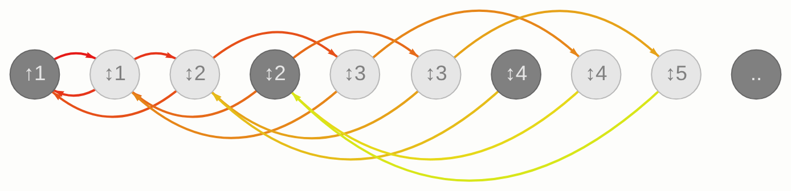
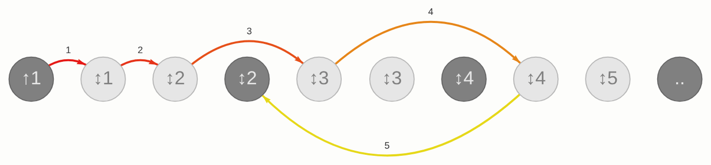
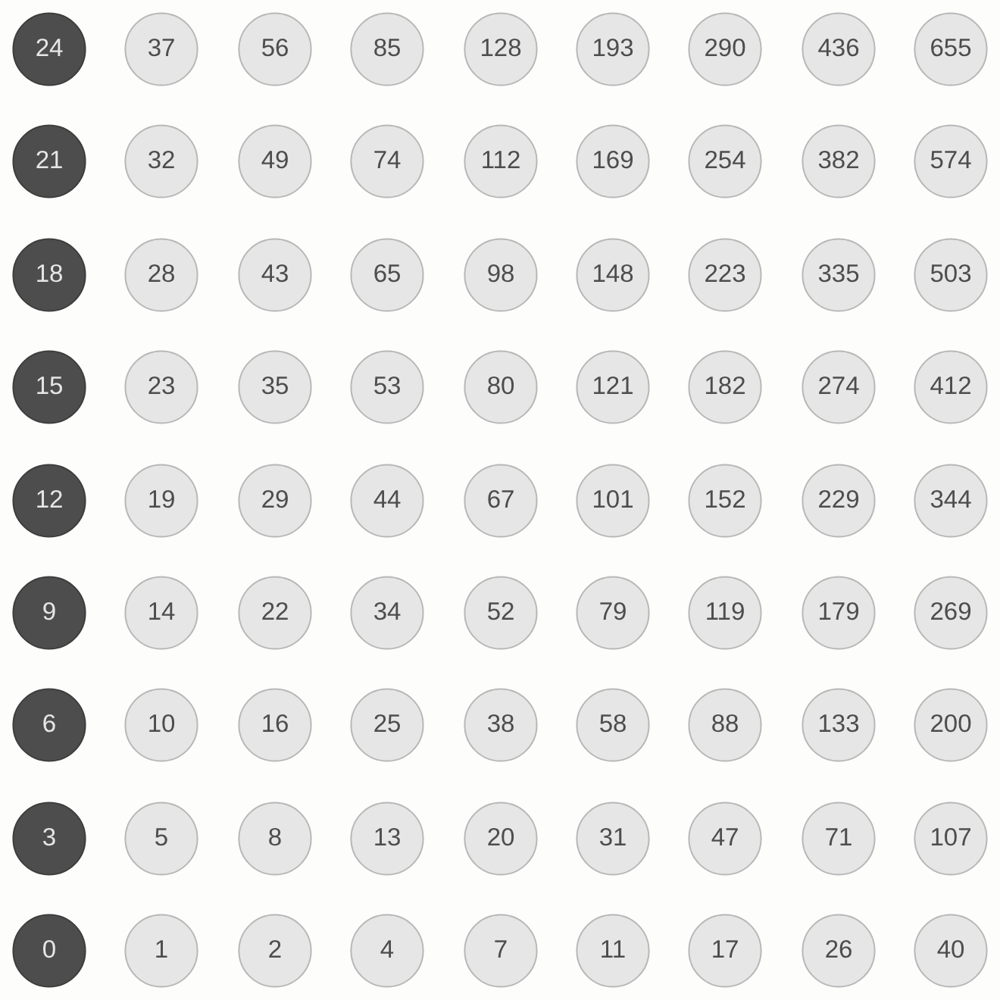
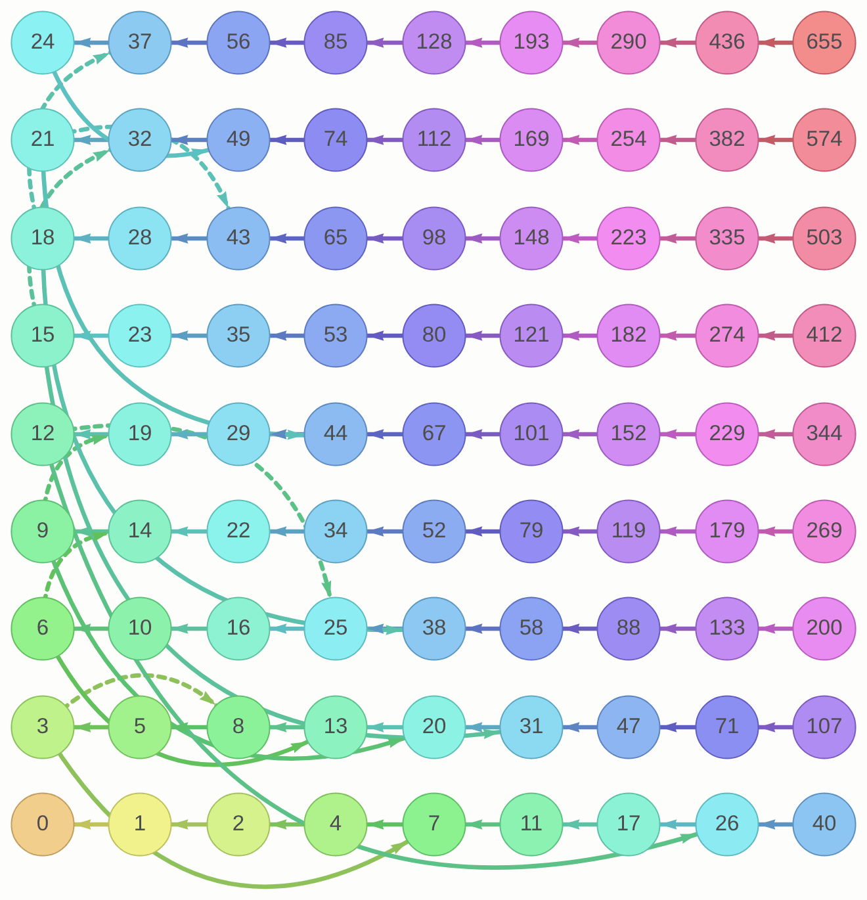
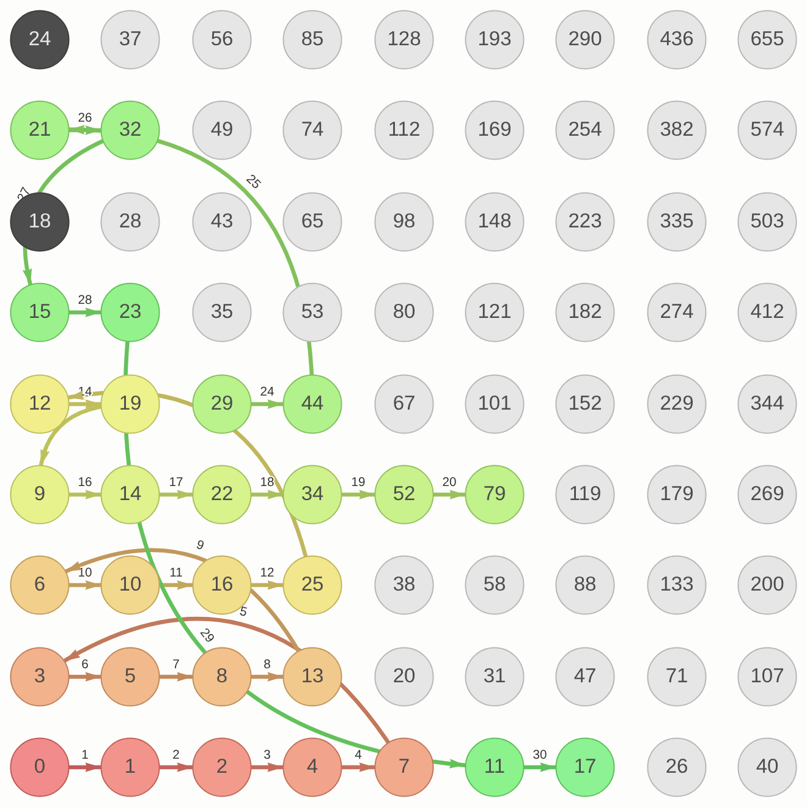
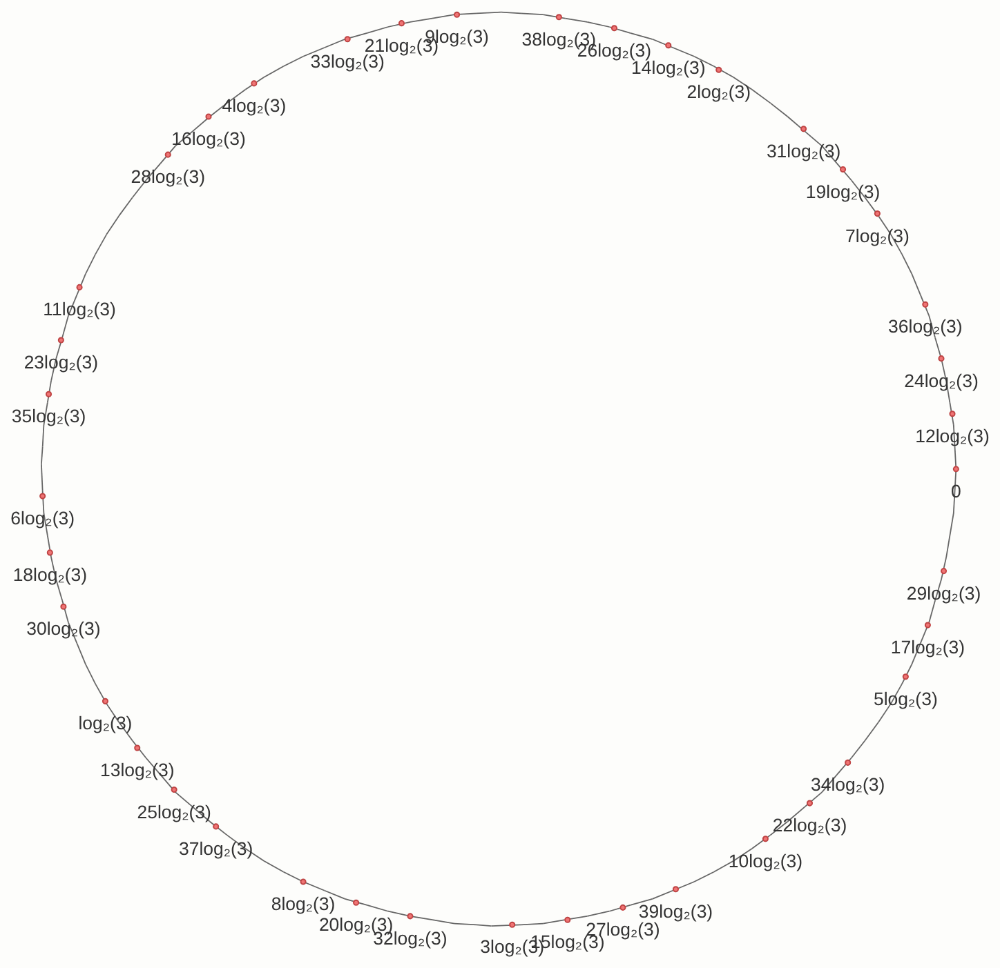

This treat was inspired by [Jane Street](https://www.janestreet.com/)'s puzzle
[Traversing the Infinite Sidewalk](https://www.janestreet.com/numberphile/).
See also the [On-Line Encyclopedia of Integer Sequences](https://oeis.org/):

- [A358838](https://oeis.org/A358838): minimum number of jumps needed to go
  from slab 0 to slab $n$ in Jane Street's infinite sidewalk,
- [A359005](https://oeis.org/A359005): Jane Street's infinite sidewalk's greedy
  walk,
- [A359008](https://oeis.org/A359008): the inverse mapping of the greedy walk.

Jane owns a special rosary. It has a single end and is made of infinitely many
black and white beads. Starting from the end, the beads are numbered
$n = 0, 1, 2, \ldots$ and each carries a label $L(n) = 1, 1, 2, 2, 3, 3, \ldots$
Every third bead, including bead $0$, is black; the other beads are white.

[](https://blog.atlant.is/figures/jane-s-rosary/rosary.html?n=10&labels=position&arrows=none&interactive=yes)

> Figure 1: the rosary, bead positions ([live version](https://blog.atlant.is/figures/jane-s-rosary/rosary.html?n=10&labels=position&arrows=none&interactive=yes)).

Jane tells the beads of her rosary in a special way. She always starts at bead
$0$. Each time she is done with a bead $n$, she moves on, either *up* to bead
$n + L(n)$ or *down* to bead $n - L(n)$.

[](https://blog.atlant.is/figures/jane-s-rosary/rosary.html?n=10&labels=label&arrows=both&interactive=yes)

> Figure 2: telling the beads ([live version](https://blog.atlant.is/figures/jane-s-rosary/rosary.html?n=10&labels=label&arrows=both&interactive=yes)).

**Can Jane tell every bead of her rosary?**

The answer to the plain question is an easy *yes* (every bead has a finite
*height*). This note is about two finer questions:

1. What do *shortest* recitations look like? Theorem 1 describes them
   completely and yields an $O(\log n)$ algorithm for the height.
2. Suppose Jane is *reluctant*: she always moves down, unless the bead below
   has already been told, in which case she moves up. Does she still tell every
   bead? Theorem 2 shows that she never gets stuck, and **Theorem 3 shows that
   she tells every bead exactly once** (this was Conjecture 3 in the previous
   version of this note, and is the conjecture recorded in A359005 and A359008).
   Theorems 5 and 6 quantify how she does it: in the long run she moves up with
   frequency exactly $\log_3 2 \approx 0.6309$, and bead $m$ is told after at
   most polynomially many moves.

Theorem 4 studies the tree structure that shortest recitations induce on the
black beads.

## 1. Prelude: names

> To weave the magic of a thing, you see, one must find its true name out.
>
> Ursula K. Le Guin, *A Wizard of Earthsea*

Throughout, $\mathbb{N} = \{0, 1, 2, \ldots\}$. Unary operators are written in
postfix notation and compose from left to right: $nUD$ means "go up from $n$,
then down".

- **Bead**: a natural number $n$ (the position of the bead in the rosary).
- **Black bead**: a bead divisible by $3$. **White bead**: any other bead.
- **Label**: $L(n) = 1 + \lfloor n/2 \rfloor$.
- **Up**: $U : \mathbb{N} \to \mathbb{N}$, $\; nU = n + L(n) = \lfloor 3n/2 \rfloor + 1$.
- **Down**: $D : \mathbb{N}\setminus\{0\} \to \mathbb{N}$, $\; nD = n - L(n) = \lceil n/2 \rceil - 1$.
- **Lambda**: $\lambda : \mathbb{N}\setminus 3\mathbb{N} \to \mathbb{N}$, $\; n\lambda = \lfloor 2n/3 \rfloor$.
- **Mu** and **nu**: $n\mu = 2n+1$ and $n\nu = 2n+2$.

$U$, $\lambda$, $\mu$, $\nu$ are strictly increasing and $D$ is non-decreasing.
The operators $\lambda$, $\mu$, $\nu$ are the inverse branches of $U$ and $D$:

**Fact 1.**

1. $U$ is injective and its image is exactly the set of white beads:
   $(2j)U = 3j+1$ and $(2j+1)U = 3j+2$. Hence $n\lambda U = n$ for every white
   $n$, and $nU\lambda = n$ for every $n$. *A black bead can never be reached by
   an up move.*
2. For every $n$, the beads that go down to $n$ are exactly the odd bead $n\mu$
   and the even bead $n\nu$: $n\mu D = n\nu D = n$.

More names:

- **Recitation**: a finite or infinite sequence $(a_i)$ of beads with
  $a_{i+1} \in \{a_iU, a_iD\}$. Its **length** is its number of moves.
- **Minimal recitation** from $n$ to $m$: a recitation of minimal length.
  Unless stated otherwise, a minimal recitation *to* $m$ starts at bead $0$.
- **Height**: $h(n)$ is the length of a minimal recitation to $n$.

**Heap coordinates.** It is often convenient to shift positions by one and
write $x = n + 1 \geq 1$. In these coordinates,

$$\text{down}: x \mapsto \lfloor x/2 \rfloor, \qquad
  \mu, \nu: x \mapsto 2x,\ 2x+1, \qquad
  \text{up}: x \mapsto \lceil 3x/2 \rceil .$$

In other words, *the rosary is the infinite binary tree in heap order*: moving
down means moving to the parent, i.e. erasing the last binary digit of $n+1$,
and $n\mu$, $n\nu$ are the two children of $n$. Moving up is the map
$x \mapsto \lceil 3x/2 \rceil$ studied by Odlyzko and Wilf in connection with
the Josephus problem [OW91]; black beads are those with $x \equiv 1 \pmod 3$.
Most of what follows is an interplay between this binary structure (down) and
the multiplication by $3/2$ (up).

## 2. The height of a bead

By definition $h(0) = 0$.

[](https://blog.atlant.is/figures/jane-s-rosary/rosary.html?n=10&labels=label&arrows=to3&interactive=yes)

> Figure 3: the height of bead 3 is 5 ([live version](https://blog.atlant.is/figures/jane-s-rosary/rosary.html?n=10&labels=label&arrows=to3&interactive=yes)).

**Proposition 1.** Every bead has a finite height. Moreover, for all $n \geq 1$,

$$\log_{3/2}\frac{n+2}{2} \;\leq\; h(n) \;\leq\; \min\Big(1 + \frac{4n}{3},\;\; 12 + 3\,\frac{\ln n}{\ln(9/8)}\Big).$$

*Proof.* Let $n > 0$.

- If $3 \nmid n$, then $n = mU$ with $m = n\lambda = \lfloor 2n/3 \rfloor < n$.
- If $3 \mid n$ and $9 \nmid n$, then $n = mU^2D$ with
  $m = n\mu\lambda^2 = \lfloor 8n/9 \rfloor < n$.
- If $9 \mid n$, then $n = mU^2D$ with
  $m = n\nu\lambda^2 = \lfloor (8n+6)/9 \rfloor < n$.

By induction on $n$, every bead has a finite height, and $h(n) \leq 3 + h(m)$
with $m - 6 \leq \frac{8}{9}(n-6)$ in all three cases. Both upper bounds follow
by induction, the finitely many small cases being checked directly
($h(n) = 0, 1, 2, 5, 3, 6, 9, 4, 7, 10, 10, \ldots$; equality in
$h(n) \le 1 + 4n/3$ holds for $n = 3$ and $n = 6$).

For the lower bound, note that $nU + 2 \leq \frac{3}{2}(n+2)$ and $nD < n$, so a
recitation of length $h$ starting at $0$ ends at a bead $n$ with
$n + 2 \leq 2\,(3/2)^h$. $\quad\Box$

The logarithmic upper bound was suggested by
[Jianing Song](https://oeis.org/wiki/User:Jianing_Song). (Numerically,
$h(n) \leq 1 + 3\ln n/\ln(9/8)$ for all $1 \le n < 10^6$.) The lower bound is
asymptotically attained along the recitation that only moves up, so
$\liminf h(n)/\ln n = 1/\ln(3/2) \approx 2.466$. See Section 12 for what
$h(n)/\ln n$ does for a typical $n$.

### Computing the height by exploration

```python
import itertools

def height(n: int) -> int:
    if n < 0: raise ValueError("n must be a nonnegative integer")
    if n == 0: return 0
    if n == 1: return 1
    visited = {0, 1}     # the beads we have visited so far
    rings = [{0}, {1}]   # the beads grouped by height
    for h in itertools.count(2):
        new_ring = set()
        for bead in rings[h - 1]:
            label = (bead >> 1) + 1
            for next_bead in {bead - label, bead + label}:
                if next_bead not in visited:
                    if next_bead == n: return h
                    visited.add(next_bead)
                    new_ring.add(next_bead)
        rings.append(new_ring)
```

[](https://blog.atlant.is/figures/jane-s-rosary/height-plot.html?n=10000)

> Figure 4: plot of the heights of beads ([live version](https://blog.atlant.is/figures/jane-s-rosary/height-plot.html?n=10000)).

## 3. Minimal recitations

Everything in this section, and Theorem 2 later on, rests on one elementary
observation about the beads sitting "above" a white bead.

**Lemma 1 (commutation).** Let $w$ be a white bead.

1. Exactly one of $w\mu$, $w\nu$ is white. Call it $v$. Then $v\lambda D = w\lambda$.
2. The other one, call it $b$, is black. Both $b\mu$ and $b\nu$ are white, and
   $b\mu\lambda DD = b\nu\lambda DD = w\lambda$.

In pictures, both statements say that a diagram commutes: going from $w$ up
the right-hand side, across, and down the left-hand side leads to
$w\lambda$, from which one up move leads back to $w$. Here $x$ and $y$ stand
for $\mu$ or $\nu$:

$$
\begin{CD}
v\lambda @<\lambda<< v\\
@VVDV @AAxA\\
w\lambda @>U>> w
\end{CD}
\qquad\qquad
\begin{CD}
by\lambda @<\lambda<< by\\
@VVDV @AAyA\\
by\lambda D @. b\\
@VVDV @AAxA\\
w\lambda @>U>> w
\end{CD}
$$

*Proof.* Direct computation. If $w = 3k+1$, then $w\lambda = 2k$, the white
bead is $v = w\nu = 6k+4$ and the black bead is $b = w\mu = 6k+3$:

$$
\begin{CD}
4k+2 @<\lambda<< 6k+4\\
@VVDV @AA\nu A\\
2k @>U>> 3k+1
\end{CD}
\qquad
\begin{CD}
8k+4 @<\lambda<< 12k+7\\
@VVDV @AA\mu A\\
4k+1 @. 6k+3\\
@VVDV @AA\mu A\\
2k @>U>> 3k+1
\end{CD}
\qquad
\begin{CD}
8k+5 @<\lambda<< 12k+8\\
@VVDV @AA\nu A\\
4k+2 @. 6k+3\\
@VVDV @AA\mu A\\
2k @>U>> 3k+1
\end{CD}
$$

If $w = 3k+2$, then $w\lambda = 2k+1$, the white bead is $v = w\mu = 6k+5$
and the black bead is $b = w\nu = 6k+6$:

$$
\begin{CD}
4k+3 @<\lambda<< 6k+5\\
@VVDV @AA\mu A\\
2k+1 @>U>> 3k+2
\end{CD}
\qquad
\begin{CD}
8k+8 @<\lambda<< 12k+13\\
@VVDV @AA\mu A\\
4k+3 @. 6k+6\\
@VVDV @AA\nu A\\
2k+1 @>U>> 3k+2
\end{CD}
\qquad
\begin{CD}
8k+9 @<\lambda<< 12k+14\\
@VVDV @AA\nu A\\
4k+4 @. 6k+6\\
@VVDV @AA\nu A\\
2k+1 @>U>> 3k+2
\end{CD}
\qquad\Box
$$

**Lemma 2 (white beads).** For every white bead $w$ there is a minimal
recitation to $w$ that ends with an up move. Equivalently,
$h(w) = h(w\lambda) + 1$.

*Proof.* By strong induction on $h = h(w)$. Take a minimal recitation
$\mathcal{R}$ to $w$ and assume that it ends with a down move, from a bead
$v' \in \{w\mu, w\nu\}$ of height $h - 1$. We exhibit a recitation to
$w\lambda$ of length at most $h - 1$; appending one up move then gives a
recitation to $w$ of length at most $h$ that ends with an up move.

- If $v'$ is the white bead $v$ of Lemma 1: by induction $h(v\lambda) = h - 2$,
  and $v\lambda D = w\lambda$, so $h(w\lambda) \leq h - 1$.
- If $v'$ is the black bead $b$ of Lemma 1: by Fact 1, $\mathcal{R}$ reaches
  $b$ by a down move from a white bead $v'' \in \{b\mu, b\nu\}$ of height
  $h - 2$. By induction $h(v''\lambda) = h - 3$, and $v''\lambda DD = w\lambda$,
  so $h(w\lambda) \leq h - 1$. $\quad\Box$

**Corollary 1 (black beads).** For every black bead $b > 0$,
$h(b) = 1 + \min\big(h(b\mu), h(b\nu)\big)$, and there is a minimal recitation
to $b$ that ends with *up*-*down*.

*Proof.* A black bead can only be reached by a down move (Fact 1), from $b\mu$
or $b\nu$, which are both white; apply Lemma 2. $\quad\Box$

For $b = 3k$ the two candidates are:

$$
\begin{CD}
4k @<\lambda<< 6k+1\\
@. @AA\mu A\\
{} @. 3k
\end{CD}
\qquad\qquad
\begin{CD}
4k+1 @<\lambda<< 6k+2\\
@. @AA\nu A\\
{} @. 3k
\end{CD}
$$

So a minimal recitation can be built backwards: from a white bead apply
$\lambda$; from a black bead choose between $\mu$ and $\nu$. Theorem 1 says
which one to choose.

## 4. Interlude: more names

> Hey, Louie. The man is dry. Give him one on the house, okay?
>
> Ridley Scott, *Blade Runner* (1982)

- **Up-chain**: $\uparrow\!(n) = \{nU^i \mid i \in \mathbb{N}\}$.
- **Down-chain**: $\downarrow\!(n) = \{nD^i \mid i \geq 0,\ nD^i \text{ defined}\}$;
  it is finite and ends in $0$.
- **Seed**: $\sigma(n)$ is the unique black bead from which $n$ is reached by up
  moves only. **Lambex**: $\Lambda(n)$ is the number of those up moves. In other
  words $n = \sigma(n)U^{\Lambda(n)}$ and $\sigma(n) = n\lambda^{\Lambda(n)}$.

By Fact 1, the up-chains of the black beads partition the rosary,
$\mathbb{N} = \biguplus_{n} \uparrow\!(3n)$, and

$$\gamma(n) = \Big(\frac{\sigma(n)}{3},\ \Lambda(n)\Big)$$

is a bijection between $\mathbb{N}$ and $\mathbb{N}\times\mathbb{N}$.

[](https://blog.atlant.is/figures/jane-s-rosary/deconstructed.html?n=0&width=9&height=9&ordering=none&label=position&color=none&arrows=none&interactive=yes)

> Figure 5: the rosary deconstructed, one up-chain per row ([live version](https://blog.atlant.is/figures/jane-s-rosary/deconstructed.html?n=0&width=9&height=9&ordering=none&label=position&color=none&arrows=none&interactive=yes)).

[](https://blog.atlant.is/figures/jane-s-rosary/deconstructed.html?n=0&width=9&height=9&ordering=canonic&label=height&color=height&arrows=yes&interactive=yes)

> Figure 6: the same, with heights ([live version](https://blog.atlant.is/figures/jane-s-rosary/deconstructed.html?n=0&width=9&height=9&ordering=canonic&label=height&color=height&arrows=yes&interactive=yes)).

In heap coordinates the up-chain of $0$ reads $1, 2, 3, 5, 8, 12, 18, 27, 41,
\ldots$ ([A061419](https://oeis.org/A061419)); by [OW91] every up-chain grows
like $K\cdot(3/2)^i$ for a constant $K$ depending on the chain.

**Remark (neighbors of black beads have lower seeds).** Since
$\sigma(n) \leq n\lambda$ for white $n$, we get for all $n > 0$:
$\sigma(3n-1) \leq 2n-1$ and $\sigma(3n+1) \leq 2n$. (This was "Conjecture 3"
in the very first version of this note.)

## 5. Theorem 1: minimal recitations ending in a black bead

Let $3n > 0$ be a black bead. Write

$$2n + 1 = 3^e q \quad\text{with } 3 \nmid q, \qquad\text{and}\qquad
  a_i = \Big(\frac{2}{3}\Big)^i (6n+3) - 2, \quad b_i = a_i + 1
  \qquad (0 \leq i \leq e+1).$$

**Theorem 1.** With these notations:

1. $a_0 = 3n\mu$, $b_0 = 3n\nu$, and $a_i = 3n\mu\lambda^i$,
   $b_i = 3n\nu\lambda^i$ for all $i \leq e+1$. For $i \leq e$ both $a_i$ and
   $b_i$ are white; exactly one of $a_{e+1}$, $b_{e+1}$ is black.
2. If $2^{e+1}q \equiv 1 \pmod 3$ then $b_{e+1}$ is black and
   $\Lambda(3n\mu) > \Lambda(3n\nu) = e+1$; we say that *$\mu$ wins*.
   If $2^{e+1}q \equiv 2 \pmod 3$ then $a_{e+1}$ is black and
   $\Lambda(3n\nu) > \Lambda(3n\mu) = e+1$; we say that *$\nu$ wins*.
3. In particular $\Lambda(3n\mu) \neq \Lambda(3n\nu)$,
   $\sigma(3n\mu) \neq \sigma(3n\nu)$, and
   $$\Lambda(3n\mu) > \Lambda(3n\nu) \iff \sigma(3n\mu) < \sigma(3n\nu).$$
4. $h(3n) \geq h(3n-1)$ and $h(3n) \geq h(3n+1)$.
5. Let $v$ be the winner ($v = 3n\mu$ if $\mu$ wins, $v = 3n\nu$ if $\nu$ wins).
   Then $h(3n) = h(\sigma(v)) + \Lambda(v) + 1$: there is a minimal recitation
   to $3n$ ending in $\sigma(v)\,U^{\Lambda(v)}D$.

In words: of the two beads $3n\mu$ and $3n\nu$ above a black bead, *the one
with the larger lambex, equivalently the smaller seed, lies on a minimal
recitation*; and which one it is can be read off the base-3 expansion of
$2n+1$.

[](https://blog.atlant.is/figures/jane-s-rosary/deconstructed.html?n=0&width=9&height=9&ordering=back&label=position&color=position&arrows=yes&interactive=yes)

> Figure 7: when in doubt, choose the predecessor with the larger lambex ([live version](https://blog.atlant.is/figures/jane-s-rosary/deconstructed.html?n=0&width=9&height=9&ordering=back&label=position&color=position&arrows=yes&interactive=yes)).

*Proof.* **(1) and (2).** We have $a_0 = 6n+1$ and $b_0 = 6n+2$. For
$i \leq e$, $a_i + 2 = 2^i 3^{e+1-i} q$ is divisible by $3$, so
$a_i \equiv 1$ and $b_i \equiv 2 \pmod 3$: both are white, and one checks
$a_i\lambda = \frac{2}{3}(a_i + 2) - 2 = a_{i+1}$ and
$b_i\lambda = a_{i+1} + 1 = b_{i+1}$. Finally $a_{e+1} + 2 = 2^{e+1}q$ is not
divisible by $3$: if it is $\equiv 2$ then $a_{e+1}$ is black and $b_{e+1}$ is
white, and if it is $\equiv 1$ then $a_{e+1} \equiv 2$ is white and $b_{e+1}$
is black. The lambex of the bead that turned black is $e+1$; the other one is
larger.

**(3).** The loser's seed is the black bead $s \in \{a_{e+1}, b_{e+1}\}$, and
$s \geq 3$ (indeed $a_{e+1} = 0$ would force $n = 0$). The winner's seed is at
most $(s \pm 1)\lambda \leq \frac{2}{3}(s+1) < s$.

**(4) and (5).** For $1 \le i \le e+1$ put $c_i = a_iD = a_i/2 - 1$ and
$d_i = b_iD = c_i + 1$. The same computation as above gives
$c_i = (3n-1)\lambda^i$ and $d_i = (3n+1)\lambda^i$, with $c_i$ and $d_i$ white
for $i \leq e$. Write $a, b, c, d$ for $a_{e+1}, b_{e+1}, c_{e+1}, d_{e+1}$.
By Lemma 2 and Corollary 1,

$$h(3n) = \min\big(h(a), h(b)\big) + e + 2, \qquad
  h(3n-1) = h(c) + e + 1, \qquad h(3n+1) = h(d) + e + 1. \tag{$\ast$}$$

Modulo $3$ there are only two configurations:

| | $a$ | $b = a+1$ | $c = aD$ | $d = bD = c+1$ |
|---|---|---|---|---|
| $\mu$ wins | white | **black** | **black** | white |
| $\nu$ wins | **black** | white | white | **black** |

We prove (4) and (5) by strong induction on $h(3n)$. The bead $3n = 3$ is
checked directly ($h(2) = 2$, $h(3) = 5$, $h(4) = 3$, and
$0\,U^4 D = 3$ with $\sigma(3\mu) = \sigma(7) = 0$). It is the only case in
which $c = 0$, so from now on $c > 0$.

*Case "$\mu$ wins".* If we had $h(b) < h(a)$, then by $(\ast)$
$h(b) < h(3n)$, and the induction hypothesis (4) applied to the black bead
$b$ would give $h(b) \geq h(b-1) = h(a)$, a contradiction. Hence
$h(3n) = h(a) + e + 2$, and since $a = \sigma(3n\mu)U^{\Lambda(3n\mu)-e-1}$,
Lemma 2 gives (5). Next, $c = aD$ yields
$h(3n-1) = h(c) + e + 1 \leq h(a) + e + 2 = h(3n)$. Finally $c$ is black with
$h(c) \leq h(a) + 1 < h(3n)$, so by induction $h(d) = h(c+1) \leq h(c)$ and
$h(3n+1) = h(d) + e + 1 \leq h(3n)$.

*Case "$\nu$ wins".* Symmetric: if $h(a) < h(b)$, the induction hypothesis on
the black bead $a$ gives $h(a) \geq h(a+1) = h(b)$, a contradiction; hence
$h(3n) = h(b) + e + 2$, which gives (5). Then $d = bD$ yields
$h(3n+1) \leq h(3n)$, and $d$ is black with $h(d) < h(3n)$, so
$h(c) = h(d-1) \leq h(d)$ and $h(3n-1) \leq h(3n)$. $\quad\Box$

### Computing the height in logarithmic time

Lemma 2 and Theorem 1 give an algorithm that computes $h(n)$ in $O(\log n)$
arithmetic operations and constant space:

```python
def height(n: int) -> int:
    if n < 0: raise ValueError("n must be a nonnegative integer")
    h = 0
    while n:
        if n % 3:                 # white bead: one up move from n.lambda
            n = (2*n)//3
            h += 1
        else:                     # black bead 3m: n becomes a_1 = 4m
            n = (4*n + 2)//3
            h += 2                # one down move + one up move
            while n % 3 == 1:     # a_i and b_i are both white
                n = (2*n)//3
                h += 1
            if n % 3 == 0:        # a_i is black: nu wins, continue from b_i
                n += 1
    return h
```

(It agrees with the exploration algorithm for all $n < 60000$.)

## 6. Jane's reluctant recitation

The reluctant recitation was suggested by
[Neal Gersh Tolunsky](https://oeis.org/wiki/User:Neal_Gersh_Tolunsky). Jane
starts at bead $0$ and always prefers to move *down*; only when the bead below
has already been told (or when she is at bead $0$) does she reluctantly move
*up*.

We write $\rho(i)$ for the bead reached after $i$ moves and
$V_i = \{\rho(0), \ldots, \rho(i)\}$ for the set of beads told so far. For
instance $\rho(0), \rho(1), \ldots = 0, 1, 2, 4, 7, 3, 5, 8, 13, 6, 10, 16, 25,
12, \ldots$, so $\rho(5) = 3$ and $\rho(13) = 12$.

[](https://blog.atlant.is/figures/jane-s-rosary/deconstructed.html?n=0&width=9&height=9&ordering=reluctant&label=position&color=reluctant_inv&arrows=labelled&interactive=yes)

> Figure 8: Jane's reluctant recitation ([live version](https://blog.atlant.is/figures/jane-s-rosary/deconstructed.html?n=0&width=9&height=9&ordering=reluctant&label=position&color=reluctant_inv&arrows=labelled&interactive=yes)).

```python
def rho(i: int) -> int:
    if i < 0: raise ValueError("argument must be nonnegative")
    visited = {0}
    bead = 0
    for _ in range(i):
        label = 1 + bead//2
        if bead > 0 and bead - label not in visited:
            bead -= label         # moving down
        else:
            bead += label         # moving up
        visited.add(bead)
    return bead
```

A priori the definition could break down: Jane might find that both the bead
below and the bead above have already been told. Theorem 2 says that this
never happens.

**Lemma 3 (down-closure).** As long as the recitation is defined: if
$n \in V_i$, $n > 0$ and $n \neq \rho(i)$, then $nD \in V_i$.

*Proof.* Say $n = \rho(j)$ with $j < i$. At that moment either $nD$ had been
told already, or Jane moved to it: $\rho(j+1) = nD$. $\quad\Box$

So *Jane never leaves a bead before the bead below it has been told.* In heap
coordinates: the set of told beads is always a subtree containing the root,
except possibly for the path Jane is currently descending.

## 7. Theorem 2: Jane's reluctant recitation never halts

**Theorem 2.** The reluctant recitation is well defined for all times, $\rho$
is injective, and it never creates a gap in an up-chain: for every $i$ and
every white bead $w \in V_i$, we have $w\lambda \in V_i$.

[](https://blog.atlant.is/figures/jane-s-rosary/deconstructed.html?n=31&width=9&height=9&ordering=reluctant&label=position&color=reluctant_inv&arrows=labelled&interactive=yes)

> Figure 9: the reluctant recitation fills the up-chains from the left ([live version](https://blog.atlant.is/figures/jane-s-rosary/deconstructed.html?n=31&width=9&height=9&ordering=reluctant&label=position&color=reluctant_inv&arrows=labelled&interactive=yes)).

*Proof.* By induction on $i$ we prove: (a) $\rho(0), \ldots, \rho(i)$ are
defined and distinct; (b) the no-gap property holds at all times $j \leq i$.
Both are clear for $i = 0$.

*Jane can move at time $i$.* Let $n = \rho(i)$. If $n > 0$ and
$nD \notin V_i$, she moves down to a new bead. Otherwise she wants to move up
to $nU$, and we must show $nU \notin V_i$. If $nU = \rho(j)$ for some
$j \le i$, then $j < i$ and, $nU$ being white, (b) at time $j$ gives
$n = nU\lambda \in V_j$, contradicting (a). So (a) holds at time $i+1$.

*No gap at time $i+1$.* Let $w = \rho(i+1)$ be white and suppose
$g = w\lambda \notin V_{i+1}$. The last move was not an up move (it would have
come from $g$), so $\rho(i) \in \{w\mu, w\nu\}$. We use Lemma 1.

- If $\rho(i)$ is the white bead $v$: by (b), $v\lambda \in V_i$, and
  $v\lambda \neq \rho(i)$, so Lemma 3 gives $g = v\lambda D \in V_i$.
- If $\rho(i)$ is the black bead $b$: a black bead is never reached by an up
  move, so $\rho(i-1) = v''$ for some $v'' \in \{b\mu, b\nu\}$, which is white.
  By (b), $v''\lambda \in V_{i-1}$. Applying Lemma 3 twice (to $v''\lambda$ and
  then to $v''\lambda D$, neither of which is the current bead $v''$) gives
  $g = v''\lambda DD \in V_{i-1}$.

Both cases contradict $g \notin V_{i+1}$. $\quad\Box$

## 8. Theorem 3: Jane's reluctant recitation tells all beads

**Theorem 3.** $\rho$ is a permutation of $\mathbb{N}$: the reluctant
recitation tells every bead exactly once.

(The previous version of this note stated this as Conjecture 3, checked by
computer for all beads below $7\,884\,654$, and proved only a dichotomy.)

Injectivity is Theorem 2. For surjectivity we need two lemmas. The first one
describes down-chains; the second one says that, on a logarithmic scale, an up
move is a rotation by an irrational angle and down moves do nothing.

**Lemma 4 (binary prefixes).** $\downarrow\!(n)$ consists of the beads $m$ such
that the binary expansion of $m+1$ is a prefix of that of $n+1$:

$$m \in\ \downarrow\!(n) \iff \exists k \geq 0,\ \ m + 1 = \Big\lfloor \frac{n+1}{2^k} \Big\rfloor \geq 1 .$$

*Proof.* $nD + 1 = \lceil n/2 \rceil = \lfloor (n+1)/2 \rfloor$, and
$\lfloor \lfloor x/2^j \rfloor / 2 \rfloor = \lfloor x/2^{j+1} \rfloor$. $\quad\Box$

Define the **cone** of a bead $m$ as the set of beads $n$ with
$m \in\ \downarrow\!(n)$, and the **phase** of a bead $n$ as

$$\theta(n) = \log_2(n+1) \bmod 1 \ \in \mathbb{R}/\mathbb{Z}.$$

By Lemma 4, $n$ is in the cone of $m$ if and only if $n \geq m$ and
$\theta(n)$ lies in the arc
$A_m = \big[\log_2(m+1),\ \log_2(m+2)\big) \bmod 1$, whose length is
$w_m = \log_2\big(1 + \frac{1}{m+1}\big) \ge \frac{1}{m+1}$. Let

$$\alpha = \log_2\frac{3}{2} = \log_2 3 - 1 .$$

**Lemma 5 (phases).** Let $n \geq 0$ and $x = n+1$.

1. $\log_2(nU + 1) = \log_2 x + \alpha + \varepsilon$ with
   $0 \leq \varepsilon < \dfrac{1}{2x}$.
2. If $m = nD^k$ and $y = m + 1$, then
   $\log_2 y = \log_2 x - k - \varepsilon'$ with
   $0 \leq \varepsilon' < \dfrac{3}{2y}$.

*Proof.* (1) $nU + 1 = \lceil 3x/2 \rceil \in \{3x/2,\ (3x+1)/2\}$ and
$\log_2(1 + \frac{1}{3x}) < \frac{1}{2x}$. (2) By Lemma 4,
$y \leq x/2^k < y+1$ and $\log_2(1 + \frac{1}{y}) < \frac{3}{2y}$. $\quad\Box$

[](https://blog.atlant.is/figures/jane-s-rosary/irrational-log2-3.html?n=40&interactive=yes)

> Figure 10: the multiples of $\log_2(3/2)$ are dense in the circle ([live version](https://blog.atlant.is/figures/jane-s-rosary/irrational-log2-3.html?n=40&interactive=yes)).

*Proof of Theorem 3.* Fix a bead $m$ and suppose that $m$ is never told.

*Step 1: Jane never enters the cone of $m$.* By Lemma 3, whenever Jane leaves a
bead $n > 0$, the bead $nD$ has been told. So every bead of
$\downarrow\!(n)$ is eventually told, for every told bead $n$. Hence no bead of
the cone of $m$ is ever told.

*Step 2: Jane drifts away.* Since $\rho$ is injective, for every $N$ there is a
time $T_N$ after which all beads told are larger than $N$.

*Step 3: Jane makes infinitely many up moves*, since she never halts (Theorem
2) and a run of down moves is finite.

*Step 4: rotation.* Since $\log_2 3$ is irrational, so is $\alpha$, and the
rotation of the circle by $\alpha$ is minimal: there is an integer $J$ such
that any $J$ consecutive points $\theta_0, \theta_0 + \alpha, \ldots,
\theta_0 + (J-1)\alpha$ of any orbit contain a point in the middle third of
the arc $A_m$. Choose $N \ge m$ such that $2J/N < w_m/3$, and look at Jane
after time $T_N$. Let $n_0$ be her position at some time after $T_N$ and let
$n_j$ be her position right after her $j$-th subsequent up move. Between
$n_{j-1}$ and $n_j$ she makes a (possibly empty) run of down moves followed by
one up move, all the beads involved being larger than $N$. By Lemma 5,

$$\theta(n_j) = \theta(n_0) + j\alpha + \delta_j, \qquad
  |\delta_j| \leq j\Big(\frac{3}{2N} + \frac{1}{2N}\Big) = \frac{2j}{N} .$$

Pick $j < J$ such that $\theta(n_0) + j\alpha$ lies in the middle third of
$A_m$. Since $|\delta_j| < w_m/3$, the phase $\theta(n_j)$ lies in $A_m$, and
$n_j > N \geq m$: the told bead $n_j$ belongs to the cone of $m$. This
contradicts Step 1. $\quad\Box$

**Remarks.**

1. The proof uses very little about the reluctant rule: it applies to *any*
   injective recitation that makes infinitely many up moves and never leaves a
   bead before the bead below it has been told.
2. The argument is not effective because of Step 2. Section 11 makes it
   effective.

## 9. Interlude: for a few names more

> **Colonnello Mortimer**: Che succede ragazzo?
> **Il Monco**: No, niente vecchio, non mi tornavano i conti. Ne mancava uno.
>
> Sergio Leone, *Per qualche dollaro in più* (1965)

- **Canonical recitation** $\boldsymbol{C}(n)$: the recitation
  $0 = a_0, a_1, \ldots, a_{h(n)} = n$ defined backwards by
  $a_{i-1} = a_i\lambda$ if $a_i$ is white, and $a_{i-1} =$ the winner among
  $a_i\mu$, $a_i\nu$ (the one with the larger lambex) if $a_i$ is black. By
  Lemma 2 and Theorem 1 it is a minimal recitation to $n$.
- **Onyx rosary**: the rosary obtained by removing all white beads. **Onyx
  bead** $n$ is the black bead $3n$.
- **Onyx predecessor**: for an onyx bead $n > 0$,
  $\boldsymbol{\pi}(n) = \frac{1}{3}\sigma(v)$ where $v$ is the winner among
  $3n\mu$, $3n\nu$. The black beads met by the canonical recitation to $3n$
  are exactly $3n, 3\boldsymbol{\pi}(n), 3\boldsymbol{\pi}^2(n), \ldots, 0$.
- **Onyx ordering**: $m \boldsymbol{\preceq} n$ if and only if $3m$ appears in
  the canonical recitation to $3n$, i.e. $m = \boldsymbol{\pi}^j(n)$ for some
  $j \geq 0$.
- **Onyx height**: $\boldsymbol{h}(n)$ is the number of black beads in
  $\boldsymbol{C}(3n)$, minus one; i.e. $\boldsymbol{\pi}^{\boldsymbol{h}(n)}(n) = 0$.
- **Onyx mu, nu**: $\boldsymbol{\mu}(n) = \frac{1}{3}\sigma(3n\mu)$ and
  $\boldsymbol{\nu}(n) = \frac{1}{3}\sigma(3n\nu)$, so that
  $\boldsymbol{\pi}(n) = \min(\boldsymbol{\mu}(n), \boldsymbol{\nu}(n))$ by
  Theorem 1.

## 10. Jane's onyx rosary

### Onyx ordering

**Proposition 2.** For every onyx bead $n > 0$,
$\boldsymbol{\pi}(n) \leq 8n/9 < n$. Consequently the onyx ordering is a
well-founded partial order with least element $0$, it is embedded in
$(\mathbb{N}, \leq)$, i.e. $m \boldsymbol{\preceq} n \implies m \leq n$, and its
Hasse diagram is a tree rooted at $0$ in which $n$ is at distance
$\boldsymbol{h}(n)$ from the root.

*Proof.* With the notations of Theorem 1, the winner's seed is at most
$b_{e+1}\lambda = \frac{2}{3}a_{e+1}$ if $\nu$ wins, and at most
$a_{e+1}\lambda \le \frac{2}{3}a_{e+1}$ if $\mu$ wins. Since
$a_{e+1} \leq a_1 = 4n$, this gives $\sigma(v) \leq \frac{8n}{3}$. $\quad\Box$

[](https://blog.atlant.is/figures/jane-s-rosary/onyx-ordering.html?n=1000&interactive=yes)

> Figure 11: the onyx ordering ([live version](https://blog.atlant.is/figures/jane-s-rosary/onyx-ordering.html?n=1000&interactive=yes)).

We say that $n$ **covers** $m$ when $\boldsymbol{\pi}(n) = m$.

### Theorem 4: every onyx bead has infinitely many covers

**Lemma 6 (parity).** For every bead $n$: $\ 3 \mid nUD$ if and only if $n$ and
$nU$ have *different* parities.

*Proof.* Check the four classes of $n$ modulo $4$:
$(4j)UD = 3j$, $(4j+1)UD = 3j$, $(4j+2)UD = 3j+1$, $(4j+3)UD = 3j+2$, while
$(4j)U = 6j+1$, $(4j+1)U = 6j+2$, $(4j+2)U = 6j+4$, $(4j+3)U = 6j+5$. $\quad\Box$

**Lemma 7 (parity changes).** Along any up-chain $n, nU, nU^2, \ldots$ the
parity changes infinitely often. More precisely, $n, nU, \ldots, nU^{r-1}$ are
all even if and only if $2^r \mid n+2$, and all odd if and only if
$2^r \mid n+1$.

*Proof.* If $n$ is even then $nU + 2 = \frac{3}{2}(n+2)$; if $n$ is odd then
$nU + 1 = \frac{3}{2}(n+1)$. Iterate. $\quad\Box$

**Lemma 8 (neighboring up-chains).** Let $\uparrow\!(m)$ and $\uparrow\!(n)$ be
two disjoint up-chains. Then $\uparrow\!(n) \cap (\uparrow\!(m) + 1)$ is finite.
More precisely, if it is non-empty and $a$ is the least element of
$\uparrow\!(m)$ such that $a + 1 \in\ \uparrow\!(n)$, then it has exactly
$1 + v_2(a+2)$ elements, where $v_2$ is the 2-adic valuation.

*Proof.* Put $a_r = aU^r$ and $b_r = (a+1)U^r$. Since the chains are disjoint,
$a \geq 2$ (otherwise $a + 1 = aU$), hence $a < a+1 < aU$ and, $U$ being
strictly increasing, $a_r < b_r < a_{r+1}$ for all $r$. So the only element of
$\uparrow\!(m) + 1$ that $b_r$ can be equal to is $a_r + 1$. Now
$b_{r+1} - a_{r+1} = (b_r - a_r) + L(b_r) - L(a_r)$ is non-decreasing in $r$,
and when $b_r - a_r = 1$ it remains equal to $1$ if and only if $a_r$ is even.
By Lemma 7 this happens exactly for $r \leq v_2(a+2)$. $\quad\Box$

(The previous version claimed "at most 2 elements", which is false:
$\uparrow\!(255) \cap (\uparrow\!(21) + 1)$ has 9 elements,
$255, 383, 575, \ldots, 6560$. Only finiteness matters below.)

**Theorem 4.** Every onyx bead has infinitely many covers.

*Proof.* Fix an onyx bead $m$ and let

$$S_m = \{k \in\ \uparrow\!(3m) \mid kD \text{ is black and } kD > 0\}.$$

By Lemmas 6 and 7, $S_m$ is infinite. For $k \in S_m$, write $kD = 3n$; then
$\{k, k'\} = \{3n\mu, 3n\nu\}$ where the *sibling* $k' = k \pm 1$ is white. By
Theorem 1, $k$ is the winner (so that $\boldsymbol{\pi}(n) = m$) if and only if
$\sigma(k') > \sigma(k) = 3m$. Suppose not: then $k' \in\ \uparrow\!(3j)$ for
some $j < m$, and therefore

$$k \in\ \uparrow\!(3m) \cap \big((\uparrow\!(3j) + 1) \cup (\uparrow\!(3j) - 1)\big).$$

By Lemma 8 (applied twice, exchanging the roles of the two chains for the
"$-1$" part), this set is finite for each of the finitely many $j < m$. So all
but finitely many $k \in S_m$ are winners, and distinct $k$ give distinct
onyx beads $n = kD/3$ covering $m$. $\quad\Box$

### Corollary: the canonical onyx mapping

Order the covers of each onyx bead increasingly and number them from $0$: let
$\boldsymbol{s}_n(k)$ be the $k$-th cover of $n$, and for $n > 0$ let
$\boldsymbol{\iota}(n)$ be the index of $n$ among the covers of
$\boldsymbol{\pi}(n)$. For instance $\boldsymbol{s}_0(2) = 10$,
$\boldsymbol{s}_1(2) = 5$ and $\boldsymbol{\iota}(38) = 3$ (the covers of $0$
are $1, 4, 10, 15, 23, 52, \ldots$, those of $1$ are $2, 3, 5, 40, 91, \ldots$,
and those of $4$ are $7, 11, 25, 38, \ldots$).

The **canonical onyx mapping** sends $n$ to its address in the tree, read from
the root:

$$C(n) = \Big(\boldsymbol{\iota}\big(\boldsymbol{\pi}^{\boldsymbol{h}(n)-1}(n)\big),\ \ldots,\ \boldsymbol{\iota}\big(\boldsymbol{\pi}(n)\big),\ \boldsymbol{\iota}(n)\Big) \in \mathbb{N}^{<\omega}.$$

**Corollary 2.** $C$ is a bijection from $\mathbb{N}$ onto the set
$\mathbb{N}^{<\omega}$ of finite sequences of natural numbers, and
$m \boldsymbol{\preceq} n$ if and only if $C(m)$ is a prefix of $C(n)$. In
other words, the onyx ordering is isomorphic to the full infinitely branching
tree.

*Proof.* Injectivity and the prefix property hold in any rooted tree;
surjectivity is Theorem 4. $\quad\Box$

| $n$ | 0 | 1 | 2 | 3 | 4 | 5 | 6 | 7 | 8 | 9 | 10 |
|---|---|---|---|---|---|---|---|---|---|---|---|
| $C(n)$ | $()$ | $(0)$ | $(0,0)$ | $(0,1)$ | $(1)$ | $(0,2)$ | $(0,0,0)$ | $(1,0)$ | $(1,0,0)$ | $(1,0,0,0)$ | $(2)$ |

### Jane's foraging sequence

Jane's foraging sequence $(\boldsymbol{\Phi}(i))_{i \ge 0}$ is the sequence of
onyx beads obtained from the reluctant recitation by replacing each $\rho(i)$
with $\frac{1}{3}\sigma(\rho(i))$ and then removing direct repetitions:

$$0, 1, 2, 4, 3, 13, 4, 7, 5, 0, 10, 40, 30, 4, 11, 8, 6, 16, 12, 9, 1, 5, 20, 15, \ldots$$

**Corollary 3.** The foraging sequence is infinite and takes every value
infinitely often.

*Proof.* By Theorem 3 Jane tells every bead of every up-chain, so she is in
$\uparrow\!(3m)$ at infinitely many times, and she is outside of it at
infinitely many times. Hence $\frac{1}{3}\sigma(\rho(i))$ takes the value $m$
on infinitely many maximal runs. $\quad\Box$

```python
import itertools

def Phi(n: int) -> int:
    if n < 0: raise ValueError("argument must be nonnegative")
    visited = {0}
    bead = 0
    res = 0
    for _ in itertools.count():
        if n == 0: return res
        label = 1 + bead//2
        if bead > 0 and bead - label not in visited:
            bead -= label         # moving down
        else:
            bead += label         # moving up
        visited.add(bead)
        nxt = bead
        while nxt % 3: nxt = (2*nxt)//3   # compute the seed
        nxt //= 3
        if nxt != res:
            res = nxt
            n -= 1
```

## 11. How reluctant is Jane?

This section makes Theorem 3 quantitative. Let $u(t)$ be the number of up
moves among Jane's first $t$ moves, and let

$$F(t) = \min\big(\mathbb{N}\setminus V_t\big)$$

be the smallest bead that has not been told after $t$ moves (the *frontier*).
Trivially $F(t) \leq t + 1$.

### Theorem 5: Jane moves up with frequency $\log_3 2$

**Theorem 5.**

1. For all $t \ge 1$:
   $\ \big|\,u(t)\log_2 3 - t - \log_2(\rho(t)+1)\,\big| \leq \frac{3}{2}(1 + \ln t)$.
2. $\log_2(\rho(t)+1) \leq 2\sqrt{t} + O(\log t)$.
3. Consequently
   $$\frac{u(t)}{t} = \log_3 2 + O\big(t^{-1/2}\big) \approx 0.63093 .$$

*Proof.* (1) Sum the identities of Lemma 5 over the first $t$ moves (each down
move being a run of length $1$): with $x_t = \rho(t) + 1$,

$$\log_2 x_t = u(t)\,\alpha - (t - u(t)) + E_t, \qquad
  E_t = \sum_{\text{up}} \varepsilon - \sum_{\text{down}} \varepsilon' .$$

Each up move contributes less than $\frac{1}{2x}$ where $x - 1$ is the bead it
leaves, and each down move less than $\frac{3}{2y}$ where $y - 1$ is the bead
it reaches. Since $\rho$ is injective, both sums are bounded by
$\frac{3}{2}\sum_{x=1}^{t}\frac{1}{x}$, and they have opposite signs. Finally
$1 + \alpha = \log_2 3$.

(2) Call *depth* of a bead $n$ the integer $\lfloor \log_2(n+1) \rfloor$: a
down move decreases the depth by exactly $1$ and an up move increases it by
$0$ or $1$. Let $t$ be a time at which Jane is about to move up, and let $E$
be the depth of $\rho(t)$. By Lemma 3, $V_t$ is then closed under $D$: it is a
subtree with $t + 1$ nodes.

Fix an integer $K \geq 2$ and let
$\eta_K = \min_{1 \leq q < K} \lVert q\alpha \rVert > 0$, where
$\lVert\cdot\rVert$ is the distance to the nearest integer. Let
$e_K = \lceil \log_2(2K/\eta_K) \rceil$ and
$d_K = \lceil \log_2(3/\eta_K) \rceil \le e_K$, and assume $E \geq K + e_K$. Put
$e = E - K$ and consider the last time $s < t$ at which Jane was at depth at
most $e$. After time $s$ she stays at depth at least $e + 1$, i.e. on beads
with $x \geq 2^{e+1}$, and she makes at least $K - 1$ further up moves before
time $t$. Let $n_0 = \rho(s+1)$ and let $n_1, \ldots, n_{K-1}$ be her
positions right after the next $K - 1$ up moves. As in the proof of Theorem 3,
for $0 \le i < j < K$,

$$\theta(n_j) - \theta(n_i) = (j - i)\alpha + \delta, \qquad
  |\delta| \leq \frac{2(j-i)}{2^{e+1}} \leq \frac{\eta_K}{2},$$

so the phases of $n_0, \ldots, n_{K-1}$ are pairwise at distance at least
$\eta_K/2$ on the circle. Two beads at depth larger than $d$ whose phases
differ by at least $2^{-d}/\ln 2$ have distinct ancestors at depth $d$ (their
"mantissas" $x/2^{\lfloor\log_2 x\rfloor} \in [1,2)$ differ by at least
$2^{-d}$). Hence for every $d$ with $d_K \leq d \leq e$, the beads
$n_0, \ldots, n_{K-1}$ have $K$ distinct ancestors at depth $d$, all of which
belong to $V_t$. Counting, $t + 1 \geq K(E - K - d_K + 1)$, that is,

$$E \leq \frac{t+1}{K} + K + d_K \qquad\text{whenever } E \ge K + e_K. \tag{$\ast\ast$}$$

For fixed $K$ this already gives $\limsup E/t \leq 1/K$, hence $E = o(t)$,
using nothing but the irrationality of $\alpha$. To get the stated bound, use
the fact that $\log_2 3$ has a finite irrationality exponent (Baker's theorem;
see Theorem 6 below): $\eta_K \geq cK^{-\nu}$ for some constants $c, \nu > 0$,
so $d_K, e_K = O(\log K)$, and $(\ast\ast)$ with $K = \lceil\sqrt{t}\,\rceil$
gives $E \leq 2\sqrt{t} + O(\log t)$. Finally, at a time when Jane is not about
to move up she is inside a run of down moves, which started just after an up
move; and an up move increases $\log_2(n+1)$ by at most $1$.

(3) follows from (1) and (2). $\quad\Box$

The square root in (2) is certainly far from the truth: numerically
$\rho(t)$ grows polynomially (see Conjecture B), in which case
$u(t) = t\log_3 2 + O(\log t)$.

### Theorem 6: bead $m$ is told in polynomial time

Let $\mu_0$ be an *irrationality exponent* of $\log_2 3$: a real number such
that $|\log_2 3 - p/q| \geq c\,q^{-\mu_0}$ for some $c > 0$ and all integers
$p$ and $q \ge 1$. Baker's theory of linear forms in logarithms shows that
such a $\mu_0$ exists; Rhin's measure [Rh87] gives $\mu_0 \leq 8.616$.

**Lemma 9 (covering time of a rotation).** Let $\nu = \mu_0 - 1$, so that
$\lVert q\alpha \rVert \geq c\,q^{-\nu}$ for all $q \geq 1$. For every
$0 < w < 1$, any $J = \lfloor (2/w)^{\nu}/c \rfloor$ consecutive points of an
orbit of the rotation by $\alpha$ meet every arc of length $w$.

*Proof.* Let $(q_k)$ be the denominators of the convergents of $\alpha$ and let
$k$ be minimal with $q_k \geq 2/w$. By the three-distance theorem [Sós58], the
gaps left on the circle by $q_k$ consecutive points of an orbit have length at
most $\lVert q_{k-1}\alpha \rVert + \lVert q_k\alpha \rVert < 2/q_k \leq w$. And
$q_k < 1/\lVert q_{k-1}\alpha \rVert \leq q_{k-1}^{\nu}/c < (2/w)^{\nu}/c$.
$\quad\Box$

**Theorem 6.** There is a constant $\kappa$ such that for every bead $m$,

$$\rho^{-1}(m) \leq \kappa\,(m+1)^{2\mu_0 - 1},
  \qquad\text{hence}\qquad
  F(t) \geq (t/\kappa)^{1/(2\mu_0 - 1)} - 1 .$$

*Proof.* We rerun the proof of Theorem 3 with a clock. Let $z = m + 1$, so
that $w_m \geq 1/z$. Let $J$ be given by Lemma 9 for arcs of length $w_m/3$,
so $J \leq (6z)^{\nu}/c$, and let $N = 6Jz$, so that $2J/N \leq w_m/3$ and
$N \ge m$.

Consider the moves made before Jane enters the cone of $m$. At most $N + 1$
of the beads told are $\leq N$ (they are distinct), so the remaining times
form at most $N + 2$ maximal blocks during which Jane stays above $N$. By
Step 4 of the proof of Theorem 3, a block contains fewer than $J$ up moves
after its first bead. Counting the up move that enters each block and the up
moves that reach a bead $\leq N$, Jane makes at most
$(N+2)J + N + 1$ up moves before entering the cone of $m$.

Once she is in the cone of $m$, she moves straight down to $m$ (Step 1).
Finally, an up move at most doubles $n + 1$ and a down move at least halves
it, so at any time the number of down moves is at most the number of up
moves. Altogether
$\rho^{-1}(m) \leq 2\big((N+2)J + N + 1\big) \leq 30\,J^2 z
\leq \kappa\, z^{2\nu + 1}$. The bound on $F$ follows since the right-hand
side is increasing in $m$. $\quad\Box$

With Rhin's exponent, $2\mu_0 - 1 \le 16.24$. This is a proof of concept
rather than a sharp estimate: the truth seems to be $\rho^{-1}(m) \approx m\log m$
(Conjecture A).

### Numerical data

The first $2^{27}$ moves of the reluctant recitation:

| $t$ | $F(t)$ | $t/F(t)$ | $F(t)\log_2 t\,/\,t$ | $u(t)/t$ | $u(t) - t\log_3 2$ | $\log_2 \max_{i\le t}\rho(i)$ |
|---|---|---|---|---|---|---|
| $2^{10}$ | 269 | 3.81 | 2.63 | 0.635742 | 4.9 | 14.3 |
| $2^{12}$ | 902 | 4.54 | 2.64 | 0.632568 | 6.7 | 16.6 |
| $2^{14}$ | 3 548 | 4.62 | 3.03 | 0.631409 | 7.8 | 20.6 |
| $2^{16}$ | 9 709 | 6.75 | 2.37 | 0.631088 | 10.4 | 23.8 |
| $2^{18}$ | 30 424 | 8.62 | 2.09 | 0.630970 | 10.6 | 25.4 |
| $2^{20}$ | 125 595 | 8.35 | 2.40 | 0.630941 | 12.2 | 26.9 |
| $2^{22}$ | 438 795 | 9.56 | 2.30 | 0.630933 | 13.8 | 30.1 |
| $2^{24}$ | 1 614 095 | 10.39 | 2.31 | 0.630931 | 14.2 | 33.3 |
| $2^{26}$ | 5 088 361 | 13.19 | 1.97 | 0.630930 | 16.0 | 35.1 |
| $2^{27}$ | 10 801 813 | 12.43 | 2.17 | 0.630930 | 15.9 | 37.3 |

($\log_3 2 = 0.6309297\ldots$) In particular the recitation tells every bead
below $10\,801\,813$ within its first $2^{27}$ moves.

## 12. Conjectures and open questions

**Conjecture A (the frontier).** $F(t) = \Theta(t/\log t)$; equivalently the
largest index $\max_{m' \le m}\rho^{-1}(m')$ is of order $m\log m$. Numerically
$F(t)\log_2 t / t$ stays between $1.9$ and $3.1$ for
$2^{10} \leq t \leq 2^{27}$. In the binary tree picture: at time $t$ the told
beads fill the tree completely up to depth $\log_2 F(t)$, and above that they
seem to occupy $\Theta(\log t)$ further levels, each only partially.

**Conjecture B (Jane does not wander far).** $\rho(t) \leq t^{C}$ for some
constant $C$ and all $t \ge 2$ (numerically
$\max_{i \le t}\rho(i) \leq t^{3/2}$ for $t = 2^5, \ldots, 2^{27}$). By
Theorem 5 this would give $u(t) = t\log_3 2 + O(\log t)$, in agreement with
the table above.

**Question C (runs).** Among Jane's first $t$ down moves, let $p_r(t)$ be the
proportion of those that are preceded by exactly $r$ consecutive up moves. Do
the limits $p_r = \lim p_r(t)$ exist? After $2^{27}$ moves,

$$(p_0, p_1, p_2, \ldots) \approx (0.1012,\ 0.4999,\ 0.1552,\ 0.1429,\ 0.0565,\ 0.0296,\ 0.0088,\ 0.0040,\ 0.0011, \ldots)$$

with necessarily $\sum_r r\,p_r = 1/\log_2(3/2) \approx 1.7095$ (Theorem 5). Is
$p_1 = 1/2$ exactly? (The observed value is $0.49993$ with a statistical error
of about $10^{-4}$.)

**Conjecture D (typical heights).** For almost all $n$ (in the sense of
natural density),

$$\frac{h(n)}{\ln n} \longrightarrow \frac{11}{\ln(3^9/2^{11})} = \frac{11}{9\ln 3 - 11\ln 2} \approx 4.861,$$

with Gaussian fluctuations of order $\sqrt{\ln n}$. Heuristic: follow the
canonical recitation backwards and assume that residues modulo $3$ are
equidistributed. A white bead (probability $2/3$) costs one move and multiplies
the position by $2/3$. A black bead $3n$ (probability $1/3$) costs
$e + 2$ moves, where $e = v_3(2n+1)$ has mean $1/2$, multiplies the position
by $2\cdot(2/3)^{e+1}$, and is always followed by a white bead. Per cycle this
makes $11/6$ moves for a logarithmic decrease of
$\frac{3}{2}\ln\frac{3}{2} - \frac{1}{3}\ln 2 = \frac{1}{6}\ln\frac{3^9}{2^{11}}$.
Numerically the mean of $h(n)/\ln n$ over random $n$ of $64$, $256$ and $1024$
bits is $4.720$, $4.824$ and $4.849$, and the standard deviation of $h(n)$ is
about $2.4\sqrt{\ln n}$.

**Question E (extreme heights).** We have
$\liminf h(n)/\ln n = 1/\ln(3/2) \approx 2.466$ (Proposition 1). What is
$\limsup h(n)/\ln n$? Proposition 1 gives at most $3/\ln(9/8) \approx 25.5$;
the largest value observed for $10^3 \leq n < 10^6$ is about $7.7$.

**Conjecture F (growth of the onyx tree).** The $k$-th cover of any onyx bead
$m$ satisfies $\boldsymbol{s}_m(k)^{1/k} \to 9/4$; equivalently $m$ has
$\sim \frac{1}{2}\log_{3/2} N$ covers below $N$. By the proof of Theorem 4
this is equivalent to saying that the parity changes with asymptotic frequency
$1/2$ along the up-chain $\uparrow\!(3m)$. This is a statement of the same
nature as Mahler's $3/2$ problem [Ma68] on the distribution of
$(3/2)^k \bmod 1$, and is presumably very hard. A more accessible question:
describe the distribution of the onyx height $\boldsymbol{h}(n)$.

**Question G (other walks).** By Remark 1 after Theorem 3, the proof of
surjectivity only uses down-closure, injectivity and the irrationality of
$\log_2 3$. Which other natural rules ("up unless...", random tie-breaking,
sidewalks with labels $1 + \lfloor n/k \rfloor$, ...) produce permutations of
$\mathbb{N}$?

## References

- [Ca12] X. Caruso, *Application des fractions continues à la construction des
  gammes musicales*, Revue des Mathématiques de l'Enseignement Supérieur 123
  (2012).
- [Ma68] K. Mahler, *An unsolved problem on the powers of 3/2*, J. Austral.
  Math. Soc. 8 (1968), 313–321.
- [OW91] A. M. Odlyzko and H. S. Wilf, *Functional iteration and the Josephus
  problem*, Glasgow Math. J. 33 (1991), 235–240.
- [Rh87] G. Rhin, *Approximants de Padé et mesures effectives
  d'irrationalité*, Séminaire de Théorie des Nombres, Paris 1985–86, Progr.
  Math. 71, Birkhäuser (1987), 155–164.
- [Sós58] V. T. Sós, *On the distribution mod 1 of the sequence $n\alpha$*,
  Ann. Univ. Sci. Budapest. Eötvös Sect. Math. 1 (1958), 127–134.
- OEIS Foundation, *The On-Line Encyclopedia of Integer Sequences*, sequences
  A061419, A358838, A359005, A359008.

## Appendix: changes with respect to the January 2023 version

- **Conjecture 3 is now Theorem 3** (Section 8). The former "Theorem 3"
  (a dichotomy) and the former Lemma 2 (bound $b(m)$ along a single up-chain)
  are superseded: the key new remark is that down moves preserve the phase
  $\log_2(n+1) \bmod 1$, so the rotation argument applies to the whole
  recitation and not only to one up-chain.
- New quantitative results: Theorem 5 (frequency of up moves, growth of
  $\rho$), Theorem 6 (polynomial bound on $\rho^{-1}$), numerical table, and a
  list of conjectures.
- **Theorem 2** has a new, shorter proof: the twelve commutative diagrams are
  replaced by the commutation Lemma 1 and the down-closure Lemma 3. The same
  Lemma 1 also proves the lemma on white beads. No base case ("moves up to the
  20th") is needed any more.
- **Theorem 1**: the "easy" claims are now proved, with an explicit rule
  ($2n+1 = 3^e q$) for which of $\mu$, $\nu$ wins; the base case is made
  explicit ($3n = 3$, the only case where $c = 0$); the caption of Figure 7
  said "lower lambex", whereas the minimal recitation goes through the
  predecessor with the *larger* lambex (to be checked against the figure).
- **Fixed**: the fast `height` algorithm (the printed version returns
  $6$ for $n = 3$ and loops forever on $n = 6$, because of the `+ 1` in its
  `case 2`); the bound $h(n) \leq 6\log n/\log(9/8)$, which fails at $n = 1$
  (replaced by Proposition 1, which also has a better constant and a lower
  bound).
- **Fixed**: former Lemma 3 (now Lemma 6) had the parity condition reversed;
  former Lemma 5 (now Lemma 8) claimed "at most 2 elements", which is false,
  and had no proof; former Lemma 4 (now Lemma 7) is stated for tails of
  up-chains, which is what Theorem 4 needs.
- **Theorem 4**: the proof is rewritten (the index sets $S_n$, $P_{3n}$ mixed
  beads and onyx beads); the properties of the onyx ordering that were stated
  without proof ($m \boldsymbol{\preceq} n \Rightarrow m \le n$,
  well-foundedness, tree structure) are now Proposition 2.
- **Corollary 2**: the canonical onyx mapping is now read from the root, so
  that "prefix" is correct (with the former definition and table it should
  have been "suffix"); it is a bijection, not just an injection.
- Former "Conjecture 3" of the first version ($\sigma(3n \mp 1) \le 2n$) is a
  one-line remark in Section 4.
- Lemma numbering: old Lemma 1 → Lemma 4; old Lemma 2 → removed (see Lemma 5);
  old Lemmas 3, 4, 5 → Lemmas 6, 7, 8.
- Typos: "bean" → "bead"; "$L$ is a strictly increasing function" under *Up*
  → $U$; "contant" → "constant"; "$\lambda_i$" → "$\lambda^i$" in the second
  diagram of Theorem 1; "$d_1{i+1}$" → "$d_{i+1}$".
