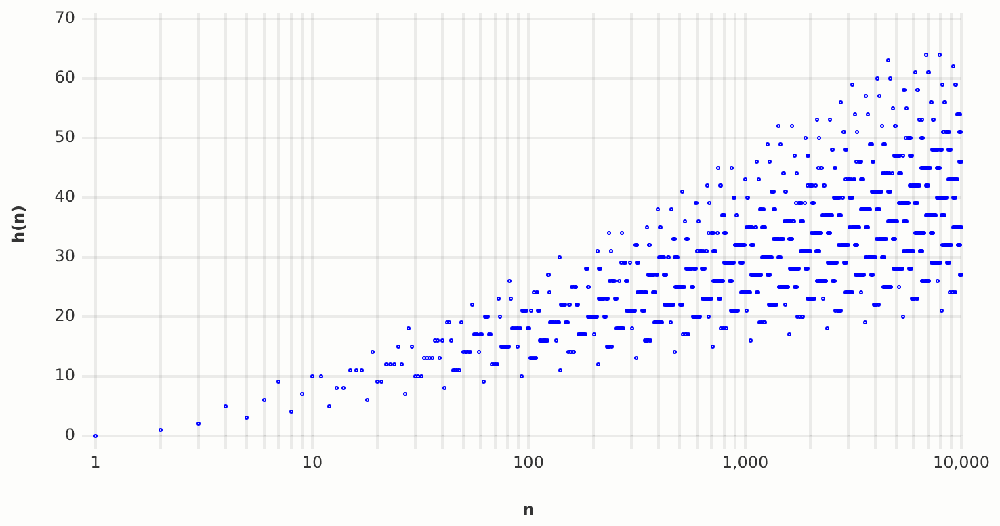
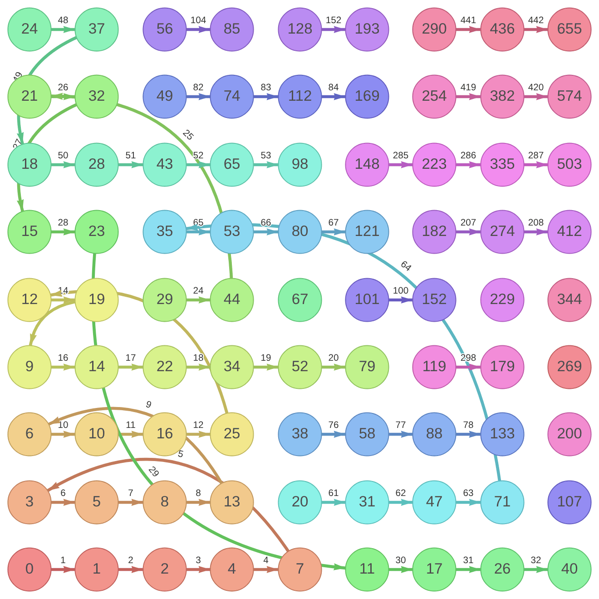
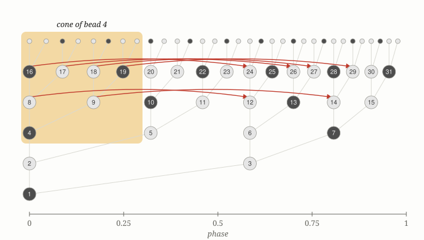
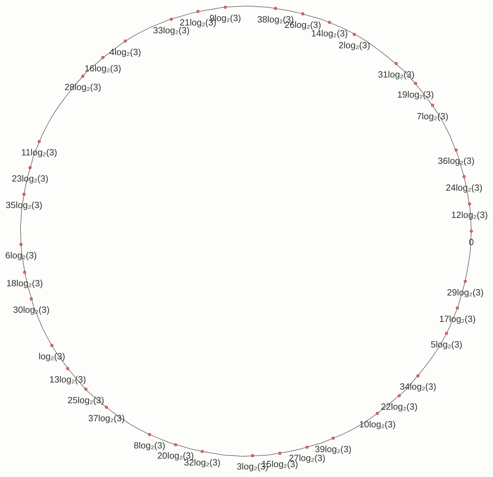

> Reluctant Jane at work (a detail of a figure of the first version of this paper, in which the beads were counted from $0$).

Jane owns a special rosary. It has a single end and is made of infinitely many
black and white beads. Starting from the end, the beads are numbered
$n = 1, 2, 3, \ldots$ and each carries a label $L(n) = 1, 1, 2, 2, 3, 3, \ldots$
Every third bead, starting with bead $1$, is black; the other beads are white.

[](https://blog.atlant.is/figures/jane-s-rosary/rosary.html?n=10&labels=position&arrows=none&below=label&end=open&interactive=yes&first=1)

> Figure 1: the rosary. Each bead shows its position, with its label underneath ($L = 1, 1, 2, 2, \ldots$); every third bead is black. Up is to the right, down to the left ([live version](https://blog.atlant.is/figures/jane-s-rosary/rosary.html?n=10&labels=position&arrows=none&below=label&end=open&interactive=yes&first=1)).

Jane tells the beads of her rosary in a special way. She always starts at bead
$1$. Each time she is done with a bead $n$, she moves on, either *up* to bead
$n + L(n)$ or *down* to bead $n - L(n)$.

[](https://blog.atlant.is/figures/jane-s-rosary/rosary.html?n=10&labels=position&arrows=both&colors=label&string=yes&end=open&interactive=yes&first=1)

> Figure 2: telling the beads. Each bead shows its position. Its two arrows, one up (to the right) and one down (to the left), reach as many places away as its label says. The color of an arrow tells its length, and the arrows that leave the picture fade out ([live version](https://blog.atlant.is/figures/jane-s-rosary/rosary.html?n=10&labels=position&arrows=both&colors=label&string=yes&end=open&interactive=yes&first=1)).

**Can Jane tell every bead of her rosary?** Yes, by a short induction
([Proposition 1](#proposition-1)): every bead can be
reached from bead $1$. The fun starts with two finer questions.

**How fast?** The least number of moves needed to reach bead $n$ is its
*height*. Bead $4$, only three beads away from bead $1$, has height $5$: Jane
must go up four times, to bead $8$, before one move down brings her to it.
*[Theorem 1](#theorem-1)* says what shortest recitations look like, bead by bead, and turns
into a program that computes the height of bead $n$ in about $\log n$ steps,
without searching.

**What if Jane is reluctant?** Suppose she always moves down, unless the bead
below has already been told, in which case, and only then, she moves up. Her
recitation starts

$$1,\ 2,\ 3,\ 5,\ 8,\ 4,\ 6,\ 9,\ 14,\ 7,\ 11,\ 17,\ 26,\ 13,\ \ldots$$

and nothing in her rule seems to prevent her from painting herself into a
corner, with told beads both below and above, or from leaving some bead behind
forever. Neither happens:

- *[Theorem 2](#theorem-2)*: she never gets stuck;
- *[Theorem 3](#theorem-3)*: she tells every bead, exactly once;
- *[Theorem 5](#theorem-5)*: in the long run she moves up with frequency exactly
  $\log_3 2 \approx 0.6309$, a little less than two moves out of three;
- *[Theorem 6](#theorem-6)*: bead $m$ gets its turn after at most polynomially many moves.

**Why she tells every bead, by ear.** Hear the position of a bead as the
frequency of a note. A down move halves it: Jane drops an octave, onto the
same note, only lower. An up move multiplies it by $3/2$: she climbs a fifth,
as from A to E. Now, stacking fifths never brings back the note you started
from, in any octave, because no power of $3$ is a power of $2$. So as Jane
climbs she keeps sounding new notes, and they end up crowding every stretch of
the octave, however narrow. A bead that she never told would be a stretch that
she never enters. Section 8 makes this precise, with a circle in place of the
octave.

Along the way the black beads turn out to form a tree, the *onyx rosary*, in
which every black bead has infinitely many children (*[Theorem 4](#theorem-4)*).

**Where this comes from.** The rosary is [Jane Street](https://www.janestreet.com/)'s
puzzle [Traversing the Infinite Sidewalk](https://www.janestreet.com/numberphile/)
in disguise, and three entries of the
[On-Line Encyclopedia of Integer Sequences](https://oeis.org/) record it
(more on the rosary's [relatives](#relatives-of-the-rosary) at the end):

| Here | On the sidewalk | OEIS |
|---|---|---|
| bead $n$, moves up and down | the $n$-th square, jumps forward and backward | slab $n - 1$ |
| height $h(n)$ | minimum number of jumps from the first square to the $n$-th | [A358838](https://oeis.org/A358838), at $n - 1$ |
| reluctant recitation $\rho$ | the greedy walk | [A359005](https://oeis.org/A359005), plus one |
| the move at which bead $m$ is told, $\rho^{-1}(m)$ | the inverse mapping of the greedy walk | [A359008](https://oeis.org/A359008), at $m - 1$ |

**And what is still open.** Plenty; the last section has eight questions. A
favorite: in the reluctant recitation, look at each of Jane's down moves and
count the up moves that came just before it. After $2^{27}$ moves, the count
is exactly one in $49.993\%$ of the cases. Is the true proportion one half?

## How to read this paper

The paper has four parts and a coda. They lean on each other less than their
order suggests:

$$
\begin{CD}
\textbf{I} @>\text{Lemma 1}>> \textbf{II} @>\text{Theorem 3}>> \textbf{IV}\\
@V\text{Theorem 1}VV\\
\textbf{III}
\end{CD}
$$

- **Part I, shortest recitations** (Sections 1 to 5): the names, the height,
  [Theorem 1](#theorem-1) and the fast algorithm. It needs nothing.
- **Part II, the reluctant recitation** (Sections 6 to 8): [Theorems 2](#theorem-2) and [3](#theorem-3).
  From Part I it needs the names (Section 1 and the first lines of Section 4)
  and one elementary lemma ([Lemma 1](#lemma-1), in Section 3). It does not use
  [Theorem 1](#theorem-1): a reader in a hurry to see why reluctant Jane tells every bead
  can read Section 1 and [Lemma 1](#lemma-1), and jump to Section 6.
- **Part III, the onyx rosary** (Sections 9 and 10): [Theorem 4](#theorem-4). It is built
  on [Theorem 1](#theorem-1); only its last corollary, on Jane's foraging sequence, also uses
  [Theorem 3](#theorem-3).
- **Part IV, the pace of the recitation** (Section 11): [Theorems 5](#theorem-5) and [6](#theorem-6). It
  continues Part II and uses neither [Theorem 1](#theorem-1) nor Part III.

  Part IV is the only place where the paper uses a result that is not
  elementary, and that it does not prove. Everything up to [Theorem 3](#theorem-3) needs
  only that $\log_2 3$ is irrational, which is $2^a \neq 3^b$. The clock of [Theorem 6](#theorem-6), and the square root in
  [Theorem 5](#theorem-5), need more: that fractions cannot approach $\log_2 3$ faster
  than a fixed power of their denominator (a finite *irrationality
  exponent*). This is a theorem, with two kinds of sources: the classical measures
  of Baker, of Rhin, and of Wu and Wang, and a bound formalized in Lean by
  R. K. Jha in 2026.
  Section 11 states its results for any such exponent and then says what
  each source gives ("Which exponent?", after [Theorem 6](#theorem-6)).
- **Coda**: the rosary's relatives (the sidewalk, the powers of $3/2$, the
  $3x+1$ problem), and what is still open.
- **Appendix**: the detailed proofs of the longer results. The main text
  gives the idea of each and says where its proof is.

Theorems, lemmas and conjectures keep the numbers they had in the previous
version of this paper. Every name used in the paper is listed in a
[table at the end](#names-at-a-glance), with the section where it is defined.

## Part I. Shortest recitations

*Sections 1 to 5.* The names of things, the height of a bead, and what a
shortest recitation looks like: always one step up from $n\lambda$ to reach a
white bead $n$ ([Lemma 2](#lemma-2)), and, to reach a black bead, a choice between two
ways that [Theorem 1](#theorem-1) settles. The part ends with the fast algorithm for the
height.

### 1. Prelude: names

> To weave the magic of a thing, you see, one must find its true name out.
>
> Ursula K. Le Guin, *A Wizard of Earthsea*

Throughout, $\mathbb{N} = \{0, 1, 2, \ldots\}$ and
$\mathbb{N}^* = \{1, 2, 3, \ldots\}$. Moves are written *after* the
bead they apply to, and read from left to right: $nUD$ means "go up from $n$,
then down". This way a recitation reads in the order in which Jane tells it:
$1\,UUUUD$ is bead $1$, four moves up, one move down, and that is bead $4$.

A few names are needed to begin with. Bead $8$ will serve as an example
throughout.

- **Bead**: a positive integer $n$ (the position of the bead in the rosary,
  counted from its end).
- **Black bead**: a bead $n \equiv 1 \pmod 3$, that is $1, 4, 7, 10, \ldots$
  **White bead**: any other bead. Bead $8$ is white.
- **Label**: $L(n) = \lceil n/2 \rceil$. The label of bead $8$ is $4$.
- **Up**: $nU = n + L(n) = \lceil 3n/2 \rceil$.
  From bead $8$, up leads to $8U = 12$.
- **Down**: $nD = n - L(n) = \lfloor n/2 \rfloor$, for $n \geq 2$: there is
  no down move from bead $1$. From bead $8$, down leads to $8D = 4$.

The next three run the moves backwards: they say where Jane may have come
from.

- **Lambda**: $n\lambda = \lfloor 2n/3 \rfloor$ for a white bead $n$,
  the bead from which an up move leads to $n$. Jane comes up
  to bead $8$ from $8\lambda = 5$.
- **Mu** and **nu**: $n\mu = 2n$ and $n\nu = 2n+1$, the two beads from which
  a down move leads to $n$. Jane can come down to bead $8$ from $8\mu = 16$
  and from $8\nu = 17$.

Black beads are also counted among themselves. Counted this way, a black bead
is called an *onyx* and its number is written in bold: onyx $\boldsymbol{n}$ is
the bead

$$\boldsymbol{n}^\bullet = 3\boldsymbol{n} - 2, \qquad\text{so that}\quad \mathbf{1}^\bullet = 1,\quad \mathbf{2}^\bullet = 4,\quad \mathbf{3}^\bullet = 7 .$$

The bullet is one more map written after its argument. A bold number or
letter always counts onyxes; a plain one counts all the beads.

$U$, $\lambda$, $\mu$, $\nu$ are strictly increasing and $D$ is non-decreasing.
That $\lambda$ undoes an up move, and that $\mu$ and $\nu$ are the two ways to
undo a down move, is the content of:

**Fact 1.**

1. $U$ is injective and its image is exactly the set of white beads:
   $(2j-1)U = 3j-1$ and $(2j)U = 3j$. Hence $n\lambda U = n$ for every white
   $n$, and $nU\lambda = n$ for every $n$. *A black bead can never be reached by
   an up move.*
2. For every $n$, the beads that go down to $n$ are exactly the even bead $n\mu$
   and the odd bead $n\nu$: $n\mu D = n\nu D = n$.

So a white bead such as $8$ can be reached in three ways (up from $5$, down
from $16$ or from $17$), and a black bead such as $4$ in two ways only, both
from above (down from $8$ or from $9$). Much of Part I is about which way is
shortest.

Three more names, for sequences of moves:

- **Recitation**: a finite or infinite sequence $(a_i)$ of beads with
  $a_{i+1} \in \{a_iU, a_iD\}$. Its **length** is its number of moves.
- **Minimal recitation** from $n$ to $m$: a recitation of minimal length.
  Unless stated otherwise, a minimal recitation *to* $m$ starts at bead $1$.
- **Height**: $h(n)$ is the length of a minimal recitation to $n$. The
  recitation $1, 2, 3, 5, 8$ shows that $h(8) \leq 4$ (in fact $h(8) = 4$,
  by [Lemma 2](#lemma-2) below).

**The binary tree.** A down move is $n \mapsto \lfloor n/2 \rfloor$: *the
rosary is the infinite binary tree*, with bead $1$ at the root and the beads
numbered breadth-first (also known as heap order): level by level, from left
to right, so that the two children of bead $n$ are $n\mu = 2n$ and
$n\nu = 2n + 1$. Moving down means moving to the parent, i.e. erasing the
last binary digit of $n$. Bead $8$ is $1000$ in binary: its parent is bead $4$
and its children are beads $16$ and $17$. Moving up multiplies the position by
$3/2$, rounding up. Most of what follows is an interplay between this binary
structure (down) and the multiplication by $3/2$ (up).

### 2. The height of a bead

By definition $h(1) = 0$.

[](https://blog.atlant.is/figures/jane-s-rosary/rosary.html?n=10&labels=position&arrows=to3&colors=label&below=label&string=yes&end=open&interactive=yes&first=1)

> Figure 3: the height of bead $4$ is $5$. Beads show their positions, with their labels underneath. The arrows are those of Figure 2, dimmed except for the five moves of a shortest recitation, which are numbered in order: four up, then one down onto bead $4$ ([live version](https://blog.atlant.is/figures/jane-s-rosary/rosary.html?n=10&labels=position&arrows=to3&colors=label&below=label&string=yes&end=open&interactive=yes&first=1)).

**Proposition 1.** Every bead has a finite height. Moreover, for all $n \geq 2$,

$$\frac{\log_2(n+1) - 1}{\log_2(3/2)} \;\leq\; h(n) \;\leq\; 4 + \frac{3\,\log_2 n}{\log_2(9/8)},$$

where $1/\log_2(3/2) \approx 1.710$ and $3/\log_2(9/8) \approx 17.65$.

*The idea.* Every bead $n > 1$ is at most three moves away from a smaller
bead $m$: one up move if $n$ is white, up, up, down if it is black. And $m$
is at most about $\frac{8}{9}n$. So every bead is reached, and going from $n$
down to the first few beads takes about $\log_{9/8} n$ such steps, of at most
three moves each: this is the upper bound, and its constant $4$ is the height
of bead $8$, where the count stops. For the lower bound, an up move
multiplies the position by about $3/2$ and a down move makes it smaller, so
$h$ moves cannot lead much beyond $(3/2)^h$. The details are in the
[appendix](#proof-of-proposition-1).

The upper bound was suggested by
[Jianing Song](https://oeis.org/wiki/User:Jianing_Song). The lower bound is
asymptotically attained along the recitation that only moves up, so
$\liminf h(n)/\log_2 n = 1/\log_2(3/2) \approx 1.710$. See [the open questions](#conjectures-and-open-questions) for what
$h(n)/\log_2 n$ does for a typical $n$, and for how far the upper bound is
from what is observed.

#### Computing the height by exploration

```python
import itertools

def height(n: int) -> int:
    if n < 1: raise ValueError("n must be a positive integer")
    if n == 1: return 0
    if n == 2: return 1
    visited = {1, 2}     # the beads we have visited so far
    rings = [{1}, {2}]   # the beads grouped by height
    for h in itertools.count(2):
        new_ring = set()
        for bead in rings[h - 1]:
            label = (bead + 1) >> 1
            for next_bead in {bead - label, bead + label}:
                if next_bead not in visited:
                    if next_bead == n: return h
                    visited.add(next_bead)
                    new_ring.add(next_bead)
        rings.append(new_ring)
```

[](https://blog.atlant.is/figures/jane-s-rosary/height-plot.html?n=10000&first=1 "live")

> Figure 4: the heights of the first $10\,000$ beads, with positions on a logarithmic scale. Look at the horizontal dashes: long streaks of neighboring beads share the same height ([Question H](#question-H) asks how long they get). Click the picture to explore it ([live version](https://blog.atlant.is/figures/jane-s-rosary/height-plot.html?n=10000&first=1)).

### 3. Minimal recitations

Everything in this section, and [Theorem 2](#theorem-2) later on, rests on one elementary
observation about the beads sitting "above" a white bead.

**Lemma 1 (commutation).** Let $w$ be a white bead.

1. Exactly one of $w\mu$, $w\nu$ is white. Call it $\hat{w}$. Then $\hat{w}\lambda D = w\lambda$.
2. The other one, call it $b$, is black. Both $b\mu$ and $b\nu$ are white, and
   $b\mu\lambda DD = b\nu\lambda DD = w\lambda$.

**How to read the diagrams.** All the diagrams of beads in this paper are
read in the same way.

- An arrow carries the name of a move ($U$, $D$) or of a move run backwards
  ($\lambda$, $\mu$, $\nu$), and leads from a bead to the bead that this name
  gives.
- Larger beads are to the right and to the top: along a row the beads grow
  from left to right, and along a column from bottom to top. So $U$ points
  to the right, $\lambda$ to the left, $D$ downwards, $\mu$ and $\nu$
  upwards.
- A mark under a bead gives its color when it is known: $\blackmark$ for a
  black bead, $\whitemark$ for a white one. A bead without a mark can be of
  either color.
- A diagram *commutes* when two routes that follow its arrows from one bead
  to another always arrive at the same bead; when the arrows go round in a
  loop, this means that the loop closes.

Both statements of [Lemma 1](#lemma-1) say that a loop closes. Start from $w$, in the
bottom right corner: go up the right-hand side, across the top, and down the
left-hand side; you arrive at $w\lambda$, from which one up move leads back
to $w$. With $w = 8$ in the first diagram: up to $\hat{w} = 17$, across to
$17\lambda = 11$, down to $11D = 5$, and $5U = 8$. Here $x$ and $y$ stand for
$\mu$ or $\nu$:

$$
\begin{CD}
\hat{w}\lambda @<\lambda<< \whitebead{\hat{w}}\\
@VVDV @AAxA\\
w\lambda @>U>> \whitebead{w}
\end{CD}
\qquad\qquad
\begin{CD}
by\lambda @<\lambda<< \whitebead{by}\\
@VVDV @AAyA\\
by\lambda D @. \blackbead{b}\\
@VVDV @AAxA\\
w\lambda @>U>> \whitebead{w}
\end{CD}
$$

The proof is a direct computation, with one small and two tall diagrams for
each of the two cases $w = 3k + 2$ and $w = 3k$: see the
[appendix](#proof-of-lemma-1).

**Lemma 2 (white beads).** For every white bead $w$ there is a minimal
recitation to $w$ that ends with an up move. Equivalently,
$h(w) = h(w\lambda) + 1$.

*Proof.* By induction on $h = h(w)$. Take a minimal recitation
$\mathcal{R}$ to $w$ and assume that it ends with a down move, from a bead
$p \in \{w\mu, w\nu\}$ of height $h - 1$. We exhibit a recitation to
$w\lambda$ of length at most $h - 1$; appending one up move then gives a
recitation to $w$ of length at most $h$ that ends with an up move.

- If $p$ is the white bead $\hat{w}$ of [Lemma 1](#lemma-1): by induction
  $h(\hat{w}\lambda) = h - 2$, and $\hat{w}\lambda D = w\lambda$, so
  $h(w\lambda) \leq h - 1$.
- If $p$ is the black bead $b$ of [Lemma 1](#lemma-1): by [Fact 1](#fact-1), $\mathcal{R}$ reaches
  $b$ by a down move from a white bead $p' \in \{b\mu, b\nu\}$ of height
  $h - 2$. By induction $h(p'\lambda) = h - 3$, and $p'\lambda DD = w\lambda$,
  so $h(w\lambda) \leq h - 1$. $\quad\Box$

**Corollary 1 (black beads).** For every black bead $b > 1$,
$h(b) = 1 + \min\big(h(b\mu), h(b\nu)\big)$, and there is a minimal recitation
to $b$ that ends with *up*-*down*.

*Proof.* A black bead can only be reached by a down move ([Fact 1](#fact-1)), from $b\mu$
or $b\nu$, which are both white; apply [Lemma 2](#lemma-2). $\quad\Box$

For $b = \boldsymbol{n}^\bullet$ the two candidates are:

$$
\begin{CD}
4\boldsymbol{n}-3 @<\lambda<< \whitebead{6\boldsymbol{n}-4}\\
@. @AA\mu A\\
{} @. \blackbead{\boldsymbol{n}^\bullet}
\end{CD}
\qquad\qquad
\begin{CD}
4\boldsymbol{n}-2 @<\lambda<< \whitebead{6\boldsymbol{n}-3}\\
@. @AA\nu A\\
{} @. \blackbead{\boldsymbol{n}^\bullet}
\end{CD}
$$

So a minimal recitation can be built backwards: from a white bead apply
$\lambda$; from a black bead choose between $\mu$ and $\nu$. [Theorem 1](#theorem-1) says
which one to choose.

### 4. Interlude: more names

> Hey, Louie. The man is dry. Give him one on the house, okay?
>
> Ridley Scott, *Blade Runner* (1982)

[Theorem 1](#theorem-1) compares two beads by looking at where they come from when one
only moves up. This takes four names; bead $8$ is the example again.

- **Up-chain**: $\uparrow\!(n) = \{nU^i \mid i \in \mathbb{N}\}$, what Jane tells
  if she starts at $n$ and only moves up:
  $\uparrow\!(8) = \{8, 12, 18, 27, \ldots\}$.
- **Down-chain**: $\downarrow\!(n) = \{nD^i \mid i \geq 0,\ nD^i \text{ defined}\}$,
  what she tells if she only moves down; it is finite and ends in $1$:
  $\downarrow\!(8) = \{8, 4, 2, 1\}$.
- **Seed**: $\sigma(n)$ is the unique black bead from which $n$ is reached by up
  moves only. **Lambda exponent**: $\Lambda(n)$ is the number of those up
  moves. In other words $n = \sigma(n)U^{\Lambda(n)}$ and
  $\sigma(n) = n\lambda^{\Lambda(n)}$: it is the exponent of $\lambda$ that
  leads from $n$ back to its seed.
  Going back from bead $8$ by $\lambda$ gives $5, 3, 2, 1$, and $1$ is black:
  $\sigma(8) = 1$ and $\Lambda(8) = 4$. Its neighbor $9$ goes back to $6$ and
  then to $4$, which is black: $\sigma(9) = 4$ and $\Lambda(9) = 2$.

By [Fact 1](#fact-1), the up-chains of the black beads partition the rosary,
$\mathbb{N}^* = \biguplus_{\boldsymbol{n}} \uparrow\!(\boldsymbol{n}^\bullet)$. So a bead is known
by the number of its seed and by its lambda exponent:

$$\gamma(n) = \big(\boldsymbol{k},\ \Lambda(n)\big) \quad\text{where}\quad \sigma(n) = \boldsymbol{k}^\bullet$$

is a bijection between $\mathbb{N}^*$ and $\mathbb{N}^*\times\mathbb{N}$. For
instance $\gamma(8) = (\mathbf{1}, 4)$ and $\gamma(9) = (\mathbf{2}, 2)$.

[](https://blog.atlant.is/figures/jane-s-rosary/deconstructed.html?n=0&width=9&height=9&ordering=canonic_back&label=position&color=none&below=height&arrows=yes&interactive=yes&first=1)

> Figure 5: the rosary deconstructed. Each row is an up-chain and starts from a black bead, on the left: an up move is a step to the right, and $\lambda$ is a step to the left. Each bead shows its position, with its height underneath ($h = \ldots$): bead $8$ sits in the bottom row, four steps from its seed $1$, and its height is $4$. Each arrow leads from a bead back to the one before it on a shortest recitation: a white bead points one step to the left ([Lemma 2](#lemma-2)), a black bead to one of the two beads above it in the binary tree ([live version](https://blog.atlant.is/figures/jane-s-rosary/deconstructed.html?n=0&width=9&height=9&ordering=canonic_back&label=position&color=none&below=height&arrows=yes&interactive=yes&first=1)).

The up-chain of bead $1$ reads $1, 2, 3, 5, 8, 12, 18, 27, 41,
\ldots$ ([A061419](https://oeis.org/A061419)); every up-chain grows
geometrically: $nU^i/(3/2)^i$ increases to a limit $K$ that depends on the
chain, and $nU^i$ stays within $1$ of $K\,(3/2)^i$. For the chain of bead $1$
this is in [OW91], with $K \approx 1.6222$.

**Remark (neighbors of black beads have lower seeds).** Since
$\sigma(n) \leq n\lambda$ for white $n$, the two neighbors of a black bead
$\boldsymbol{n}^\bullet > 1$ have small seeds:
$\sigma(\boldsymbol{n}^\bullet - 1) \leq 2\boldsymbol{n}-2$ and $\sigma(\boldsymbol{n}^\bullet + 1) \leq 2\boldsymbol{n}-1$.

### 5. Theorem 1: minimal recitations ending in a black bead

A minimal recitation can be built backwards, and only black beads leave a
choice. At a white bead there is nothing to decide: by [Lemma 2](#lemma-2) one goes back
by $\lambda$. At a black bead $\boldsymbol{n}^\bullet$ one must come from one of the
two beads above it, $\boldsymbol{n}^\bullet\mu$ or $\boldsymbol{n}^\bullet\nu$
([Corollary 1](#corollary-1)), and the question is which.

**Theorem 1.** Let $\boldsymbol{n}^\bullet = 3\boldsymbol{n} - 2 > 1$ be a black bead, and write
$2\boldsymbol{n} - 1 = 3^e q$ with $3 \nmid q$. Some minimal recitation to
$\boldsymbol{n}^\bullet$ comes down from the bead
$$w = \begin{cases} \boldsymbol{n}^\bullet\mu & \text{if } 2^{e+1}q \equiv 1 \pmod 3,\\ \boldsymbol{n}^\bullet\nu & \text{if } 2^{e+1}q \equiv 2 \pmod 3. \end{cases}$$
We call $w$ the *winner* and the other bead above $\boldsymbol{n}^\bullet$ the *loser*, and say
that *$\mu$ wins* or that *$\nu$ wins*. Moreover:

1. $h(\boldsymbol{n}^\bullet) = h(w) + 1 = h(\sigma(w)) + \Lambda(w) + 1$: there is a minimal
   recitation to $\boldsymbol{n}^\bullet$ ending in $\sigma(w)\,U^{\Lambda(w)}D$.
2. The winner is the one with the larger lambda exponent, and the one with
   the smaller seed. The loser has lambda exponent $e + 1$.
3. $h(\boldsymbol{n}^\bullet) \geq h(\boldsymbol{n}^\bullet-1)$ and $h(\boldsymbol{n}^\bullet) \geq h(\boldsymbol{n}^\bullet+1)$.

The number $2\boldsymbol{n} - 1$ is the bead $\boldsymbol{n}^\bullet\nu$ divided by $3$, since
$\boldsymbol{n}^\bullet\nu = 6\boldsymbol{n} - 3$; so the rule only asks how many factors $3$ that
bead has, and what is left once they are removed. Lambda exponents are the
device behind the rule (part 2), and they are how one remembers it: *the
winner is the candidate whose up-chain goes further back before it meets its
seed*. Part 3 compares a black bead with its two neighbors; it is what makes
the induction work.

Two examples.

- Bead $4$ is onyx $\mathbf{2}$, and $2\boldsymbol{n} - 1 = 3$, so $e = 1$,
  $q = 1$ and $2^{e+1}q = 4 \equiv 1$: $\mu$ wins, $w = 4\mu = 8$. Indeed
  $h(4) = h(8) + 1 = 5$. The winner $8$ has lambda exponent $4$ and seed $1$;
  the loser $9$ has lambda exponent $2 = e + 1$ and seed $4$.
- Bead $10$ is onyx $\mathbf{4}$, and $2\boldsymbol{n} - 1 = 7$, so $e = 0$,
  $q = 7$ and $2^{e+1}q = 14 \equiv 2$: $\nu$ wins, $w = 10\nu = 21$. Indeed
  $h(10) = h(21) + 1 = 10$. Here the loser $20$ has height $9$ as well: the
  theorem names one candidate that always works, it does not say that the
  other never does.

[](https://blog.atlant.is/figures/jane-s-rosary/deconstructed.html?n=0&width=9&height=9&ordering=candidates&label=position&color=none&columns=lambex&arrows=yes&interactive=yes&first=1)

> Figure 6: when in doubt, choose the predecessor with the larger lambda exponent. Only the black beads, in the left column, have a choice. Each has two candidates, shown by two arrows of the same color: the solid one points to the winner, the dashed one to the loser. The lambda exponent of a bead is the column it sits in, written at the bottom, so the winner is always the candidate further to the right ([live version](https://blog.atlant.is/figures/jane-s-rosary/deconstructed.html?n=0&width=9&height=9&ordering=candidates&label=position&color=none&columns=lambex&arrows=yes&interactive=yes&first=1)).

**Notation.** The two candidates are neighbors, and one of them is a multiple
of $3$:

$$\boldsymbol{n}^\bullet\mu = 6\boldsymbol{n} - 4, \qquad \boldsymbol{n}^\bullet\nu = 6\boldsymbol{n} - 3 = 3\,(2\boldsymbol{n} - 1) = 3^{e+1}q .$$

Follow them back, one $\lambda$ at a time, and look one row down as well:

$$a_i = \boldsymbol{n}^\bullet\mu\lambda^i, \qquad b_i = \boldsymbol{n}^\bullet\nu\lambda^i, \qquad c_i = a_iD, \qquad d_i = b_iD,$$

for as long as these beads are defined ($\lambda$ applies to white beads
only). So $a_0 = \boldsymbol{n}^\bullet\mu$ and $b_0 = \boldsymbol{n}^\bullet\nu$ are the two candidates, and each
$a_i$ is one up move below $a_{i-1}$. Write $a, b, c, d$ for
$a_{e+1}, b_{e+1}, c_{e+1}, d_{e+1}$.

**The idea.** It has three moments.

*Where the two chains part (the rule and part 2).* Going back by $\lambda$
multiplies a multiple of $3$ by $2/3$:
it removes one factor $3$. So the chain of $b_0 = 3^{e+1}q$ can be followed
for $e + 1$ steps, and the chain of its neighbor $a_0$ stays next to it,
$b_i = a_i + 1$. All the beads met on the way are white, except one of the
last two, $a$ and $b$: that one is a seed, and the other candidate goes on
further back. This is the rule and part 2, and it is plain arithmetic
modulo $3$.

*Why the winner works (part 1).* By [Lemma 2](#lemma-2), walking along a
chain costs one move per step. So the height of $\boldsymbol{n}^\bullet$ is $e + 2$ plus the
smaller of $h(a)$ and $h(b)$, and the question is which of $a$ and $b$ is the
lower one. They are neighbors, and one of them is black: say $b$, the case
where $\mu$ wins. Suppose that part 3 is already known for the black bead
$b$, which is smaller than $\boldsymbol{n}^\bullet$: a black bead is never lower than its
neighbors, so $h(a) \leq h(b)$. The minimum is on the side of $a$, that is,
on the winner's chain.

*Why a row below (part 3).* This argument uses part 3 for a smaller black
bead. So part 3 has to be proved along with part 1, for $\boldsymbol{n}^\bullet$ itself: we also
need the heights of its two neighbors, $\boldsymbol{n}^\bullet - 1$ and $\boldsymbol{n}^\bullet + 1$. Both are white,
so their heights are read along their own chains, going back by $\lambda$.
Now these two chains are exactly the beads one row below ours: $c_i = a_iD$
is the chain of $\boldsymbol{n}^\bullet - 1$, and $d_i = b_iD$ is the chain of $\boldsymbol{n}^\bullet + 1$.

$$
\begin{CD}
a @<\lambda<< \cdots @<\lambda<< a_1 @<\lambda<< \whitebead{a_0 = \boldsymbol{n}^\bullet\mu}\\
@VVDV @VVDV @VVDV @.\\
c @<\lambda<< \cdots @<\lambda<< c_1 @<\lambda<< \whitebead{\boldsymbol{n}^\bullet-1}
\end{CD}
$$

$$
\begin{CD}
b @<\lambda<< \cdots @<\lambda<< b_1 @<\lambda<< \whitebead{b_0 = \boldsymbol{n}^\bullet\nu}\\
@VVDV @VVDV @VVDV @.\\
d @<\lambda<< \cdots @<\lambda<< d_1 @<\lambda<< \whitebead{\boldsymbol{n}^\bullet+1}
\end{CD}
$$

A down move leads from each $a_i$ to $c_i$, and from each $b_i$ to $d_i$, for
every $i \geq 1$. There is no arrow under $a_0$ and $b_0$: one down move from
either of them leads to $\boldsymbol{n}^\bullet$ itself, which sits between $\boldsymbol{n}^\bullet - 1$ and $\boldsymbol{n}^\bullet + 1$.

So the height of $\boldsymbol{n}^\bullet - 1$ is read off $c$, and that of $\boldsymbol{n}^\bullet + 1$ off $d$, just
as the height of $\boldsymbol{n}^\bullet$ is read off $a$ (we are still in the case where $\mu$
wins). It remains to compare them.

- *The neighbor $\boldsymbol{n}^\bullet - 1$ comes for free.* The bead $c$ is one down move from
  $a$, so $h(c) \leq h(a) + 1$, and this gives $h(\boldsymbol{n}^\bullet - 1) \leq h(\boldsymbol{n}^\bullet)$.
- *The neighbor $\boldsymbol{n}^\bullet + 1$ needs the induction once more.* The bead $d$ is one
  down move from $b$, not from $a$, and $b$ may be much higher than $a$: this
  says nothing. But $d$ is the right-hand neighbor of $c$, and $c$ is black.
  (Indeed $b = 2d$, neither is a multiple of $3$, and doubling exchanges the
  remainders $1$ and $2$ modulo $3$: since $b \equiv 1$, we get $d \equiv 2$
  and $c = d - 1 \equiv 1$.) So part 3, known for the smaller black bead $c$,
  says that $d$ is not higher than $c$: $h(d) \leq h(c) \leq h(a) + 1$, and
  this gives $h(\boldsymbol{n}^\bullet + 1) \leq h(\boldsymbol{n}^\bullet)$.

When $\nu$ wins, $a$ and $b$ exchange their roles, and so do $c$ and $d$: then
$a$ and $d$ are the black ones.

The three steps of the proof, the chains, the seeds and the heights, are
written out in the [appendix](#proof-of-theorem-1).

#### Computing the height in logarithmic time

[Lemma 2](#lemma-2) and [Theorem 1](#theorem-1) give an algorithm that computes $h(n)$ in $O(\log n)$
arithmetic operations and constant space:

```python
def height(n: int) -> int:
    if n < 1: raise ValueError("n must be a positive integer")
    h = 0
    while n > 1:
        if n % 3 != 1:            # white bead: one up move from n.lambda
            n = (2*n)//3
            h += 1
        else:                     # black bead: n becomes b_1 = (2/3)(2n + 1)
            n = (4*n + 2)//3
            h += 2                # one down move + one up move
            while n % 3 == 0:     # a_i = b_i - 1 and b_i are both white
                n = (2*n)//3
                h += 1
            if n % 3 == 1:        # b_i is black: mu wins, continue from a_i
                n -= 1
    return h
```

(It agrees with the exploration algorithm for all $n < 60000$.)

## Part II. The reluctant recitation

> I would prefer not to.
>
> Herman Melville, *Bartleby, the Scrivener* (1853)

*Sections 6 to 8.* Jane's reluctant rule, the proof that it never leaves her
stuck ([Theorem 2](#theorem-2)) and the proof that it leads her to every bead ([Theorem 3](#theorem-3)).
From Part I this part uses the names and [Lemma 1](#lemma-1), nothing more.

### 6. Jane's reluctant recitation

The reluctant recitation was suggested by
[Neal Gersh Tolunsky](https://oeis.org/wiki/User:Neal_Gersh_Tolunsky). Jane
starts at bead $1$ and always prefers to move *down*; only when the bead below
has already been told (or when she is at bead $1$) does she reluctantly move
*up*.

We write $\rho(i)$ for the bead reached after $i$ moves and
$T_i = \{\rho(0), \ldots, \rho(i)\}$ for the set of beads told so far ($T$ for
*told*). For
instance $\rho(0), \rho(1), \ldots = 1, 2, 3, 5, 8, 4, 6, 9, 14, 7, 11, 17, 26,
13, \ldots$, so $\rho(5) = 4$ and $\rho(12) = 26$. Time is counted from $0$:
$\rho(i)$ comes after $i$ moves.

[](https://blog.atlant.is/figures/jane-s-rosary/deconstructed.html?n=0&width=9&height=9&ordering=reluctant&label=position&color=none&ink=down&arrows=labelled&interactive=yes&first=1)

> Figure 7: Jane's reluctant recitation on the deconstructed rosary. Each arrow carries the number of the move. An up move is a step to the right, drawn in gray; a down move jumps to another row, and these curved arrows are colored in the order of the moves, from red to green ([live version](https://blog.atlant.is/figures/jane-s-rosary/deconstructed.html?n=0&width=9&height=9&ordering=reluctant&label=position&color=none&ink=down&arrows=labelled&interactive=yes&first=1)).

```python
def rho(i: int) -> int:
    if i < 0: raise ValueError("argument must be nonnegative")
    visited = {1}
    bead = 1
    for _ in range(i):
        label = (bead + 1)//2
        if bead > 1 and bead - label not in visited:
            bead -= label         # moving down
        else:
            bead += label         # moving up
        visited.add(bead)
    return bead
```

A priori the definition could break down: Jane might find that both the bead
below and the bead above have already been told. [Theorem 2](#theorem-2) says that this
never happens.

**Lemma 3 (down-closure).** As long as the recitation is defined: if
$n \in T_i$, $n > 1$ and $n \neq \rho(i)$, then $nD \in T_i$.

*Proof.* Say $n = \rho(j)$ with $j < i$. At that moment either $nD$ had been
told already, or Jane moved to it: $\rho(j+1) = nD$. $\quad\Box$

So *once Jane has left a bead, the bead below it has been told.* In the
binary tree: the set of told beads is always a subtree containing the root,
except possibly for the path Jane is currently descending.

### 7. Theorem 2: Jane's reluctant recitation never halts

**Theorem 2.** The reluctant recitation is well defined for all times, $\rho$
is injective, and it never creates a gap in an up-chain: for every $i$ and
every white bead $w \in T_i$, we have $w\lambda \in T_i$.

[](https://blog.atlant.is/figures/jane-s-rosary/deconstructed.html?n=32&width=9&height=9&ordering=reluctant&label=position&color=none&ink=down&hide=untold&stubs=yes&arrows=labelled&interactive=yes&first=1)

> Figure 8: the beads told after $31$ moves, that is, the set $T_{31}$, drawn as in Figure 7. They fill every row from the left without leaving a hole: this is the no-gap property of [Theorem 2](#theorem-2). Two of them are outside the picture: beads $40$ and $60$, told at moves $21$ and $22$, start a row of their own higher up. The two arrows that fade out are move $21$, which leaves bead $80$ for bead $40$, and move $23$, which comes back from bead $60$ to bead $30$ ([live version](https://blog.atlant.is/figures/jane-s-rosary/deconstructed.html?n=32&width=9&height=9&ordering=reluctant&label=position&color=none&ink=down&hide=untold&stubs=yes&arrows=labelled&interactive=yes&first=1)).

*The idea.* Jane is stuck if the bead below her and the bead above her have
both been told. Suppose she stands on $n$, wants to go up, and finds $nU$
already told. Then $nU$, a white bead, was told at a time when the bead
before it in its up-chain, $nU\lambda = n$, was not: a *gap* in the up-chain.
So it is enough to show that Jane never creates a gap, and this is what the
two diagrams of [Lemma 1](#lemma-1) are for: whichever way Jane comes down onto a white
bead $w$, they show that $w\lambda$ lies below a bead she has told before,
and [Lemma 3](#lemma-3) says that she has then told $w\lambda$ too.

Suppose then that Jane has just come down onto a white bead $w$, and call
$g = w\lambda$ the bead that should have been told before.

Here are the two diagrams of [Lemma 1](#lemma-1) again, with $g$ in the
bottom left corner. Read each as a route from $w$ to $g$: up the right-hand
side, across the top, down the left-hand side.

$$
\begin{CD}
\hat{w}\lambda @<\lambda<< \whitebead{\hat{w}}\\
@VVDV @AAxA\\
g @>U>> \whitebead{w}
\end{CD}
\qquad\qquad
\begin{CD}
by\lambda @<\lambda<< \whitebead{by}\\
@VVDV @AAyA\\
by\lambda D @. \blackbead{b}\\
@VVDV @AAxA\\
g @>U>> \whitebead{w}
\end{CD}
$$

Each side of the route has its own reason for being told, and the reasons are
the same in both diagrams:

- *The right-hand side* is where Jane has just been. In the first diagram she
  was on $\hat{w}$ one move ago. In the second she was on $b$ one move ago,
  and on $by$ the move before: a black bead is only ever reached by a down
  move.
- *The top arrow* is a $\lambda$ that starts from the white bead at the top
  right, $\hat{w}$ or $by$, which she has told. By the no-gap property,
  which has held so far, the bead at the top left, $\hat{w}\lambda$ or
  $by\lambda$, has been told as well.
- *The left-hand side* goes down from that bead to $g$, in one step in the
  first diagram and in two in the second. By [Lemma 3](#lemma-3), once Jane
  has left a bead, the bead below it has been told: so every bead of the
  left-hand side has been told, down to $g$.

So $g$ had been told, and Jane leaves no gap. The proof, an induction on the
number of moves, is in the [appendix](#proof-of-theorem-2).

### 8. Theorem 3: Jane's reluctant recitation tells all beads

**Theorem 3.** $\rho$ is a permutation of $\mathbb{N}^*$: the reluctant
recitation tells every bead exactly once.

Jane tells no bead twice. For a down move this is her rule: she only moves
down to a bead that has not been told. For an up move it is [Theorem
2](#theorem-2): when she has to move up, the bead above is always a new one.
What remains is that she leaves no bead out. It is proved twice: here with
a rotation of the circle, which is the proof that explains and the one that
Part IV builds on; and in the appendix with integers only.

*The idea.* Suppose some bead $m$ is never told.

1. Then Jane stays out of the whole *cone* of $m$, that is, of everything
   above $m$ in the binary tree: had she told a bead up there, she would have
   told $m$ as well ([Lemma 3](#lemma-3)).
2. The cone of $m$ is easy to recognize: its beads are those whose position
   $n$, written in binary, starts with the digits of $m$. On a logarithmic
   scale this is a condition on the fractional part
   of $\log_2 n$ alone, the *phase* of the bead: it must fall in a fixed arc
   of the circle ([Lemma 4](#lemma-4)).
3. A down move erases the last binary digit of $n$ and leaves the leading
   ones alone: the phase hardly moves. An up move multiplies $n$ by $3/2$, or
   very nearly: the phase turns by $\alpha = \log_2(3/2)$ ([Lemma 5](#lemma-5)).
4. Now Jane makes infinitely many up moves. So her phase goes round the
   circle in steps of $\alpha$, and $\alpha$ is irrational: the steps never
   close up, and they come close to every point of the circle (the open
   circles of Figure 10).
   Sooner or later the phase falls in the arc of $m$: Jane is in the cone,
   which she was supposed to avoid.

This is the argument. It is not yet a proof, because of the words "hardly"
and "very nearly" in point 3: every move blurs the phase a little, by about
$1/n$, and the blur adds up (the slanted lines of Figure 10). Over the whole recitation nothing keeps it
bounded. Two things deal with it, and they do real work:

- *A deadline.* It is not enough that the exact steps of $\alpha$ reach the
  arc sooner or later: by then the blur could have carried Jane's phase
  anywhere. An irrational rotation gives more: a number $J$ such that any $J$
  steps in a row, from any starting point, put a point in the middle of the
  arc. So the blur has only $J$ up moves in which to add up.
- *Height.* Over those $J$ up moves the blur must stay smaller than the arc.
  It does if Jane is far enough up the rosary, since each move blurs by about
  $1/n$. And Jane does get far up and stay there: she never tells a bead
  twice, so she runs out of beads below any given $N$.

**Lemma 4 (binary prefixes).** $\downarrow\!(n)$ consists of the beads $m$ whose
binary expansion is a prefix of that of $n$:

$$m \in\ \downarrow\!(n) \iff \exists k \geq 0,\ \ m = \Big\lfloor \frac{n}{2^k} \Big\rfloor \geq 1 .$$

*Proof.* $nD = \lfloor n/2 \rfloor$, and
$\lfloor \lfloor n/2^j \rfloor / 2 \rfloor = \lfloor n/2^{j+1} \rfloor$. $\quad\Box$

Define the **cone** of a bead $m$ as the set of beads $n$ with
$m \in\ \downarrow\!(n)$, and the **phase** of a bead $n$ as

$$\theta(n) = \log_2 n \bmod 1 \ \in \mathbb{R}/\mathbb{Z}.$$

The cone of $m$ is $m$ and everything above it in the binary tree: the cone
of bead $4$ is $\{4,\ 8, 9,\ 16, 17, 18, 19,\ \ldots\}$. If Jane tells one
of these beads, she tells bead $4$ as well: by [Lemma 3](#lemma-3), once she has left a
bead, the bead below it has been told. The phase forgets how high a bead is
in the tree and remembers only where it stands within its level: bead $8$,
the first of its level, has phase $0$.



> Figure 9: the binary tree of the rosary, each bead placed above its phase;
> the root, bead $1$, is at the bottom. The cone of bead $4$ is the shaded
> strip. A down move follows a gray line to the parent, which is straight
> below, or nearly so as soon as the beads are large. An up move (the arrows,
> drawn from the beads of the cone) carries a bead to the right by about
> $\alpha \approx 0.585$ of the width, wrapping around: it leaves the strip,
> and the question is when Jane's phase will come back to it.

By [Lemma 4](#lemma-4), $n$ is in the cone of $m$ if and only if $n \geq m$ and
$\theta(n)$ lies in the arc
$A_m = \big[\log_2 m,\ \log_2(m+1)\big) \bmod 1$, whose length is
$w_m = \log_2\big(1 + \frac{1}{m}\big) \ge \frac{1}{m}$. Let

$$\alpha = \log_2\frac{3}{2} = \log_2 3 - 1 .$$

**Lemma 5 (phases).** Let $n \geq 1$.

1. $\log_2(nU) = \log_2 n + \alpha + \varepsilon$ with
   $0 \leq \varepsilon < \dfrac{1}{2n}$.
2. If $m = nD^k$, then
   $\log_2 m = \log_2 n - k - \varepsilon'$ with
   $0 \leq \varepsilon' < \dfrac{3}{2m}$.

*Proof.* (1) $nU = \lceil 3n/2 \rceil \in \{3n/2,\ (3n+1)/2\}$ and
$\log_2(1 + \frac{1}{3n}) < \frac{1}{2n}$. (2) By [Lemma 4](#lemma-4),
$m \leq n/2^k < m+1$ and $\log_2(1 + \frac{1}{m}) < \frac{3}{2m}$. $\quad\Box$

The two items differ on purpose. A run of down moves costs a single
rounding, whatever its length, because $nD^k = \lfloor n/2^k \rfloor$. Up
moves have no such formula: each one rounds a bead that is already rounded,
and their errors add up.


> Figure 10: Jane's phase against the exact rotation, at three moments of her
> recitation. Each strip follows her for twenty up moves. The open circles are
> the exact rotation, restarted from Jane's phase at the beginning of each
> strip: that phase plus $\alpha$, plus $2\alpha$, and so on. The full
> circles are her real phase after each up move, and a line joins the two. The exact steps spread
> over the whole circle. The arc of bead $4$ is shaded on Jane's row only,
> as in Figure 9: it is made of beads, and the exact steps are not beads. At the start the beads are small, and Jane's phase is carried
> away from the exact steps, by up to $0.43$ of a turn. From move $300$ on she
> stays on beads from $135$ up, and within $0.022$ of the exact steps; from
> move $3\,000$ on, on beads from $1\,290$ up, and within $0.0011$. In the
> first strip the first twelve exact steps are marked $\alpha$ to $12\alpha$, and
> each full circle carries the bead Jane is on; beads that differ by a power
> of $2$ share a phase.

The proof has four steps: Jane never enters the cone of $m$; she drifts away
(the height); she makes infinitely many up moves; and the rotation brings her
phase into the arc within a fixed number of up moves (the deadline). They are
written out in the [appendix](#proof-of-theorem-3-by-rotation).

**Remarks.**

1. The proof by rotation uses very little about the reluctant rule: it applies to *any*
   injective recitation that makes infinitely many up moves and never moves up
   from a bead before the bead below it has been told.
2. The argument is not effective, because of its second step (the height):
   nothing says when Jane has left the small beads for good. Section 11 makes
   it effective.

**A second proof.** There is a second proof that Jane tells every bead. It
was found while the first one was being prepared for the proof assistant,
and it uses integers only: no logarithm, no circle, and no rounding error
to keep under control. If bead $m$ is never told, then no bead of
$[ms, (m+1)s)$ is ever told, for every number $s$ of the form $2^e 3^j$;
and these intervals cover every large bead. It is written out in the
[appendix](#proof-of-theorem-3-with-integers-only), and nothing in the
paper depends on it.

Compared with the first proof, the circle has become the interval $[1, 2)$
cut into pieces, and "the phases come close to every point" has become "the numbers
$2^e 3^j$ have small ratios". The intervals $[ms, (m+1)s)$ are exact, which is why
nothing has to be estimated. On the other hand this proof leans on the no-gap
property, which is special to Jane's rule, where the first proof does not
(Remark 1 above); and it says nothing about *when* a bead is told, which is
what Section 11 extracts from the first proof.

## Part III. The onyx rosary

*Sections 9 and 10.* Shortest recitations, followed backwards, hop from black
bead to black bead. Keeping only the black beads gives a tree, the onyx
rosary, in which every black bead has infinitely many children ([Theorem 4](#theorem-4)). This
part rests on [Theorem 1](#theorem-1).

### 9. Interlude: for a few names more

> **Colonel Mortimer**: Any trouble, boy?
> **Monco**: No, old man. Thought I was having trouble with my adding. One was
> missing. It's all right now.
>
> Sergio Leone, *For a Few Dollars More* (1965); "one was missing" is from the
> Italian version, *Ne mancava uno*

Bold is for the onyx rosary, which lives on the black beads only: the
names of its maps are bold, like the numbers that count the onyxes since
Section 1. The example is bead $4$, which is onyx $\mathbf{2}$, reached
through our bead $8$.

- **Canonical recitation** $C(n)$ to a bead $n$: the recitation
  $1 = a_0, a_1, \ldots, a_{h(n)} = n$ defined backwards by
  $a_{i-1} = a_i\lambda$ if $a_i$ is white, and $a_{i-1} =$ the winner among
  $a_i\mu$, $a_i\nu$ (the one with the larger lambda exponent) if $a_i$ is black. By
  [Lemma 2](#lemma-2) and [Theorem 1](#theorem-1) it is a minimal recitation to $n$. For the (black)
  bead $4$ the candidates are $4\mu = 8$, with lambda exponent $4$, and
  $4\nu = 9$, with lambda exponent $2$: bead $8$ wins, and
  $C(4) = 1, 2, 3, 5, 8, 4$.
- **Onyx rosary**: the rosary obtained by removing all white beads. Its
  beads are the onyxes of Section 1: onyx $\boldsymbol{n}$ is bead
  $\boldsymbol{n}^\bullet$. So a black bead has two numbers: its place among
  all the beads, written plain, and its rank among the onyxes, written
  bold. The onyxes $\mathbf{1}$, $\mathbf{2}$,
  $\mathbf{3}$, $\mathbf{4}$ are the beads $1$, $4$, $7$, $10$.
- **Onyx predecessor**: $\boldsymbol{\pi}(\boldsymbol{n})$ is the onyx met just
  before onyx $\boldsymbol{n}$ on the canonical recitation. For instance the
  canonical recitation to bead $10 = \mathbf{4}^\bullet$ is
  $$C(10) = 1, 2, 3, 5, 8, 4, 6, 9, 14, 21, 10,$$
  where the black beads are $1 = \mathbf{1}^\bullet$,
  $4 = \mathbf{2}^\bullet$ and $10 = \mathbf{4}^\bullet$: so
  $\boldsymbol{\pi}(\mathbf{4}) = \mathbf{2}$ and $\boldsymbol{\pi}(\mathbf{2}) = \mathbf{1}$.
  (This is a shortest way to bead $10$, not Jane's reluctant recitation: at
  bead $14$ reluctant Jane would move down to $7$.)
  In general, for $\boldsymbol{n} \geq \mathbf{2}$, the last black bead before $\boldsymbol{n}^\bullet$ is
  the seed of the winner $w$ among $\boldsymbol{n}^\bullet\mu$, $\boldsymbol{n}^\bullet\nu$, so
  $\boldsymbol{\pi}(\boldsymbol{n})$ is defined by
  $\boldsymbol{\pi}(\boldsymbol{n})^\bullet = \sigma(w)$. Above $10$ the candidates are
  $20$, with seed $13$, and $21$, with seed $4$; bead $21$ wins and
  $\boldsymbol{\pi}(\mathbf{4})^\bullet = 4$. The black beads met by the canonical
  recitation to $\boldsymbol{n}^\bullet$ are exactly
  $\boldsymbol{n}^\bullet, \boldsymbol{\pi}(\boldsymbol{n})^\bullet, \boldsymbol{\pi}^2(\boldsymbol{n})^\bullet, \ldots, 1$.
- **Onyx ordering**: $\boldsymbol{m} \boldsymbol{\preceq} \boldsymbol{n}$ if and only if
  $\boldsymbol{m}^\bullet$ appears in the canonical recitation to $\boldsymbol{n}^\bullet$, i.e.
  $\boldsymbol{m} = \boldsymbol{\pi}^j(\boldsymbol{n})$ for some $j \geq 0$.
- **Onyx height**: $\boldsymbol{h}(\boldsymbol{n})$ is the number of black beads in
  $C(\boldsymbol{n}^\bullet)$, minus one; i.e.
  $\boldsymbol{\pi}^{\boldsymbol{h}(\boldsymbol{n})}(\boldsymbol{n}) = \mathbf{1}$.
- **Onyx mu, nu**: $\boldsymbol{\mu}(\boldsymbol{n})$ and $\boldsymbol{\nu}(\boldsymbol{n})$ are the
  onyxes such that
  $\boldsymbol{\mu}(\boldsymbol{n})^\bullet = \sigma(\boldsymbol{n}^\bullet\mu)$ and
  $\boldsymbol{\nu}(\boldsymbol{n})^\bullet = \sigma(\boldsymbol{n}^\bullet\nu)$, so that
  $\boldsymbol{\pi}(\boldsymbol{n}) = \min(\boldsymbol{\mu}(\boldsymbol{n}), \boldsymbol{\nu}(\boldsymbol{n}))$
  by [Theorem 1](#theorem-1).

### 10. Jane's onyx rosary

#### Onyx ordering

**Proposition 2.** For every onyx $\boldsymbol{n} \geq \mathbf{2}$,
$\boldsymbol{\pi}(\boldsymbol{n}) \leq (8\boldsymbol{n}+1)/9 < \boldsymbol{n}$. Consequently the onyx ordering
is a well-founded partial order with least element $\mathbf{1}$, it agrees with the
usual order of the numbers, i.e.
$\boldsymbol{m} \boldsymbol{\preceq} \boldsymbol{n} \implies \boldsymbol{m} \leq \boldsymbol{n}$, and
its Hasse diagram is a tree rooted at $\mathbf{1}$ in which $\boldsymbol{n}$ is at distance
$\boldsymbol{h}(\boldsymbol{n})$ from the root.

*Proof.* With the notations of [Theorem 1](#theorem-1), the winner is $b_{e+1}$ or
$b_{e+1} - 1$, and it is white, so its seed is at most its image by
$\lambda$, which is at most $\frac{1}{3}(2b_{e+1} - 1)$ in both cases. Since
$b_{e+1} \leq b_1 = 4\boldsymbol{n} - 2$, this gives
$3\boldsymbol{\pi}(\boldsymbol{n}) - 2 = \sigma(w) \leq \frac{1}{3}(8\boldsymbol{n} - 5)$. $\quad\Box$

(The bound is attained: $\boldsymbol{\pi}(\mathbf{10}) = \mathbf{9}$.)

[](https://blog.atlant.is/figures/jane-s-rosary/onyx-ordering.html?n=1000&interactive=yes&first=1 "live")

> Figure 11: the onyx tree on the first $70$ onyxes, with its root, onyx $\mathbf{1}$, at the bottom. Each onyx hangs from its onyx predecessor. Onyx $\mathbf{1}$ already has six children here ($\mathbf{2}$, $\mathbf{5}$, $\mathbf{11}$, $\mathbf{16}$, $\mathbf{24}$ and $\mathbf{53}$), and [Theorem 4](#theorem-4) says that more will keep coming, for every onyx. Click the picture for the tree on $1\,000$ onyxes ([live version](https://blog.atlant.is/figures/jane-s-rosary/onyx-ordering.html?n=1000&interactive=yes&first=1)).

We say that $\boldsymbol{n}$ **covers** $\boldsymbol{m}$ when $\boldsymbol{\pi}(\boldsymbol{n}) = \boldsymbol{m}$.

#### Theorem 4: every onyx has infinitely many covers

*The idea.* The covers of the onyx $\boldsymbol{m}$ are found along the up-chain of
the black bead $\boldsymbol{m}^\bullet$. Whenever a bead $k$ of that chain sits just
above a black bead, $kD = \boldsymbol{n}^\bullet$, it is one of the two candidates for
the last step down to $\boldsymbol{n}^\bullet$; and if it wins, $\boldsymbol{n}$ covers $\boldsymbol{m}$. Two
things are needed. First, that the chain passes just above a black bead
infinitely often: this happens each time the parity changes along the chain
([Lemma 6](#lemma-6)), and it changes forever ([Lemma 7](#lemma-7)). Second, that $k$ loses only
finitely often. By [Theorem 1](#theorem-1), $k$ can only lose to a neighbor $k \pm 1$ with
a smaller seed: our chain would then run side by side with one of the
finitely many chains that start lower. And two up-chains run side by side
only finitely many times ([Lemma 8](#lemma-8)).

The three lemmas are about beads, not onyxes: nothing in them is bold.

**Lemma 6 (parity).** For every bead $n$: $\ nUD$ is black if and only if $n$
and $nU$ have *different* parities.

*Proof.* Check the four classes of $n$ modulo $4$:
$(4j)UD = 3j$, $(4j+1)UD = 3j+1$, $(4j+2)UD = 3j+1$, $(4j+3)UD = 3j+2$, while
$(4j)U = 6j$, $(4j+1)U = 6j+2$, $(4j+2)U = 6j+3$, $(4j+3)U = 6j+5$. $\quad\Box$

**Lemma 7 (parity changes).** Along any up-chain $n, nU, nU^2, \ldots$ the
parity changes infinitely often. More precisely, $n, nU, \ldots, nU^{r-1}$ are
all even if and only if $2^r \mid n$, and all odd if and only if
$2^r \mid n+1$.

*Proof.* If $n$ is even then $nU = \frac{3}{2}n$; if $n$ is odd then
$nU + 1 = \frac{3}{2}(n+1)$. Iterate. $\quad\Box$

**Lemma 8 (neighboring up-chains).** Let $\uparrow\!(m)$ and $\uparrow\!(n)$ be
two disjoint up-chains. Then $\uparrow\!(n) \cap (\uparrow\!(m) + 1)$ is finite.
More precisely, if it is non-empty and $a$ is the least element of
$\uparrow\!(m)$ such that $a + 1 \in\ \uparrow\!(n)$, then it has exactly
$1 + v_2(a+1)$ elements, where $v_2$ is the 2-adic valuation.

*Proof.* Put $a_r = aU^r$ and $b_r = (a+1)U^r$. Since the chains are disjoint,
$a \geq 3$ (otherwise $a + 1 = aU$), hence $a < a+1 < aU$ and, $U$ being
strictly increasing, $a_r < b_r < a_{r+1}$ for all $r$. So the only element of
$\uparrow\!(m) + 1$ that $b_r$ can be equal to is $a_r + 1$. Now
$b_{r+1} - a_{r+1} = (b_r - a_r) + L(b_r) - L(a_r)$ is non-decreasing in $r$,
and when $b_r - a_r = 1$ it remains equal to $1$ if and only if $a_r$ is odd.
By [Lemma 7](#lemma-7) this happens exactly for $r \leq v_2(a+1)$. $\quad\Box$

(Two up-chains can keep each other company for a while:
$\uparrow\!(256) \cap (\uparrow\!(22) + 1)$ has 9 elements,
$2^8,\ 2^7 3,\ 2^6 3^2,\ \ldots,\ 3^8$. Only finiteness matters below.)

**Theorem 4.** Every onyx has infinitely many covers.

*Proof.* Fix an onyx $\boldsymbol{m}$ and let

$$S = \{k \in\ \uparrow\!(\boldsymbol{m}^\bullet) \mid kD \text{ is black and } kD > 1\}.$$

By [Lemmas 6](#lemma-6) and [7](#lemma-7), $S$ is infinite. For $k \in S$, write
$kD = \boldsymbol{n}^\bullet$; then
$\{k, k'\} = \{\boldsymbol{n}^\bullet\mu, \boldsymbol{n}^\bullet\nu\}$ where the
*sibling* $k' = k \pm 1$ is white. By [Theorem 1](#theorem-1), $k$ is the winner (so that
$\boldsymbol{\pi}(\boldsymbol{n}) = \boldsymbol{m}$) if and only if
$\sigma(k') > \sigma(k) = \boldsymbol{m}^\bullet$.
Suppose not: then $k' \in\ \uparrow\!(\boldsymbol{j}^\bullet)$ for some onyx
$\boldsymbol{j} < \boldsymbol{m}$, and therefore

$$k \in\ \uparrow\!(\boldsymbol{m}^\bullet) \cap \big((\uparrow\!(\boldsymbol{j}^\bullet) + 1) \cup (\uparrow\!(\boldsymbol{j}^\bullet) - 1)\big).$$

By [Lemma 8](#lemma-8) (applied twice, exchanging the roles of the two chains for the
"$-1$" part), this set is finite for each of the finitely many
$\boldsymbol{j} < \boldsymbol{m}$. So all but finitely many $k \in S$ are winners, and distinct
$k$ give distinct black beads $kD = \boldsymbol{n}^\bullet$, hence distinct onyxes
$\boldsymbol{n}$ covering $\boldsymbol{m}$. $\quad\Box$

*Used:* [Theorem 1](#theorem-1) and [Lemmas 6](#lemma-6), [7](#lemma-7) and [8](#lemma-8).

#### Corollary: the address of an onyx

Order the covers of each onyx increasingly and number them from $1$: let
$\boldsymbol{s}_{\boldsymbol{n}}(k)$ be the $k$-th cover of $\boldsymbol{n}$, and for
$\boldsymbol{n} \geq \mathbf{2}$ let $\iota(\boldsymbol{n})$ be the rank of $\boldsymbol{n}$ among the
covers of $\boldsymbol{\pi}(\boldsymbol{n})$. Ranks are plain numbers, not onyxes.
For instance $\boldsymbol{s}_{\mathbf{1}}(3) = \mathbf{11}$,
$\boldsymbol{s}_{\mathbf{2}}(3) = \mathbf{6}$ and $\iota(\mathbf{39}) = 4$ (the covers
of $\mathbf{1}$ are $\mathbf{2}, \mathbf{5}, \mathbf{11}, \mathbf{16}, \mathbf{24}, \mathbf{53}, \ldots$, those of $\mathbf{2}$ are
$\mathbf{3}, \mathbf{4}, \mathbf{6}, \mathbf{41}, \mathbf{92}, \ldots$, and those of $\mathbf{5}$ are
$\mathbf{8}, \mathbf{12}, \mathbf{26}, \mathbf{39}, \ldots$).

The **address** $v(\boldsymbol{n})$ of an onyx $\boldsymbol{n}$ tells where it
sits in the tree, read from the root (the original version called it the
canonical onyx mapping and wrote it $C$):

$$v(\boldsymbol{n}) = \Big(\iota\big(\boldsymbol{\pi}^{\boldsymbol{h}(\boldsymbol{n})-1}(\boldsymbol{n})\big),\ \ldots,\ \iota\big(\boldsymbol{\pi}(\boldsymbol{n})\big),\ \iota(\boldsymbol{n})\Big) \in (\mathbb{N}^*)^{<\omega}.$$

Naming the nodes of a tree by finite sequences of integers is classical:
it is the Ulam–Harris labeling of probability theory [Ha63, Chapter VI,
Section 2] and, with ranks counted from $0$, the Gorn address of computer
science [Go67].

**Corollary 2.** $v$ is a bijection from the onyxes onto the set
$(\mathbb{N}^*)^{<\omega}$ of finite sequences of positive integers, and
$\boldsymbol{m} \boldsymbol{\preceq} \boldsymbol{n}$ if and only if $v(\boldsymbol{m})$ is a prefix of
$v(\boldsymbol{n})$. In other words, the onyx ordering is isomorphic to the full
infinitely branching tree.

*Proof.* Injectivity and the prefix property hold in any rooted tree;
surjectivity is [Theorem 4](#theorem-4). $\quad\Box$

| $\boldsymbol{n}$ | $\mathbf{1}$ | $\mathbf{2}$ | $\mathbf{3}$ | $\mathbf{4}$ | $\mathbf{5}$ | $\mathbf{6}$ | $\mathbf{7}$ | $\mathbf{8}$ | $\mathbf{9}$ | $\mathbf{10}$ | $\mathbf{11}$ |
|---|---|---|---|---|---|---|---|---|---|---|---|
| $v(\boldsymbol{n})$ | $()$ | $(1)$ | $(1,1)$ | $(1,2)$ | $(2)$ | $(1,3)$ | $(1,1,1)$ | $(2,1)$ | $(2,1,1)$ | $(2,1,1,1)$ | $(3)$ |

#### Jane's foraging sequence

Jane's foraging sequence $(\boldsymbol{\Phi}(i))_{i \ge 0}$ is the sequence of
onyxes obtained from the reluctant recitation by replacing each $\rho(i)$
with the onyx of its seed (the $\boldsymbol{n}$ such that
$\sigma(\rho(i)) = \boldsymbol{n}^\bullet$) and then removing direct repetitions:

$$\mathbf{1}, \mathbf{2}, \mathbf{3}, \mathbf{5}, \mathbf{4}, \mathbf{14}, \mathbf{5}, \mathbf{8}, \mathbf{6}, \mathbf{1}, \mathbf{11}, \mathbf{41}, \mathbf{31}, \mathbf{5}, \mathbf{12}, \mathbf{9}, \mathbf{7}, \mathbf{17}, \mathbf{13}, \mathbf{10}, \mathbf{2}, \mathbf{6}, \mathbf{21}, \mathbf{16}, \ldots$$

**Corollary 3.** The foraging sequence is infinite and takes every value
infinitely often.

*Proof.* By [Theorem 3](#theorem-3) Jane tells every bead of every up-chain, so she is in
$\uparrow\!(\boldsymbol{m}^\bullet)$ at infinitely many times, and she is outside of it
at infinitely many times. Hence the onyx of $\sigma(\rho(i))$ takes the
value $\boldsymbol{m}$ on infinitely many maximal runs. $\quad\Box$

```python
import itertools

def Phi(n: int) -> int:
    if n < 0: raise ValueError("argument must be nonnegative")
    visited = {1}
    bead = 1
    res = 1
    for _ in itertools.count():
        if n == 0: return res
        if bead > 1 and bead//2 not in visited:
            bead //= 2               # moving down
        else:
            bead += (bead + 1)//2    # moving up
        visited.add(bead)
        nxt = bead
        while nxt % 3 != 1: nxt = (2*nxt)//3   # compute the seed
        nxt = (nxt + 2)//3                     # its rank among black beads
        if nxt != res:
            res = nxt
            n -= 1
```

## Part IV. The pace of the recitation

> **Scavenger**: Where'd you come from?
> **Killy**: From below. Over 5,000 floors below.
> **Scavenger**: That can't be right! It doesn't even go down that far.
>
> Tsutomu Nihei, *Blame!*

*Section 11.* [Theorem 3](#theorem-3) says that every bead gets its turn; this part says
how Jane spends her time ([Theorem 5](#theorem-5)) and how long a bead may have to wait
([Theorem 6](#theorem-6)). It continues Part II and uses neither [Theorem 1](#theorem-1) nor Part III.

### 11. How reluctant is Jane?

This section makes [Theorem 3](#theorem-3) quantitative. Let $u(t)$ be the number of up
moves among Jane's first $t$ moves, and let

$$F(t) = \min\big(\mathbb{N}^*\setminus T_t\big)$$

be the smallest bead that has not been told after $t$ moves (the *frontier*).
Trivially $F(t) \leq t + 2$.

#### Theorem 5: Jane moves up with frequency $\log_3 2$

**Theorem 5.**

1. For all $t \ge 1$:
   $\ \big|\,u(t)\log_2 3 - t - \log_2 \rho(t)\,\big| \leq \frac{3}{2}(1 + \ln t)$.
2. $\log_2 \rho(t) \leq 2\sqrt{t} + O(\log t)$.
3. Consequently
   $$\frac{u(t)}{t} = \log_3 2 + O\big(t^{-1/2}\big) \approx 0.63093 .$$

*Why $\log_3 2$.* An up move multiplies the position by $3/2$ and
a down move divides it by $2$, give or take the rounding. After $t$ moves,
$u$ of them up, Jane, who started at bead $1$, is therefore near

$$\rho(t) \approx \frac{(3/2)^u}{2^{\,t-u}} = \frac{3^u}{2^t} .$$

If she is neither astronomically far nor, which is impossible, below $1$,
then $3^u$ and $2^t$ must be of the same order: $u/t \approx \log_3 2$.

Part (1) keeps the books of the rounding errors. They add up to no more than
a logarithm, because Jane never tells a bead twice. Part (2) says how far
Jane can be: after $t$ moves her bead has at most about $2\sqrt{t}$ binary
digits. The reason is the rotation of [Theorem 3](#theorem-3) once more: a walker who is
very far up has, on her way, entered many different branches of the tree, and
each of them had to be told all the way down ([Lemma 3](#lemma-3)); with only $t$ beads
told, there is a limit to that.

The proof is in the [appendix](#proof-of-theorem-5). Its part (2) is the most
technical passage of the paper, and nothing later depends on its details.

The square root in (2) is certainly far from the truth: numerically
$\rho(t)$ grows polynomially (see [Conjecture B](#conjecture-B)), in which case
$u(t) = t\log_3 2 + O(\log t)$.

#### Theorem 6: bead $m$ is told in polynomial time

Let $\mu_0$ be an *irrationality exponent* of $\log_2 3$: a real number for
which there is a constant $c > 0$ such that
$|\log_2 3 - p/q| \geq c\,q^{-\mu_0}$ for all integers $p$ and $q \ge 1$. Baker's theory of linear forms in logarithms [Ba75] shows
that such a $\mu_0$ exists; Rhin [Rh87] gives one explicitly, $\mu_0 = 14.3$
with $c = 10^{-4}$, and smaller exponents are known (see "Which exponent?"
below).

Recall that $\alpha = \log_2 3 - 1$, and write $\lVert x \rVert$ for the
distance from $x$ to the nearest integer. Multiplied by $q$, the inequality
above says that $\lVert q\alpha \rVert \geq c\,q^{-(\mu_0 - 1)}$.

**Lemma 9 (covering time of a rotation).** Let $\tau = \mu_0 - 1$, so that
$\lVert q\alpha \rVert \geq c\,q^{-\tau}$ for all $q \geq 1$. For every
$0 < w < 1$ and every starting point $\theta_0$, the
$J = \lfloor (2/w)^{\tau}/c \rfloor$ consecutive points
$\theta_0,\ \theta_0 + \alpha,\ \ldots,\ \theta_0 + (J-1)\alpha$ of the
rotation by $\alpha$ meet every arc of length $w$.

*The idea.* The points are consecutive in time, and the question is where
they sit on the circle. The three-distance theorem [Sós58] links the two:
the gaps between neighbors on the circle are given by the two multiples of
$\alpha$ closest to $0$, one on each side.

Take the first $q \geq 1$ whose multiple $q\alpha$ comes closer to $0$ on
the circle than every $k\alpha$ with $1 \leq k < 2/w$ (there is one, since
$\alpha$ is irrational). Let $d$ be the distance from $0$ of the closest of
the earlier multiples, and $e < d$ that of $q\alpha$. Among $q$ points
consecutive in time, the gaps then have two lengths only, $d$ and $d + e$.
Now $d \leq 1/q$, because two of the $q$ points are within $1/q$ of each
other, and $q \geq 2/w$: every gap is shorter than $2d \leq w$, so an arc
of length $w$ cannot fit between two neighbors. And $q$ cannot be large:
$d \geq c\,k^{-\tau}$ for some $k < 2/w$, and $q \leq 1/d$. The details
are in the [appendix](#proof-of-lemma-9).

The lemma is explicit, and far from sharp. With Rhin's exponent
($\tau = 13.3$ and $c = 10^{-4}$), here is the $J$ that it gives, next to
the smallest $J$ that works, found by trying. The first length is that of
the arc of bead $4$.

| Length $w$ of the arc | $J$ given by the lemma | Smallest $J$ that works |
|---|---|---|
| $0.32$ | $3.6 \cdot 10^{14}$ | $5$ |
| $0.1$ | $2.0 \cdot 10^{21}$ | $12$ |
| $0.01$ | $4.0 \cdot 10^{34}$ | $253$ |
| $0.001$ | $8.0 \cdot 10^{47}$ | $6\,291$ |

In this range the smallest $J$ is a few times $1/w$, and the lemma gives
the power $13.3$ of $2/w$. The smaller exponents quoted below lower that
power to $4.12$ and to $2 + \varepsilon$, but they give no number to put in
the table, because their constant $c$ is not known.

**Theorem 6.** There is a constant $\kappa$ such that for every bead $m$,

$$\rho^{-1}(m) \leq \kappa\,m^{2\mu_0 - 1},
  \qquad\text{hence}\qquad
  F(t) \geq (t/\kappa)^{1/(2\mu_0 - 1)} .$$

In words: every bead is told after a number of moves bounded by a fixed power
of its position; and after $t$ moves, all the beads up to a fixed (small)
power of $t$ have been told.

*The idea.* The proof of [Theorem 3](#theorem-3) has one step that gives no bound: "wait
until Jane has left the beads up to $N$ for good". Counting replaces waiting.
There are only $N$ beads up to $N$, so Jane makes at most $N + 1$
excursions above $N$; and an excursion that lasts long enough enters the cone
of $m$. "Long enough" is [Lemma 9](#lemma-9), and this is where the arithmetic of
$\log_2 3$ comes in: the rotation by $\alpha$ reaches every arc of length $w$
within a number of steps that is a power of $1/w$, because $\log_2 3$ is not
too well approximated by fractions.

The proof is in the [appendix](#proof-of-theorem-6).

**Which exponent?** [Theorem 6](#theorem-6) holds for every irrationality exponent
$\mu_0$ of $\log_2 3$. Three kinds of results give one. The first two are
lower bounds for a linear form in $\log 2$ and $\log 3$,

$$\Lambda = u_0 + u_1 \log 2 + u_2 \log 3, \qquad H = \max(|u_1|, |u_2|),$$

with integers $u_0$, $u_1$, $u_2$. Taking $u_0 = 0$, $u_1 = -p$ and
$u_2 = q$, and dividing by $q \log 2$, such a bound becomes a lower bound
for $|\log_2 3 - p/q|$.

- *An explicit bound.* Rhin [Rh87] proved that $|\Lambda| \geq H^{-13.3}$ as
  soon as $H \geq 2$, with no other condition. It follows that

  $$\Big|\log_2 3 - \frac{p}{q}\Big| \;\geq\; \frac{10^{-4}}{q^{14.3}} \qquad\text{for all integers } p \text{ and } q \geq 1 .$$

  (If the left-hand side is less than $0.415$, then $p < 2q$ and $q \geq 2$,
  so $2 \leq H < 2q$ and
  $|\log_2 3 - p/q| \geq (2q)^{-13.3}/(q \log 2) > 10^{-4}\,q^{-14.3}$.) So
  $\mu_0 = 14.3$ with $c = 10^{-4}$, and the proof above gives the constant:
  $\kappa = 56 \cdot 6^{2\tau}/c^2 < 3 \cdot 10^{30}$. **Every bead $m$ is
  told within $3 \cdot 10^{30}\, m^{27.6}$ moves**, and nothing in this
  statement is left to "large enough".
- *Smaller exponents, for large $H$.* In the same paper Rhin proved
  $|\Lambda| \geq H^{-7.616}$ for $H \geq H_0$, and Wu and Wang [WW14] proved
  $|\Lambda| \geq H^{-4.1163051 - \varepsilon}$ for $H \geq H_0(\varepsilon)$,
  for every $\varepsilon > 0$; in both cases the threshold can be computed
  but is not written down. They give $\mu_0 = 8.616$, and every
  $\mu_0 > 5.1163051$: the exponent $2\mu_0 - 1$ of [Theorem
  6](#theorem-6) can be taken to be $9.24$, with a constant $\kappa$ that is
  not explicit.
- *A formalized bound.* In October 2026, R. K. Jha [Jh26] announced that
  every $\mu_0 > 3$ is an irrationality exponent of $\log_2 3$: for every
  $\varepsilon > 0$, $|\log_2 3 - p/q| \ge q^{-(3+\varepsilon)}$ for all
  large $q$ ([his preprint](https://doi.org/10.5281/zenodo.23256301), [his
  Lean sources](https://github.com/rohitkrjha/log23-measure)). The proof is
  written in Lean and uses the Lean library that comes with OpenAI's
  preprint on the irrationality exponent of $\pi$ [OAI26] ([the
  preprint](https://github.com/openai/math/tree/adc7f124/preprints/The-irrationality-exponent-of-pi-is-2-September-24-2026),
  [its Lean sources](https://github.com/openai/math/tree/adc7f124/lean/OAI/NumberTheory/PiExponent), in [OpenAI's
  repository](https://github.com/openai/math)). With it, **every bead $m$
  is told within
  $\kappa\, m^{5 + 2\varepsilon}$ moves**, for every $\varepsilon > 0$,
  and this version of [Theorem 6](#theorem-6) is checked by Lean from end to end. The
  same holds for parts 2 and 3 of [Theorem 5](#theorem-5), which need a finite
  irrationality exponent too. Here the constant $\kappa$ is not effective:
  the proof shows that the bound on $\log_2 3$ holds from some denominator
  on, and gives no way to compute which one.

  The bound on $\log_2 3$ is Jha's result, not ours. It is recent and, to
  our knowledge, has not been reviewed by specialists; we have not read
  its mathematics. What we did is rebuild his formalization and replay it
  through Lean's kernel; the [annex](#annex-the-machine-checks) says
  exactly how.

In every case this is a proof of concept rather than a sharp estimate: the
truth seems to be $\rho^{-1}(m) \approx m\log m$ ([Conjecture A](#conjecture-A)).

#### Numerical data

The first $2^{27}$ moves of the reluctant recitation were run by computer.
Within these moves Jane tells every bead up to $10\,801\,813$, and the
proportion of her up moves agrees with $\log_3 2 = 0.6309297\ldots$ to six
decimal places. Figure 12 shows two of the quantities measured; all of them
are in the [table of the appendix](#appendix-numerical-data).


> Figure 12: two columns of the table of the appendix, for every power of two
> from $2^{10}$
> to $2^{27}$. On the left, $F(t)\log_2 t / t$ wanders between $2$ and $3$
> without drifting: the frontier advances like $t/\log t$ ([Conjecture A](#conjecture-A)). On
> the right, the excess of up moves over $t\log_3 2$ grows like a straight
> line in $\log t$, far below the $\sqrt{t}$ that [Theorem 5](#theorem-5) allows
> ([Conjecture B](#conjecture-B)).

## Coda

> **Killy**: Anyone here have terminal genes?
>
> Tsutomu Nihei, *Blame!*

### Relatives of the rosary

Now that the names are in place, here is where the rosary sits among better
known things.

**The sidewalk.** Jane Street published *Traversing the Infinite Sidewalk*
[JS22] in 2022, as the puzzle page that goes with a Numberphile video they
sponsored (Neil Sloane on the inventory sequence, November 2022). The page
asks for the minimal number of jumps to each square, lists 500 values, points
at their long runs of repeated values, and ends with questions: explain these
behaviors, bound the sequence above and below, find another proof that every
square can be reached, try variants. Part I answers some of them:
[Proposition 1](#proposition-1) for the bounds and for reachability, [Lemma 2](#lemma-2) and [Theorem 1](#theorem-1) for
what shortest paths look like. It explains the runs only in part: see
[Question H](#question-H). The reluctant
recitation is one of the variants; it was suggested by Neal Gersh Tolunsky.

**The sequences.** The heights are [A358838](https://oeis.org/A358838) in
the OEIS, the reluctant recitation is [A359005](https://oeis.org/A359005) and
its inverse is [A359008](https://oeis.org/A359008); the author entered them
in December 2022. The last two record as a conjecture what is [Theorem 3](#theorem-3)
here. Other sidewalks, with other labels, have since entered the OEIS
(A360593 to A360595 by S. Brunner and A360744 to A360746 by N. G. Tolunsky,
2023).

**Powers of $3/2$.** An up move is
$n \mapsto \lceil 3n/2 \rceil$. This is the map that Mahler introduced to
study his $Z$-numbers [Ma68], and the one that Odlyzko and Wilf iterate in
connection with the Josephus problem [OW91]; the up-chain of bead $1$
is the sequence [A061419](https://oeis.org/A061419), which the OEIS
files with both. Those works
follow one orbit of the map, forever upward. The rosary adds the possibility
of stepping down the binary tree between two applications.

**The $3x+1$ problem.** There is a closer relative. The $3x+1$ map sends an
odd $x$ to $(3x+1)/2$ and an even $x$ to $x/2$: on the rosary, that is
an up move and a down move. So the $3x+1$ map is a way of telling the rosary,
*up from the odd beads and down from the even ones*, and the famous
conjecture says that a Jane who follows this rule ends up, wherever she
starts, going back and forth between beads $1$ and $2$. Reluctant Jane follows
another rule, about which everything can be proved. The two meet in one
number: the frequency $\log_3 2$ of [Theorem 5](#theorem-5) is also the proportion of up
moves that a cycle of the $3x+1$ map through large numbers would have to
approach, for the same reason, $3^u \approx 2^t$. The resemblance stops
there, and nothing in this paper
bears on the $3x+1$ problem.

**Music.** The octaves and fifths of the opening are more than a picture:
the same number rules the tuning of scales, where twelve fifths miss seven
octaves by a small interval, the Pythagorean comma, because $3^{12}$ is close
to $2^{19}$ but not equal to it [Ca12]. The denominators $12$ and $53$ of the good approximations
of $\log_2 3$, familiar to musicians, are among those that measure, in
[Lemma 9](#lemma-9), how fast Jane's phase covers the circle.

**What is new.** A search of the literature in November 2026 found nothing
on the sidewalk beyond the puzzle page and the OEIS entries. As far as we
know, [Theorems 1](#theorem-1) to [6](#theorem-6) are new, and [Theorem 3](#theorem-3) settles the conjecture recorded
in A359005 and A359008.

### Conjectures and open questions

Eight questions, in the order of the paper, except the last one, which goes
back to Part I. For the reader who would like to
pick one:

- *[Question C](#question-C)* is the easiest to state and the most teasing: is a certain
  proportion exactly one half?
- *[Conjectures A](#conjecture-A) and [B](#conjecture-B)* would replace the rough bounds of Part IV by the
  truth, and the numbers leave little doubt about what the truth is.
- *[Conjecture D](#conjecture-D)* comes with an explicit constant and a heuristic that one may
  try to make rigorous; *[Question E](#question-E)* asks for the extremes.
- *[Conjecture F](#conjecture-F)* is probably out of reach: it is of the same kind as Mahler's
  problem on the powers of $3/2$.
- *[Question G](#question-G)* is an invitation to play with other rules.
- *[Question H](#question-H)* asks how long the streaks of Figure 4 can get; it needs
  nothing beyond Part I.

**Conjecture A (the frontier).** $F(t) = \Theta(t/\log t)$; equivalently the
largest index $\max_{m' \le m}\rho^{-1}(m')$ is of order $m\log m$. Numerically
$F(t)\log_2 t / t$ stays between $1.9$ and $3.1$ for
$2^{10} \leq t \leq 2^{27}$. In the binary tree picture: at time $t$ the told
beads fill the tree completely up to level $\log_2 F(t)$, and above that they
seem to occupy $\Theta(\log t)$ further levels, each only partially.

**Conjecture B (Jane does not wander far).** $\rho(t) \leq t^{C}$ for some
constant $C$ and all $t \ge 2$ (numerically
$\max_{i \le t}\rho(i) \leq t^{3/2}$ for $t = 2^5, \ldots, 2^{27}$). By
[Theorem 5](#theorem-5) this would give $u(t) = t\log_3 2 + O(\log t)$, in agreement with
Figure 12.

**Question C (runs).** Among Jane's first $t$ down moves, let $p_r(t)$ be the
proportion of those that are preceded by exactly $r$ consecutive up moves. Do
the limits $p_r = \lim p_r(t)$ exist? After $2^{27}$ moves,

$$(p_0, p_1, p_2, \ldots) \approx (0.1012,\ 0.4999,\ 0.1552,\ 0.1429,\ 0.0565,\ 0.0296,\ 0.0088,\ 0.0040,\ 0.0011, \ldots)$$

with necessarily $\sum_r r\,p_r = 1/\log_2(3/2) \approx 1.7095$ ([Theorem 5](#theorem-5)). Is
$p_1 = 1/2$ exactly? (The observed value is $0.49993$ with a statistical error
of about $10^{-4}$.)

**Conjecture D (typical heights).** For almost all $n$ (in the sense of
natural density),

$$\frac{h(n)}{\log_2 n} \longrightarrow \frac{11}{\log_2(3^9/2^{11})} = \frac{11}{9\log_2 3 - 11} \approx 3.369,$$

with Gaussian fluctuations of order $\sqrt{\log_2 n}$. Heuristic: follow the
canonical recitation backwards and assume that residues modulo $3$ are
equidistributed. A white bead (probability $2/3$) costs one move and multiplies
the position by $2/3$. A black bead $\boldsymbol{n}^\bullet$ (probability $1/3$) costs
$e + 2$ moves, where $e = v_3(2\boldsymbol{n}-1)$ has mean $1/2$, multiplies the position
by $2\cdot(2/3)^{e+1}$, and is always followed by a white bead. Per cycle this
makes $11/6$ moves for a logarithmic decrease of
$\frac{3}{2}\log_2\frac{3}{2} - \frac{1}{3} = \frac{1}{6}\log_2\frac{3^9}{2^{11}}$
(in base $2$).
Numerically the mean of $h(n)/\log_2 n$ over random $n$ of $64$, $256$ and
$1024$ bits is $3.269$, $3.344$ and $3.362$, and the standard deviation of
$h(n)$ is about $2.0\sqrt{\log_2 n}$.

**Question E (extreme heights).** We have
$\liminf h(n)/\log_2 n = 1/\log_2(3/2) \approx 1.710$ ([Proposition 1](#proposition-1)). What is
$\limsup h(n)/\log_2 n$? [Proposition 1](#proposition-1) gives at most
$3/\log_2(9/8) \approx 17.65$, which is far from tight: the largest value
observed for $10^3 \leq n < 10^6$ is about $5.3$.

**Conjecture F (growth of the onyx tree).** The $k$-th cover of any onyx
$\boldsymbol{m}$ satisfies $\boldsymbol{s}_{\boldsymbol{m}}(k)^{1/k} \to 9/4$; equivalently $\boldsymbol{m}$ has
$\sim \frac{1}{2}\log_{3/2} N$ covers below $N$. By the proof of [Theorem 4](#theorem-4)
this is equivalent to saying that the parity changes with asymptotic frequency
$1/2$ along the up-chain $\uparrow\!(\boldsymbol{m}^\bullet)$. This is a statement of the same
nature as Mahler's $3/2$ problem [Ma68] on the distribution of
$(3/2)^k \bmod 1$, and is presumably very hard. A more accessible question:
describe the distribution of the onyx height $\boldsymbol{h}(\boldsymbol{n})$.

**Question G (other walks).** By Remark 1 after [Theorem 3](#theorem-3), the proof of
surjectivity only uses down-closure, injectivity and the irrationality of
$\log_2 3$. Which other natural rules ("up unless...", random tie-breaking,
sidewalks with labels $\lceil n/k \rceil$, ...) produce permutations of
$\mathbb{N}^*$?

**Question H (streaks of equal heights).** Figure 4 shows long streaks of
neighboring beads that share the same height. How long can they get?

Part I explains how a streak grows. By [Lemma 2](#lemma-2), $h(nU) = h(n) + 1$ for every
bead $n$. So one up move carries a streak of $L$ beads onto $L$ consecutive
white beads, which again share the same height and are spread over about
$3L/2$ positions: streaks breed longer streaks, one step up. Only the black
beads in between can break the new streak, and by [Theorem 1](#theorem-1) (part 3) a black
bead is never lower than its two neighbors. What Part I does not say is how
often a black bead falls in line with them.

Among the first $10^6$ beads, here is where a streak of a given length first
appears (each line is a record):

| Length of the streak | It starts at bead | Height |
|---|---|---|
| $14$ | $170$ | $17$ |
| $69$ | $4\,711$ | $36$ |
| $106$ | $20\,303$ | $45$ |
| $305$ | $165\,057$ | $61$ |
| $735$ | $940\,908$ | $68$ |

Records often come in families: the streaks of lengths $5$, $7$, $10$, $14$
start at beads $50$, $75$, $113$, $170$, each one up move from the one before,
and then the family dies. Are the streaks unbounded? Does the longest streak
below $n$ grow like $\sqrt{n}$, as these numbers suggest?

## Appendix: proofs

The sketches of the main text say why each result holds. Here are the
detailed proofs that were left out there, in the order of the paper.

### Proof of Proposition 1

*For [Proposition 1](#proposition-1), Section 2.*

*Proof.* Let $n > 1$.

- If $n$ is white, then $n = mU$ with $m = n\lambda = \lfloor 2n/3 \rfloor < n$.
- If $n$ is black and $n \not\equiv 1 \pmod 9$, then $n = mU^2D$ with
  $m = n\mu\lambda^2 = \lfloor 8n/9 \rfloor < n$.
- If $n \equiv 1 \pmod 9$, then $n = mU^2D$ with
  $m = n\nu\lambda^2 = \lceil 8n/9 \rceil < n$.

In all three cases $h(n) \leq 3 + h(m)$, $m \geq \lfloor 2n/3 \rfloor$ and
$m - 7 \leq \frac{8}{9}(n-7)$. By induction on $n$, every bead has a finite
height.

*Upper bound.* We prove a little more: for all $n \geq 8$,

$$h(n) \;\leq\; 4 + 3\log_{9/8}(n-7), \qquad\text{with equality at } n = 8 .$$

The induction starts from the heights of the first eleven beads, found by
hand:

| $n$ | $1$ | $2$ | $3$ | $4$ | $5$ | $6$ | $7$ | $8$ | $9$ | $10$ | $11$ |
|---|---|---|---|---|---|---|---|---|---|---|---|
| $h(n)$ | $0$ | $1$ | $2$ | $5$ | $3$ | $6$ | $9$ | $4$ | $7$ | $10$ | $10$ |

- *Beads $8$ to $11$.* For $n = 8$ both sides are $4$. For $n = 9, 10, 11$
  the height is at most $10$, and the right-hand side is at least
  $4 + 3\log_{9/8} 2 \approx 21.65$.
- *Beads from $12$ on.* Then $m \geq \lfloor 2n/3 \rfloor \geq 8$, so the
  bound holds for $m$, and $m - 7 \leq \frac{8}{9}(n-7)$ says that
  $\log_{9/8}(m-7) \leq \log_{9/8}(n-7) - 1$. Hence
  $$h(n) \;\leq\; 3 + h(m) \;\leq\; 3 + 4 + 3\log_{9/8}(m-7) \;\leq\; 4 + 3\log_{9/8}(n-7) .$$

The proposition follows. For $n \geq 8$, replace $n - 7$ by $n$ and
$\log_{9/8} n$ by $\log_2 n/\log_2(9/8)$. For $2 \leq n \leq 7$ the table gives
$h(n) \leq 9$, and the bound is at least $4 + 3\log_{9/8} 2 \approx 21.65$.

*Lower bound.* Note that $nU + 1 \leq \frac{3}{2}(n+1)$ and $nD < n$, so a
recitation of length $h$ starting at $1$ ends at a bead $n$ with
$n + 1 \leq 2\,(3/2)^h$, that is, $\log_2(n+1) - 1 \leq h \log_2(3/2)$.
$\quad\Box$

### Proof of Lemma 1

*For [Lemma 1](#lemma-1), Section 3.*

*Proof.* Direct computation. If $w = 3k+2$, then $w\lambda = 2k+1$, the white
bead is $\hat{w} = w\nu = 6k+5$ and the black bead is $b = w\mu = 6k+4$:

$$
\begin{CD}
4k+3 @<\lambda<< \whitebead{6k+5}\\
@VVDV @AA\nu A\\
2k+1 @>U>> \whitebead{3k+2}
\end{CD}
\qquad
\begin{CD}
8k+5 @<\lambda<< \whitebead{12k+8}\\
@VVDV @AA\mu A\\
4k+2 @. \blackbead{6k+4}\\
@VVDV @AA\mu A\\
2k+1 @>U>> \whitebead{3k+2}
\end{CD}
\qquad
\begin{CD}
8k+6 @<\lambda<< \whitebead{12k+9}\\
@VVDV @AA\nu A\\
4k+3 @. \blackbead{6k+4}\\
@VVDV @AA\mu A\\
2k+1 @>U>> \whitebead{3k+2}
\end{CD}
$$

If $w = 3k$, then $w\lambda = 2k$, the white bead is $\hat{w} = w\mu = 6k$
and the black bead is $b = w\nu = 6k+1$:

$$
\begin{CD}
4k @<\lambda<< \whitebead{6k}\\
@VVDV @AA\mu A\\
2k @>U>> \whitebead{3k}
\end{CD}
\qquad
\begin{CD}
8k+1 @<\lambda<< \whitebead{12k+2}\\
@VVDV @AA\mu A\\
4k @. \blackbead{6k+1}\\
@VVDV @AA\nu A\\
2k @>U>> \whitebead{3k}
\end{CD}
\qquad
\begin{CD}
8k+2 @<\lambda<< \whitebead{12k+3}\\
@VVDV @AA\nu A\\
4k+1 @. \blackbead{6k+1}\\
@VVDV @AA\nu A\\
2k @>U>> \whitebead{3k}
\end{CD}
$$

Each arrow of these six diagrams is one line of arithmetic; in the first one,
for instance, $(6k+5)\lambda = \lfloor (12k+10)/3 \rfloor = 4k+3$ and
$(4k+3)D = 2k+1$. In all six the loop closes: the left-hand side comes down
onto the very bead, $w\lambda$, from which the bottom arrow leads up to $w$.
This is statement 1 for the small diagrams and statement 2 for the tall
ones. $\quad\Box$

### Proof of Theorem 1

*For [Theorem 1](#theorem-1), Section 5.*

*Proof.* Recall the notation of Section 5: $2\boldsymbol{n} - 1 = 3^e q$ with
$3 \nmid q$; the two candidates followed back, $a_i = \boldsymbol{n}^\bullet\mu\lambda^i$ and
$b_i = \boldsymbol{n}^\bullet\nu\lambda^i$; the beads one row down, $c_i = a_iD$ and $d_i = b_iD$; and
$a, b, c, d$ for $a_{e+1}, b_{e+1}, c_{e+1}, d_{e+1}$. There are three steps.

**Step 1: the two chains.** *For $0 \leq i \leq e+1$ the beads $a_i$ and $b_i$
are defined, and*

$$b_i = 2^i\,3^{e+1-i}\,q, \qquad a_i = b_i - 1 .$$

*For $i \leq e$ both are white. Of the last two, $a = 2^{e+1}q - 1$ and
$b = 2^{e+1}q$, exactly one is black: $b$ if $2^{e+1}q \equiv 1 \pmod 3$,
and $a$ if $2^{e+1}q \equiv 2 \pmod 3$.*

Indeed $a_0 = 6\boldsymbol{n}-4$ and $b_0 = 6\boldsymbol{n}-3$. For
$i \leq e$, $b_i = 2^i 3^{e+1-i} q$ is divisible by $3$, so
$b_i \equiv 0$ and $a_i \equiv 2 \pmod 3$: both are white, and one checks
$b_i\lambda = \frac{2}{3}b_i = b_{i+1}$ and
$a_i\lambda = \lfloor \frac{2}{3}(b_i - 1) \rfloor = b_{i+1} - 1 = a_{i+1}$.
Finally $b_{e+1} = 2^{e+1}q$ is not
divisible by $3$: if it is $\equiv 1$ then $b_{e+1}$ is black and
$a_{e+1} \equiv 0$ is white, and if it is $\equiv 2$ then $b_{e+1}$ is white
and $a_{e+1} \equiv 1$ is black.

The candidate whose chain has just reached a black bead has lambda exponent
$e+1$, and that bead is its seed; the other candidate has a larger lambda
exponent. By the rule, the first one is the loser and the second one the
winner: this is the first and the last claim of part 2.

**Step 2: the seeds.** The loser's seed is the black bead
$s \in \{a, b\}$, and
$s \geq 4$ (indeed $s = 1$ would mean $b = 2$, which forces $\boldsymbol{n} = \mathbf{1}$).
The winner's seed is at
most $(s \pm 1)\lambda \leq \frac{2}{3}(s+1) < s$. This is the rest of
part 2.

**Step 3: the heights (parts 3 and 1).** For $1 \le i \le e+1$ we have
$d_i = b_i/2$ and $c_i = d_i - 1$. The same computation as in Step 1 gives
$c_i = (\boldsymbol{n}^\bullet-1)\lambda^i$ and $d_i = (\boldsymbol{n}^\bullet+1)\lambda^i$, with $c_i$ and $d_i$ white
for $i \leq e$.
So the two ladders of the sketch commute:

$$
\begin{CD}
a @<\lambda<< \cdots @<\lambda<< a_1 @<\lambda<< \whitebead{a_0 = \boldsymbol{n}^\bullet\mu}\\
@VVDV @VVDV @VVDV @.\\
c @<\lambda<< \cdots @<\lambda<< c_1 @<\lambda<< \whitebead{\boldsymbol{n}^\bullet-1}
\end{CD}
$$

$$
\begin{CD}
b @<\lambda<< \cdots @<\lambda<< b_1 @<\lambda<< \whitebead{b_0 = \boldsymbol{n}^\bullet\nu}\\
@VVDV @VVDV @VVDV @.\\
d @<\lambda<< \cdots @<\lambda<< d_1 @<\lambda<< \whitebead{\boldsymbol{n}^\bullet+1}
\end{CD}
$$

Every bead from which a $\lambda$
arrow starts is white, so by [Lemma 2](#lemma-2) it
is one higher than the bead the arrow points to. Reading the rows from right
to left, and using [Corollary 1](#corollary-1) for the step down to $\boldsymbol{n}^\bullet$,

$$h(\boldsymbol{n}^\bullet) = \min\big(h(a), h(b)\big) + e + 2, \qquad
  h(\boldsymbol{n}^\bullet-1) = h(c) + e + 1, \qquad h(\boldsymbol{n}^\bullet+1) = h(d) + e + 1. \tag{$\ast$}$$

Modulo $3$ there are only two configurations:

| | $a$ | $b = a+1$ | $c = aD$ | $d = bD = c+1$ |
|---|---|---|---|---|
| $\mu$ wins | white | **black** | **black** | white |
| $\nu$ wins | **black** | white | white | **black** |

We prove parts 3 and 1 by induction on $h(\boldsymbol{n}^\bullet)$. The bead $\mathbf{2}^\bullet = 4$ is
checked directly ($h(3) = 2$, $h(4) = 5$, $h(5) = 3$, and
$1\,U^4 D = 4$ with $\sigma(4\mu) = \sigma(8) = 1$). It is the only case in
which $c = 1$, so from now on $c > 1$.

*Case "$\mu$ wins".* If we had $h(b) < h(a)$, then by $(\ast)$
$h(b) < h(\boldsymbol{n}^\bullet)$, and the induction hypothesis (part 3) applied to the black bead
$b$ would give $h(b) \geq h(b-1) = h(a)$, a contradiction. Hence
$h(\boldsymbol{n}^\bullet) = h(a) + e + 2$, and since $a = \sigma(\boldsymbol{n}^\bullet\mu)U^{\Lambda(\boldsymbol{n}^\bullet\mu)-e-1}$,
[Lemma 2](#lemma-2) gives part 1. Next, $c = aD$ yields
$h(\boldsymbol{n}^\bullet-1) = h(c) + e + 1 \leq h(a) + e + 2 = h(\boldsymbol{n}^\bullet)$. Finally $c$ is black with
$h(c) \leq h(a) + 1 < h(\boldsymbol{n}^\bullet)$, so by induction $h(d) = h(c+1) \leq h(c)$ and
$h(\boldsymbol{n}^\bullet+1) = h(d) + e + 1 \leq h(\boldsymbol{n}^\bullet)$.

*Case "$\nu$ wins".* Symmetric: if $h(a) < h(b)$, the induction hypothesis on
the black bead $a$ gives $h(a) \geq h(a+1) = h(b)$, a contradiction; hence
$h(\boldsymbol{n}^\bullet) = h(b) + e + 2$, which gives part 1. Then $d = bD$ yields
$h(\boldsymbol{n}^\bullet+1) \leq h(\boldsymbol{n}^\bullet)$, and $d$ is black with $h(d) < h(\boldsymbol{n}^\bullet)$, so
$h(c) = h(d-1) \leq h(d)$ and $h(\boldsymbol{n}^\bullet-1) \leq h(\boldsymbol{n}^\bullet)$. $\quad\Box$

*Used:* [Lemma 2](#lemma-2) and [Corollary 1](#corollary-1).

### Proof of Theorem 2

*For [Theorem 2](#theorem-2), Section 7.*

*Proof.* By induction on $i$ we prove: (a) $\rho(0), \ldots, \rho(i)$ are
defined and distinct; (b) the no-gap property holds at all times $j \leq i$.
Both are clear for $i = 0$.

*Jane can move at time $i$.* Let $n = \rho(i)$. If $n > 1$ and
$nD \notin T_i$, she moves down to a new bead. Otherwise she wants to move up
to $nU$, and we must show $nU \notin T_i$. If $nU = \rho(j)$ for some
$j \le i$, then $j < i$ and, $nU$ being white, (b) at time $j$ gives
$n = nU\lambda \in T_j$, contradicting (a). So (a) holds at time $i+1$.

*No gap at time $i+1$.* Let $w = \rho(i+1)$ be white and suppose
$g = w\lambda \notin T_{i+1}$. The last move was not an up move (it would have
come from $g$), so $\rho(i) \in \{w\mu, w\nu\}$: Jane has just come down onto $w$.

Here are the two diagrams of [Lemma 1](#lemma-1) once more, with $g$ in the
bottom left corner. Jane came down the right-hand side; the no-gap property
gives the top arrow, and [Lemma 3](#lemma-3) the left-hand side.

$$
\begin{CD}
\hat{w}\lambda @<\lambda<< \whitebead{\hat{w}}\\
@VVDV @AAxA\\
g @>U>> \whitebead{w}
\end{CD}
\qquad\qquad
\begin{CD}
by\lambda @<\lambda<< \whitebead{by}\\
@VVDV @AAyA\\
by\lambda D @. \blackbead{b}\\
@VVDV @AAxA\\
g @>U>> \whitebead{w}
\end{CD}
$$

In detail:

- If $\rho(i)$ is the white bead $\hat{w}$ (first diagram): by (b),
  $\hat{w}\lambda \in T_i$, and $\hat{w}\lambda \neq \rho(i)$, so
  [Lemma 3](#lemma-3) gives $g = \hat{w}\lambda D \in T_i$.
- If $\rho(i)$ is the black bead $b$ (second diagram): a black bead is never
  reached by an up move, so $\rho(i-1) = p$ for some $p \in \{b\mu, b\nu\}$,
  which is white; this is the bead $by$ of the diagram.
  By (b), $p\lambda \in T_{i-1}$. Applying [Lemma 3](#lemma-3) twice (to $p\lambda$ and
  then to $p\lambda D$, neither of which is the current bead $p$) gives
  $g = p\lambda DD \in T_{i-1}$.

Both cases contradict $g \notin T_{i+1}$. $\quad\Box$

*Used:* [Fact 1](#fact-1), [Lemma 1](#lemma-1) and [Lemma 3](#lemma-3).

### Proof of Theorem 3, by rotation

*For [Theorem 3](#theorem-3), Section 8.*

*Proof of Theorem 3, by rotation.* Fix a bead $m$ and suppose that $m$ is never
told.

*Step 1: Jane never enters the cone of $m$.* By [Lemma 3](#lemma-3), once Jane has left a
bead $n > 1$, the bead $nD$ has been told. So every bead of
$\downarrow\!(n)$ is eventually told, for every told bead $n$. Hence no bead of
the cone of $m$ is ever told.

*Step 2: Jane drifts away (height).* Since $\rho$ is injective, for every $N$ there is a
time $t_N$ after which all beads told are larger than $N$.

*Step 3: Jane makes infinitely many up moves*, since she never halts ([Theorem
2](#theorem-2)) and a run of down moves is finite.

*Step 4: rotation, with a deadline.* Since $\log_2 3$ is irrational, so is $\alpha$, and the
rotation of the circle by $\alpha$ is minimal: there is an integer $J$ such
that any $J$ consecutive points $\theta_0, \theta_0 + \alpha, \ldots,
\theta_0 + (J-1)\alpha$ of any orbit contain a point in the middle third of
the arc $A_m$. Choose $N \ge m$ such that $2J/N < w_m/3$, and look at Jane
after time $t_N$. Let $n_0$ be her position at some time after $t_N$ and let
$n_j$ be her position right after her $j$-th subsequent up move. Between
$n_{j-1}$ and $n_j$ she makes a (possibly empty) run of down moves followed by
one up move, all the beads involved being larger than $N$. By [Lemma 5](#lemma-5),

$$\theta(n_j) = \theta(n_0) + j\alpha + \delta_j, \qquad
  |\delta_j| \leq j\Big(\frac{3}{2N} + \frac{1}{2N}\Big) = \frac{2j}{N} .$$

(The same can be said without naming the $n_j$: at every time, Jane's bead
lies in the cone of the bead $b$ that she reached by her last up move, and
if she has made $j$ up moves since $n_0$ then
$\theta(b) = \theta(n_0) + j\alpha + \delta_j$ with the same bound.)

Pick $j < J$ such that $\theta(n_0) + j\alpha$ lies in the middle third of
$A_m$. Since $|\delta_j| < w_m/3$, the phase $\theta(n_j)$ lies in $A_m$, and
$n_j > N \geq m$: the told bead $n_j$ belongs to the cone of $m$. This
contradicts Step 1. $\quad\Box$

### Proof of Theorem 3, with integers only

*For [Theorem 3](#theorem-3), Section 8.*

This second proof uses no logarithm, no circle, and no rounding error.
Throughout, an *interval* $[A, C)$ is the set of beads $n$ with
$A \leq n < C$, and a number is *smooth* if it is of the form $2^e 3^j$.
The proof uses [Fact 1](#fact-1), [Lemma 3](#lemma-3) and [Theorem
2](#theorem-2), and neither the phase nor [Lemmas 4](#lemma-4) and
[5](#lemma-5).

*The idea.* Suppose that bead $m$ is never told. Then neither $2m$ nor
$2m+1$ is ever told: if Jane told one of them, she would have told $m$ by
the time she left it ([Lemma 3](#lemma-3)). The same holds for a whole
interval of beads that are never told: it can be doubled.
The no-gap property shows that it can be tripled as well. So the intervals
$[ms, (m+1)s)$ are never told, for every smooth $s$. Smooth numbers become
so crowded that these intervals overlap and cover every large bead. But Jane
tells arbitrarily large beads.

*Proof of Theorem 3, with integers only.* Suppose that some bead $m \geq 1$ is
never told.

**Step 1: doubling.** *If no bead of $[A, C)$ is ever told, with $A \geq 1$,
then no bead of $[2A, 2C)$ is ever told.*

Let $n$ be a bead of $[2A, 2C)$, and suppose that it is told. Then $n \geq 2$,
and Jane leaves $n$ at the next move, since she never halts ([Theorem
2](#theorem-2)). By [Lemma 3](#lemma-3), once she has left $n$, the bead
$nD = \lfloor n/2 \rfloor$ has been told. But $A \leq \lfloor n/2 \rfloor < C$:
a contradiction.

**Step 2: tripling.** *If no bead of $[A, C)$ is ever told, with $A \geq 1$,
then no bead of $[3A, 3C)$ is ever told.*

By Step 1, applied once and then twice, no bead of $[2A, 2C)$ and no bead of
$[4A, 4C)$ is ever told. Let $n$ be a bead of $[3A, 3C)$, and suppose that it
is told.

- If $n$ is white, the no-gap property ([Theorem 2](#theorem-2)) says that
  $n\lambda = \lfloor 2n/3 \rfloor$ has been told. From $3A \leq n < 3C$ we
  get $2A \leq 2n/3 < 2C$, and since $2A$ and $2C$ are integers,
  $2A \leq \lfloor 2n/3 \rfloor < 2C$: a contradiction.
- If $n$ is black, then $n > 1$, and Jane reached $n$ by a down move, from
  $p = 2n$ or from $p = 2n + 1$ ([Fact 1](#fact-1)). This bead $p$ is white
  and told, so $p\lambda = \lfloor 2p/3 \rfloor$ has been told, by the no-gap
  property again. From $3A \leq n \leq 3C - 1$ we get
  $4A \leq 4n/3 \leq 2p/3 \leq (4n+2)/3 \leq 4C - 2/3$, hence
  $4A \leq \lfloor 2p/3 \rfloor < 4C$: a contradiction.

**Step 3: all the smooth multiples.** *For every smooth number $s$, no bead of
$[ms, (m+1)s)$ is ever told.*

For $s = 1$ the interval is $\{m\}$, which is our assumption. And if the
claim holds for $s$, Steps 1 and 2 give it for $2s$ and for $3s$.

**Step 4: two smooth numbers in a small ratio.** *There are two smooth
numbers $P < Q$ with $Q/P < 1 + 1/m$.*

This is the pigeonhole principle. Take the $m + 1$ numbers $3^0, 3^1, \ldots, 3^m$. Divide each $3^i$ by the
largest power of $2$ that does not exceed it, $2^{e_i}$: the quotient
$x_i = 3^i/2^{e_i}$ lies in $[1, 2)$. Cut $[1, 2)$ into $m$ pieces of length
$1/m$. There are $m + 1$ quotients and $m$ pieces, so two of them, $x_i$ and
$x_j$ with $i < j$, fall in the same piece
$\big[1 + \tfrac{v}{m},\ 1 + \tfrac{v+1}{m}\big)$.

They are different: $x_i = x_j$ would mean $3^{j-i} = 2^{e_j - e_i}$, and a
power of $3$ other than $1$ is not a power of $2$. This is the only place
where the proof uses that fact. Say $x_i < x_j$ (otherwise exchange them).
Then

$$\frac{x_j}{x_i} \;<\; \frac{1 + \frac{v+1}{m}}{1 + \frac{v}{m}} \;=\; \frac{m + v + 1}{m + v} \;\leq\; 1 + \frac{1}{m},$$

and $P = 3^i\,2^{e_j}$, $Q = 3^j\,2^{e_i}$ are two smooth numbers with
$Q/P = x_j/x_i$.

**Step 5: the intervals cover every large bead.** *Every bead
$n \geq mP^P$ lies in $[ms, (m+1)s)$ for some smooth number $s$.*

The interval of $s$ ends at $ms\,(1 + 1/m)$, and $Q/P < 1 + 1/m$:
so the interval of a smooth number $s' = s\,Q/P$ starts before the interval
of $s$ ends. We build a chain of such steps that stays in the integers and
is long enough to double.

First, $(Q/P)^P \geq 2$: indeed $Q \geq P + 1$, and
$(1 + 1/P)^P \geq 1 + P \cdot \frac{1}{P} = 2$.

Now let $n \geq mP^P$. Doubling $mP^P$ as many times as needed, we find
$r \geq 0$ with $mP^P\,2^r \leq n < mP^P\,2^{r+1}$. Consider the $P + 1$
smooth numbers

$$s_k = 2^r\,P^{P-k}\,Q^k \qquad (0 \leq k \leq P),$$

which go from $s_0 = 2^r P^P$ to $s_P = 2^r Q^P \geq 2^{r+1} P^P$ by steps of
ratio $Q/P$: each step spends one of the $P$ factors $P$ of $s_0$, which is
why every $s_k$ is an integer. So $m s_0 \leq n < m s_P$. Let $k$ be the largest index with
$m s_k \leq n$; then $k < P$ and

$$m s_k \;\leq\; n \;<\; m s_{k+1} \;=\; m s_k \cdot \frac{Q}{P} \;<\; m s_k \Big(1 + \frac{1}{m}\Big) \;=\; (m+1)\,s_k .$$

So $n$ lies in $[m s_k, (m+1) s_k)$.

**The end.** By Steps 3 and 5, no bead $n \geq mP^P$ is ever told. But Jane
never halts and never tells a bead twice ([Theorem 2](#theorem-2)), so she
tells infinitely many beads, and some of them are larger than $mP^P$. This
contradiction shows that $m$ is told. $\quad\Box$

*Used:* [Fact 1](#fact-1), [Lemma 3](#lemma-3) and [Theorem 2](#theorem-2).

### Proof of Theorem 5

*For [Theorem 5](#theorem-5), Section 11.*

*Proof.* (1) Sum the identities of [Lemma 5](#lemma-5) over the first $t$ moves (each down
move being a run of length $1$):

$$\log_2 \rho(t) = u(t)\,\alpha - (t - u(t)) + R_t, \qquad
  R_t = \sum_{\text{up}} \varepsilon - \sum_{\text{down}} \varepsilon' .$$

Here $R_t$ collects the rounding errors. Each up move contributes less than $\frac{1}{2n}$ where $n$ is the bead it
leaves, and each down move less than $\frac{3}{2m}$ where $m$ is the bead
it reaches. Since $\rho$ is injective, both sums are bounded by
$\frac{3}{2}\sum_{n=1}^{t}\frac{1}{n}$, and they have opposite signs. Finally
$1 + \alpha = \log_2 3$.

(2) Call *octave* of a bead $n$ the integer $\lfloor \log_2 n \rfloor$, its
level in the binary tree: a down move lowers the octave by exactly $1$ and an
up move raises it by $0$ or $1$. Let $t$ be a time at which Jane is about to
move up, and let $E$ be the octave of $\rho(t)$. By [Lemma 3](#lemma-3), $T_t$ is then closed under $D$: it is a
subtree with $t + 1$ nodes.

Fix an integer $K \geq 2$ and let
$\eta_K = \min_{1 \leq q < K} \lVert q\alpha \rVert > 0$, where
$\lVert\cdot\rVert$ is the distance to the nearest integer. Let
$f_K = \lceil \log_2(2K/\eta_K) \rceil$ and
$e_K = \lceil \log_2(3/\eta_K) \rceil \le f_K$, and assume $E \geq K + f_K$.
Consider the last time $s < t$ at which Jane was in octave $E - K$ or lower.
After time $s$ she stays in octave $E - K + 1$ or higher, i.e. on beads
$n \geq 2^{E-K+1}$, and she makes at least $K - 1$ further up moves before
time $t$. Let $n_0 = \rho(s+1)$ and let $n_1, \ldots, n_{K-1}$ be her
positions right after the next $K - 1$ up moves. As in the proof of [Theorem 3](#theorem-3),
for $0 \le i < j < K$,

$$\theta(n_j) - \theta(n_i) = (j - i)\alpha + \delta, \qquad
  |\delta| \leq \frac{2(j-i)}{2^{E-K+1}} \leq \frac{\eta_K}{2},$$

so the phases of $n_0, \ldots, n_{K-1}$ are pairwise at distance at least
$\eta_K/2$ on the circle. Two beads in octaves above $e$ whose phases
differ by at least $2^{-e}/\ln 2$ have distinct ancestors in octave $e$ (their
"mantissas" $n/2^{\lfloor\log_2 n\rfloor} \in [1,2)$ differ by at least
$2^{-e}$). Hence for every octave $e$ with $e_K \leq e \leq E - K$, the beads
$n_0, \ldots, n_{K-1}$ have $K$ distinct ancestors in octave $e$, all of which
belong to $T_t$. Counting, $t + 1 \geq K(E - K - e_K + 1)$, that is,

$$E \leq \frac{t+1}{K} + K + e_K \qquad\text{whenever } E \ge K + f_K. \tag{$\ast\ast$}$$

For fixed $K$ this already gives $\limsup E/t \leq 1/K$, hence $E = o(t)$,
using nothing but the irrationality of $\alpha$. To get the stated bound, use
the fact that $\log_2 3$ has a finite irrationality exponent (Baker's theorem;
see Section 11): $\eta_K \geq cK^{-\tau}$ for some constants $c, \tau > 0$,
so $e_K, f_K = O(\log K)$, and $(\ast\ast)$ with $K = \lceil\sqrt{t}\,\rceil$
gives $E \leq 2\sqrt{t} + O(\log t)$. Finally, at a time when Jane is not about
to move up she is inside a run of down moves, which started just after an up
move; and an up move increases $\log_2 n$ by at most $1$.

(3) follows from (1) and (2). $\quad\Box$

*Used:* [Theorem 2](#theorem-2), [Lemma 3](#lemma-3), [Lemma 5](#lemma-5), and, for the square root in (2), the
irrationality exponent of $\log_2 3$ introduced in Section 11.

### Proof of Lemma 9

*For [Lemma 9](#lemma-9), Section 11.*

*Proof.* Call $q \ge 1$ a *best approximation* of $\alpha$ when
$\lVert q\alpha \rVert < \lVert k\alpha \rVert$ for all $1 \le k < q$.
(The best approximations are the denominators $q_k$ of the convergents of
$\alpha$; only the property is used here.)

Among the denominators $k < 2/w$, let $k_0$ be one for which
$\lVert k\alpha \rVert$ is smallest, and let $q$ be the first denominator
with $\lVert q\alpha \rVert < \lVert k_0\alpha \rVert$. It exists by
Dirichlet's approximation theorem, it is a best approximation, and
$q \ge 2/w$.

Now take $q$ points consecutive in time, $\theta_0 + j\alpha$ for
$0 \le j < q$. Turning the circle, we may suppose that $\theta_0 = 0$. The
three-distance theorem, in the form given by Sós (the first theorem of
[Sós58]), says where these points sit on the circle. Let $a\alpha$ and $b\alpha$, with
$1 \le a, b < q$, be the multiples closest to $0$ on each side. Then every
gap between two neighbors has length $\lVert a\alpha \rVert$, or
$\lVert b\alpha \rVert$, or the sum of the two; and the sum does not occur
when $a + b = q$.

Here the two neighbors of $0$ are known. Write
$d = \lVert k_0\alpha \rVert$ and $e = \lVert q\alpha \rVert < d$.

- On one side the closest multiple is $k_0\alpha$, at distance $d$: no
  $k\alpha$ with $k < q$ is closer to $0$.
- The multiple $q\alpha$ is on the other side. Otherwise
  $(q - k_0)\alpha$ would be at distance $d - e < d$ from $0$.
- So $(q - k_0)\alpha$ is on that other side, at distance $d + e$, and it
  is the closest one there. Indeed, a multiple $j\alpha$ with $j < q$ at a
  distance $f < d + e$ on that side would put $(q - j)\alpha$ at distance
  $f - e < d$ from $0$.

So $a = k_0$ and $b = q - k_0$, and $a + b = q$: the gaps have two lengths
only, $d$ and $d + e$, both less than $2d$.

By Dirichlet's theorem again, some $k < q$ has
$\lVert k\alpha \rVert \le 1/q$, hence $d \le 1/q$: the gaps are shorter
than $2/q \le w$. An arc of length $w$ cannot fit between two neighbors,
so the $q$ points meet every arc of length $w$. And
$q \le 1/d \leq k_0^{\tau}/c < (2/w)^{\tau}/c$, so that $q \le J$: any $J$
points consecutive in time contain $q$ such points. $\quad\Box$

### Proof of Theorem 6

*For [Theorem 6](#theorem-6), Section 11.*

*Proof.* We rerun the proof of [Theorem 3](#theorem-3) with a clock. Recall that
$w_m \geq 1/m$. Let $J$ be given by [Lemma 9](#lemma-9) for arcs of length $w_m/3$,
so $J \leq (6m)^{\tau}/c$, and let $N = 6Jm$, so that $2J/N \leq w_m/3$ and
$N \ge m$.

*An excursion above $N$ with $J$ up moves reaches $m$.* Suppose that from
time $t_0$ to time $t$ Jane stays on beads larger than $N$ and makes at least
$J$ up moves. By Step 4 of the proof of [Theorem 3](#theorem-3), at some time $t' \le t$
the bead $b$ that she reached by her last up move is in the cone of $m$:
$m = bD^p$. An up move at most doubles a bead, so $b \le 2^{t'}$ and
$p \le t'$. By [Lemma 3](#lemma-3), once $b$ is told, $bD$, $bD^2$, $\ldots$ are told
one move after the other at the latest: $m$ is told by time
$t' + p \le 2t$.

*Counting.* Let $i = \rho^{-1}(m)$ and $t = \lfloor (i-1)/2 \rfloor$, so
that $2t < i$. By the above, no excursion above $N$ up to time $t$ contains
$J$ up moves. Jane is on a bead $\le N$ at most $N$ times, the beads she
tells being distinct. So her first $t + 1$ moves contain at most
$(N+1)(J+1)$ up moves: at most $J$ in each of the at most $N + 1$
excursions, and at most one after each visit below $N$.

Finally, an up move at most doubles the bead and a down move at least
halves it, so at any time the down moves are at most as many as the up
moves: $t + 1 \le 2(N+1)(J+1)$. Altogether
$\rho^{-1}(m) = i \le 2t + 2 \leq 4(N+1)(J+1) \leq 56\,J^2 m
\leq \kappa\, m^{2\tau + 1} = \kappa\, m^{2\mu_0 - 1}$. The bound on $F$
follows since the right-hand side is increasing in $m$. $\quad\Box$

*Used:* the proof of [Theorem 3](#theorem-3), [Lemma 9](#lemma-9), and the irrationality exponent of
$\log_2 3$.

## Checked by computer

The proofs above stand on their own. Still, whatever could be tested was
tested, by programs that are kept with the sources of this site, in
[`research/jane-s-rosary`](https://github.com/douzebis/blog.atlant.is/tree/main/research/jane-s-rosary);
one command runs all but the long one.

| What | Tested on | Program |
|---|---|---|
| The two ways of computing the height agree | beads below $60\,000$ | `check_shortest.py` |
| [Proposition 1](#proposition-1); the record streaks quoted in [Question H](#question-H) | beads up to $10^6$ | `check_shortest.py` |
| [Fact 1](#fact-1), [Lemma 1](#lemma-1) (its six diagrams), [Lemma 2](#lemma-2), [Corollary 1](#corollary-1), [Theorem 1](#theorem-1) (the rule, parts 1 to 3, and the chains of its proof) | beads below $60\,000$ | `check_shortest.py` |
| [Theorem 2](#theorem-2): never stuck, no bead told twice, no gap | $300\,000$ moves | `check_reluctant.py` |
| [Theorem 2](#theorem-2): never stuck. [Theorem 3](#theorem-3): all beads up to $10\,801\,813$ told | $2^{27}$ moves | `walk.c` |
| [Lemmas 4](#lemma-4) and [5](#lemma-5) | beads below $5\,000$ and $20\,000$ | `check_reluctant.py` |
| [Theorem 5](#theorem-5), part 1 | $300\,000$ moves | `check_reluctant.py` |
| The table that follows [Lemma 9](#lemma-9) | four lengths of arc | `check_reluctant.py` |
| [Proposition 2](#proposition-2), [Lemmas 6](#lemma-6) and [7](#lemma-7), the computation behind [Lemma 8](#lemma-8), the table of $v(\boldsymbol{n})$ | onyxes below $20\,000$ | `check_onyx.py` |
| The four programs printed in this paper | against the programs above | `check_paper_code.py` |
| The examples and the numbers quoted in the text | each one | the programs above |
| Counting the beads from $1$ changed nothing but the numbers (see the history) | $200\,000$ beads, $300\,000$ moves | `check_renumbering.py` |
| The numbers quoted with the open questions | see [the open questions](#conjectures-and-open-questions) | `walk.c`, `height_statistics.py` |

[Theorems 4](#theorem-4) and [6](#theorem-6) and the corollaries of [Theorem 4](#theorem-4) are statements about
infinitely many beads at once, and were not tested as such. One caution about
heights: the exploration that serves as a reference only visits the beads up
to a bound, so what it finds are lengths of actual recitations, that is, upper
bounds for the heights; that it agrees with the fast algorithm is strong
evidence, and the proof is [Lemma 2](#lemma-2) and [Theorem 1](#theorem-1).

## Checked by a proof assistant

A test says nothing about the beads it does not reach, and a proof on paper
is as good as its readers. For the statements below there is a third kind
of evidence: the statement and its proof were written in the language of
the proof assistant [Lean 4](https://lean-lang.org), and Lean checked every
step of the proof, with no computation left to the reader. The Lean files
are in
[`formal/jane-s-rosary`](https://github.com/douzebis/blog.atlant.is/tree/main/formal/jane-s-rosary),
with a guide for readers who have never used a proof assistant; one command
checks them all.

| Statement | In Lean |
|---|---|
| [Fact 1](#fact-1) | file `Fact1.lean` |
| [Proposition 1](#proposition-1) | `exists_reach`, `height_lower`, `height_log` |
| [Lemma 1](#lemma-1) | `lemma1` |
| [Lemma 2](#lemma-2), [Corollary 1](#corollary-1) | `lemma2`, `corollary1` |
| Section 4: every bead is $\sigma(n)U^{\Lambda(n)}$, in one way only | `seed_spec`, `seed_upPow` |
| [Theorem 1](#theorem-1): the chains of its proof and the rule (`part1`, `part2`), part 2 (`part3`), part 3 (`part4`), part 1 (`part5`); the Lean names keep an earlier numbering of the parts | `theorem1_part1` to `theorem1_part5_nu` |
| The program "height in logarithmic time" computes the height | `height_eq_heightFast` |
| [Lemma 3](#lemma-3) | `lemma3` |
| [Theorem 2](#theorem-2): never stuck, no bead told twice, no gap | `theorem2_fresh`, `theorem2_injective`, `theorem2_no_gap` |
| [Lemmas 4](#lemma-4) and [5](#lemma-5) | `lemma5_up`, `lemma5_down` |
| **[Theorem 3](#theorem-3)**: every bead is told, exactly once, by the proof of Section 8 | `theorem3_by_rotation` |
| [Theorem 3](#theorem-3) again, by the [second proof](#proof-of-theorem-3-with-integers-only) of the appendix | `theorem3`, `theorem3_permutation` |
| [Theorem 5](#theorem-5), part 1 | `theorem5_part1` |
| [Theorem 5](#theorem-5), part 2 without the square root: $\lfloor \log_2 \rho(t) \rfloor = o(t)$ | `depth_bound_up`, `depth_sublinear` |
| [Theorem 5](#theorem-5), parts 2 and 3, with the irrationality exponent as a hypothesis | `theorem5_part2`, `theorem5_part3` |
| The three-distance theorem | `three_distance` |
| [Lemma 9](#lemma-9) and [Theorem 6](#theorem-6) (both bounds), with the irrationality exponent $\mu_0$ as a hypothesis | `lemma9_three`, `theorem6_exponent`, `theorem6_frontier` |
| [Theorem 6](#theorem-6) with the exponent $5 + 2\varepsilon$, and parts 2 and 3 of [Theorem 5](#theorem-5), with no hypothesis, from Jha's formalized bound | `theorem6_log23`, `theorem6_frontier_log23`, `theorem5_part2_log23`, `theorem5_part3_log23` |
| [Proposition 2](#proposition-2) | `proposition2` |
| [Lemmas 6](#lemma-6) and [7](#lemma-7) | `lemma6`, `lemma7_even`, `lemma7_odd`, `lemma7` |
| [Lemma 8](#lemma-8) | `lemma8`, `gap_one_iff` |
| [Theorem 4](#theorem-4) | `theorem4` |
| [Corollary 2](#corollary-2): the address is a bijection, and the order is the prefix order | `corollary2_injective`, `corollary2_surjective`, `corollary2_prefix` |
| [Corollary 3](#corollary-3): the foraging sequence takes every value infinitely often | `corollary3` |

With this, every theorem, lemma, proposition and corollary of the paper
is checked in this way. The conjectures and [the open questions](#conjectures-and-open-questions) are
not: they have no proof to check.

The Lean files are in three directories. The first,
[`formal/jane-s-rosary`](https://github.com/douzebis/blog.atlant.is/tree/main/formal/jane-s-rosary),
uses no library at all (Parts I and III, [Theorem 2](#theorem-2), the second proof of
[Theorem 3](#theorem-3)). The second,
[`formal/jane-s-rosary-real`](https://github.com/douzebis/blog.atlant.is/tree/main/formal/jane-s-rosary-real),
uses Mathlib, Lean's library of mathematics, for everything that speaks of
logarithms. The third,
[`formal/jane-s-rosary-log23`](https://github.com/douzebis/blog.atlant.is/tree/main/formal/jane-s-rosary-log23),
joins [Theorem 6](#theorem-6) to Jha's formalization, which it fetches and does not
copy.

Where the checked proofs differ from the text:

- **A hypothesis is an input, never an assumption in the background.**
  [Theorem 6](#theorem-6) is proved in Lean in the form "for every $c$ and $\mu_0$, if
  $|\log_2 3 - p/q| \ge c\,q^{-\mu_0}$ for all $p$ and $q \ge 1$,
  then…". The check refuses any axiom beyond the three on which Lean's
  mathematics rests.
- **[Lemma 9](#lemma-9)** is checked by the proof printed above, and also by a
  shorter one, without the three-distance theorem, which gives
  $(4/w)^{\tau}/c + 1$.
- **[Theorem 6](#theorem-6).** The checked proof follows the text with cruder
  constants: $w_m \ge 1/(2m)$ and a slightly larger $N$. Only $\kappa$
  changes.
- **[Theorem 5](#theorem-5), part 2.** The checked inequality is
  $K(E - 1 - K - D) \le t + 1$ for every time $t$, where $E$ is the octave
  of $\rho(t)$ (the Lean sources say depth) and $2^D \ge 16K/\eta_K$; the text has
  $E \le (t+1)/K + K + e_K$ with $2^{e_K} \ge 3/\eta_K$. The argument is
  the same; the constants are cruder. Parts 2 and 3 are stated for
  $t \ge 2$, with explicit constants in place of the $O$'s.

**Theorem 3 without logarithms.** Lean also checked a second proof of
[Theorem 3](#theorem-3), found while preparing the first. It uses integers
only: no logarithm, no circle, no rounding error to control. It is written
out in the [appendix](#proof-of-theorem-3-with-integers-only), after the first. One thing Lean
cannot check is that a statement written in Lean says what the paper says;
that is for a reader to judge, and the guide shows how the statements read.

## Annex: the machine checks

Each of the three Lean projects is checked by one command, which

1. builds the project: Lean accepts every proof;
2. fails on an unfinished proof (`sorry`) and on any declared axiom;
3. prints the axioms behind each main theorem, and fails unless they are
   the three on which Lean's mathematics rests (`propext`,
   `Classical.choice`, `Quot.sound`);
4. replays every compiled module once more through Lean's kernel, with the
   tool `leanchecker` that comes with Lean: our modules and, for the third
   project, those of Jha's formalization. Mathlib itself is not replayed.

The commands run on GitHub's machines, at every change for the first two
projects and on demand for the third, which takes an hour and a half. Each
run publishes its logs, and GitHub signs the statement that this run, at
this commit, produced these files. Anyone can verify it:
`gh attestation verify <log> --repo douzebis/blog.atlant.is`. The signature
says where a log comes from; what was checked is to be read in the log.

The checks of the three projects at commit `8321e0f` of
[our repository](https://github.com/douzebis/blog.atlant.is), with the
attestations verified on 20 November 2026:

| Project | Run | Log | SHA-256 of the log |
|---|---|---|---|
| `jane-s-rosary` (no library) | [44701206189](https://github.com/douzebis/blog.atlant.is/actions/runs/44701206189) | `rosary-check.log` | `4b07c45be15d27daab8c778a24356f520edec6779bd8408bc80b8223695b8954` |
| `jane-s-rosary-real` (Mathlib) | [44701206189](https://github.com/douzebis/blog.atlant.is/actions/runs/44701206189) | `rosary-real-check.log` | `20e575a7e514bb57ae1dc9c6b86c67c95ebea49be687d8a0211d34131ba07060` |
| the same, kernel replay: 27 of 27 modules | [44701206189](https://github.com/douzebis/blog.atlant.is/actions/runs/44701206189) | `rosary-real-recheck.log` | `3630d6d881f4a2789165a454f691d7daa971a73b83fbf5db67ea4ab043a89021` |
| `jane-s-rosary-log23` (with Jha's formalization) | [44701209645](https://github.com/douzebis/blog.atlant.is/actions/runs/44701209645) | `rosary-log23-check.log` | `2d8be5948999549633aeac944b8fe20a2add23774c0311cef42e9415152e9038` |
| the same, kernel replay: 942 of 942 modules | [44701209645](https://github.com/douzebis/blog.atlant.is/actions/runs/44701209645) | `rosary-log23-recheck.log` | `050a0a5bff0df00a76f636493548fd23db016ba03a12ac44a59cf648cbe64289` |

The 942 modules of the last line are 914 of the 916 modules of Jha's
formalization and 28 of ours; the two left out are audit modules of his
that our project does not use.

Jha's formalization is fetched from the fork
[`douzebis/log23-measure`](https://github.com/douzebis/log23-measure) at
commit `2da397e`: his commit `8a43e60`, plus a two-line change of the build
configuration without which a clean copy does not build (reported to the
author). Its 916 modules, about 104 000 lines, of which 81 are his and 835
come from OpenAI's library, were also built and replayed on our own
machine. The record of what was done, and of what was not, is in
[`docs/papers/jane-s-rosary/log23-reproduction.md`](https://github.com/douzebis/blog.atlant.is/blob/main/docs/papers/jane-s-rosary/log23-reproduction.md).

## Declaration on the use of AI tools

This paper grew out of a blog post that the author wrote alone in 2022 and
revised in January 2023. That text introduced the rosary, the reluctant
recitation and the onyx rosary. It stated what are now [Theorems 1](#theorem-1), [2](#theorem-2) and [4](#theorem-4),
and it left as a conjecture that the reluctant recitation tells every bead.

The present version was written in November 2026 by the author in
collaboration with Claude, an AI system made by Anthropic. The collaboration
covered the mathematics, its verification and the writing:

- *Proofs.* The proof of the conjecture ([Theorem 3](#theorem-3)): first the one by
  rotation, then a second one, with integers only, which was found while the
  first was being formalized. [Theorems 5](#theorem-5) and [6](#theorem-6).
- *Verification.* The formalization of every statement in Lean, and the
  programs that test the statements numerically.
- *Text.* Most of the new text was drafted by Claude and then reworked in
  discussion with the author; the figures were redrawn.

The author set the questions, directed the work, read and questioned the
text, and is the sole author of the paper: the author takes responsibility
for its content. The original version of this paper is kept (see the
history above), and shows what it contained.

The statements listed in the section "Checked by a proof assistant" do not
rest on trust in either the author or the assistant: their proofs are
checked by Lean. The other statements, and the correspondence between the
Lean statements and the text, rest on the usual reading.

## Names at a glance

| Name | Notation | In short | Defined in |
|---|---|---|---|
| bead; black, white | $n$ | a positive integer; black if $n \equiv 1 \pmod 3$ | [Section 1](#1-prelude-names) |
| onyx | $\boldsymbol{n}$, $\boldsymbol{n}^\bullet$ | a black bead, as counted among the black beads, that is, as a bead of the onyx rosary: onyx $\boldsymbol{n}$ is the bead $\boldsymbol{n}^\bullet = 3\boldsymbol{n} - 2$; bold numbers and letters count onyxes | [Section 1](#1-prelude-names) |
| label | $L(n)$ | $\lceil n/2 \rceil$, the length of Jane's step at $n$ | [Section 1](#1-prelude-names) |
| up, down | $nU$, $nD$ | $n + L(n) = \lceil 3n/2 \rceil$ and $n - L(n) = \lfloor n/2 \rfloor$ | [Section 1](#1-prelude-names) |
| lambda | $n\lambda$ | the bead from which up leads to the white bead $n$ | [Section 1](#1-prelude-names) |
| mu, nu | $n\mu$, $n\nu$ | $2n$ and $2n + 1$, the two beads from which down leads to $n$ | [Section 1](#1-prelude-names) |
| recitation, minimal recitation | | a sequence of moves; one of least length | [Section 1](#1-prelude-names) |
| height | $h(n)$ | the least number of moves from bead $1$ to $n$ | [Section 1](#1-prelude-names) |
| up-chain, down-chain | $\uparrow\!(n)$, $\downarrow\!(n)$ | the beads reached from $n$ by up moves only, by down moves only | [Section 4](#4-interlude-more-names) |
| seed, lambda exponent | $\sigma(n)$, $\Lambda(n)$ | the black bead at the start of the up-chain through $n$; the number of up moves from it to $n$ | [Section 4](#4-interlude-more-names) |
| winner | "$\mu$ wins", "$\nu$ wins" | of $\boldsymbol{n}^\bullet\mu$ and $\boldsymbol{n}^\bullet\nu$, the one with the larger lambda exponent | [Section 5](#5-theorem-1-minimal-recitations-ending-in-a-black-bead) |
| reluctant recitation | $\rho(i)$, $T_i$ | Jane's $i$-th bead when she moves down whenever she can; the beads told so far | [Section 6](#6-janes-reluctant-recitation) |
| cone | | bead $m$ and the beads above it in the binary tree | [Section 8](#8-theorem-3-janes-reluctant-recitation-tells-all-beads) |
| phase | $\theta(n)$ | $\log_2 n$ modulo $1$ | [Section 8](#8-theorem-3-janes-reluctant-recitation-tells-all-beads) |
| octave | | $\lfloor \log_2 n \rfloor$, the level of bead $n$ in the binary tree | [Proof of Theorem 5](#proof-of-theorem-5) |
| the angle | $\alpha$ | $\log_2(3/2)$, by which an up move turns the phase | [Section 8](#8-theorem-3-janes-reluctant-recitation-tells-all-beads) |
| canonical recitation | $C(n)$ | the minimal recitation that always takes the winner | [Section 9](#9-interlude-for-a-few-names-more) |
| onyx rosary | | the rosary of the onyxes alone, the white beads removed | [Section 9](#9-interlude-for-a-few-names-more) |
| onyx predecessor, ordering, height | $\boldsymbol{\pi}(\boldsymbol{n})$, $\boldsymbol{\preceq}$, $\boldsymbol{h}(\boldsymbol{n})$ | the previous onyx on the canonical recitation; the order and the height it defines | [Section 9](#9-interlude-for-a-few-names-more) |
| cover, rank, address | $\iota(\boldsymbol{n})$, $v(\boldsymbol{n})$ | $\boldsymbol{n}$ covers $\boldsymbol{\pi}(\boldsymbol{n})$; its rank among the covers; its address in the onyx tree | [Section 10](#10-janes-onyx-rosary) |
| foraging sequence | $\boldsymbol{\Phi}(i)$ | the onyxes whose up-chains Jane visits, in order | [Section 10](#10-janes-onyx-rosary) |
| up moves, frontier | $u(t)$, $F(t)$ | the number of up moves among the first $t$; the smallest bead not yet told | [Section 11](#11-how-reluctant-is-jane) |
| irrationality exponent | $\mu_0$ | how badly $\log_2 3$ is approximated by fractions | [Section 11](#11-how-reluctant-is-jane) |

## Appendix: numerical data

The first $2^{27}$ moves of the reluctant recitation (program `walk.c`). Here
$F(t)$ is the smallest bead not yet told after $t$ moves and $u(t)$ is the
number of up moves among them; $\log_3 2 = 0.6309297\ldots$

| $t$ | $F(t)$ | $t/F(t)$ | $F(t)\log_2 t\,/\,t$ | $u(t)/t$ | $u(t) - t\log_3 2$ | $\log_2 \max_{i\le t}\rho(i)$ |
|---|---|---|---|---|---|---|
| $2^{10}$ | 270 | 3.79 | 2.64 | 0.635742 | 4.9 | 14.3 |
| $2^{12}$ | 903 | 4.54 | 2.65 | 0.632568 | 6.7 | 16.6 |
| $2^{14}$ | 3 549 | 4.62 | 3.03 | 0.631409 | 7.8 | 20.6 |
| $2^{16}$ | 9 710 | 6.75 | 2.37 | 0.631088 | 10.4 | 23.8 |
| $2^{18}$ | 30 425 | 8.62 | 2.09 | 0.630970 | 10.6 | 25.4 |
| $2^{20}$ | 125 596 | 8.35 | 2.40 | 0.630941 | 12.2 | 26.9 |
| $2^{22}$ | 438 796 | 9.56 | 2.30 | 0.630933 | 13.8 | 30.1 |
| $2^{24}$ | 1 614 096 | 10.39 | 2.31 | 0.630931 | 14.2 | 33.3 |
| $2^{26}$ | 5 088 362 | 13.19 | 1.97 | 0.630930 | 16.0 | 35.1 |
| $2^{27}$ | 10 801 814 | 12.43 | 2.17 | 0.630930 | 15.9 | 37.3 |

## References

- [Ba75] A. Baker, *Transcendental Number Theory*, Cambridge University
  Press, 1975.
- [Ca12] X. Caruso, *Application des fractions continues à la construction des
  gammes musicales*, Revue des Mathématiques de l'Enseignement Supérieur
  123, no. 1 (2012).
- [Go67] S. Gorn, *Handling the growth by definition of mechanical
  languages*, Proceedings of the AFIPS Spring Joint Computer Conference
  (1967), 213–224.
- [Ha63] T. E. Harris, *The Theory of Branching Processes*, Die Grundlehren
  der mathematischen Wissenschaften 119, Springer, 1963.
- [Jh26] R. K. Jha, *Rational approximation to $\log_2 3$*, preprint with
  Lean sources (2026),
  [doi:10.5281/zenodo.23256301](https://doi.org/10.5281/zenodo.23256301),
  <https://github.com/rohitkrjha/log23-measure>.
- [JS22] Jane Street, *Traversing the Infinite Sidewalk* (2022),
  <https://www.janestreet.com/numberphile2022>.
- [Ma68] K. Mahler, *An unsolved problem on the powers of 3/2*, J. Austral.
  Math. Soc. 8 (1968), 313–321.
- [OAI26] OpenAI, *The irrationality exponent of $\pi$ is 2*, preprint
  dated September 24, 2026, with Lean sources, in the repository
  <https://github.com/openai/math> (directories
  `preprints/The-irrationality-exponent-of-pi-is-2-September-24-2026` and
  `lean/OAI/NumberTheory/PiExponent`).
- [OEIS] OEIS Foundation, *The On-Line Encyclopedia of Integer Sequences*,
  <https://oeis.org>: sequences [A061419](https://oeis.org/A061419),
  [A358838](https://oeis.org/A358838), [A359005](https://oeis.org/A359005),
  [A359008](https://oeis.org/A359008), A360593 to A360595, A360744 to
  A360746.
- [OW91] A. M. Odlyzko and H. S. Wilf, *Functional iteration and the Josephus
  problem*, Glasgow Math. J. 33 (1991), 235–240,
  [doi:10.1017/S0017089500008272](https://doi.org/10.1017/S0017089500008272).
- [Rh87] G. Rhin, *Approximants de Padé et mesures effectives
  d'irrationalité*, Séminaire de Théorie des Nombres, Paris 1985–86, Progr.
  Math. 71, Birkhäuser (1987), 155–164.
- [Sós58] V. T. Sós, *On the distribution mod 1 of the sequence $n\alpha$*,
  Ann. Univ. Sci. Budapest. Eötvös Sect. Math. 1 (1958), 127–134.
- [WW14] Q. Wu and L. Wang, *On the irrationality measure of $\log 3$*,
  J. Number Theory 142 (2014), 264–273,
  [doi:10.1016/j.jnt.2014.03.007](https://doi.org/10.1016/j.jnt.2014.03.007).
