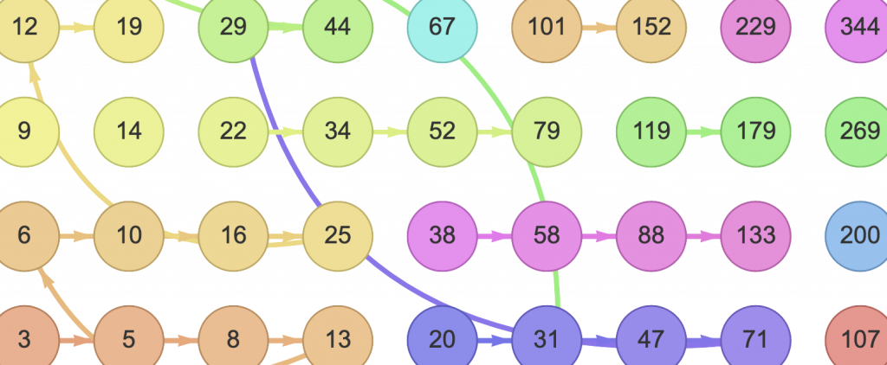

This mathematical treat was inspired by [Jane Street](https://www.janestreet.com/)‘s puzzle: [Traversing the Infinite Sidewalk](https://www.janestreet.com/numberphile/). I shared the puzzle with my mathematical friend Éric, and we had quite some fun discovering its properties.[^1]

It is also a testimony to the richness derived from the irrationality of $\log_2(3)$ and reminiscent of (Caruso, 2012) about the mathematics underlying the 12-tone Pythagorean temperament and the 53-commas musical scale.

Here goes Jane’s story: Jane owns an infinite rosary. It has a single end and is comprised of an infinite number of black and white beads. Starting from the end, the bead positions are numbered $n = 0, 1, 2,\ldots$ and each bead has a label $L(n) = 1, 1, 2, 2, 3, 3,\ldots$ Every third bead including the zeroth one is black; the other beads are white.

$\def\black{{\unicode{x25cf}}}
    \def\white{{\unicode{x25cb}}}
    \def\bblack{{\huge\unicode{x25cf}}}
    \def\bwhite{{\huge\unicode{x25cb}}}
    \def\done{{\bigcirc\!\!\!\!\!\checkmark}}
    \def\todo{{\bigcirc}}
    \def\donealt{\unicode{x2d54}}
    \def\todoalt{\unicode{x2d59}}
    \def\qed{\quad\unicode{x25fb}}
    \def\eqdef{{\stackrel{\tiny\mbox{def}}{=}}}
    \def\iffdef{{\stackrel{\tiny\mbox{def}}{\iff}}}
    \def\N{{\mathbb{N}}}
    \def\Z{{\mathbb{Z}}}
    \def\R{{\mathbb{R}}}
    \newcommand{\card}[1]{{\mbox{card}( {#1} )}}
    \newcommand{\floor}[1]{{\lfloor {#1} \rfloor}}
    \newcommand{\b}[1]{{\boldsymbol{#1}}}$



<a id="janes-rosary-positions"></a>Jane’s rosary (beads positions are shown)



<a id="janes-rosary-labels"></a>Jane’s rosary (beads labels are shown)

Jane tells the beads of her rosary in a special way: each time she is done with a bead (say bead $n$), she moves on, either *up* to bead $n + L(n)$ or *down* to bead $n - L(n)$.



<a id="janes-rosary-labels"></a>telling the beads of Jane’s rosary

Starting at bead $0$, can Jane tell every bead in her rosary? (That is the question.)

## Prelude: names

> To weave the magic of a thing, you see, one must find its true name out.
>
> Ursula K. Le Guin, A Wizard of Earthsea

- **Bead**: a natural number $n \in \mathbb{N}$ (the number represents the position of the bead in Jane’s rosary).

- **Black bead**: a bead $n$ divisible by $3$ (denoted $3 \mid n$).\
  When we know for sure that a bead is black, we may indicate it with: $\black\,3n$.

- **White bead**: a bead $n$ not divisible by $3$ (denoted $3 \not\mid n$).\
  When we know for sure that a bead is white, we may indicate it with: $\white\,3n+1$.

- **Even bead**: a bead $n$ divisible by 2 (denoted $2 \mid n$).

- **Odd bead**: a bead $n$ not divisible by 2 (denoted $2 \not\mid n$).

- **Label**: the label of bead $n$ is: $L(n) = 1 + \lfloor {n \over 2}\rfloor$, where $\lfloor\,\rfloor$ denotes the *floor* function.\
  $L$ is an increasing function.

- **Up**: going *up* from bead $n$, Jane reaches bead $U(n)$ also denoted $nU$ (postfix notation for unary operator $U$).

  $$\begin{equation}
  U: \mathbb{N}\rightarrow\mathbb{N},\quad n\mapsto\lfloor {3n\over2}\rfloor + 1
  \end{equation}$$

  $L$ is a strictly increasing function.

- **Down**: going *down* from bead $n>0$, Jane reaches bead $D(n)$ also denoted $n D$ (postfix notation for unary operator $D$).

  $$\begin{equation}
  D: \mathbb{N}\rightarrow\mathbb{N},\quad n\mapsto\lceil {n\over2}\rceil - 1
  \end{equation}$$

  $D$ is an increasing function.

- **Lambda**: Jane can reach white bead $n$ by performing one *up* move from bead $\lambda(n)$ also denoted $n\lambda$ (postfix notation for unary operator $\lambda$).

  $$\begin{equation}
  \lambda: \mathbb{N}\setminus3\mathbb{N}\rightarrow\mathbb{N}, \quad n\mapsto\lfloor{2n\over3}\rfloor
  \end{equation}$$

  $\lambda$ is a strictly increasing function. Also, it holds that:

  $$\begin{equation}
  \forall n\in\mathbb{N}\setminus3\mathbb{N}, \quad n = n\lambda U
  \end{equation}$$

- **Mu**: given any $n$, there is a unique way for Jane to reach bead $n$ while moving *down* from an odd bead, which we denote $\mu(n)$ or $n\mu$ (postfix notation for unary operator $\mu$).

  $$\begin{equation}
  \mu:\mathbb{N}\rightarrow\mathbb{N}, \quad n\mapsto2n+1
  \end{equation}$$

  $\mu$ is a strictly increasing function. Also, it holds that:

  $$\begin{equation}
  \forall n\in\mathbb{N}, \quad n = n\mu D
  \end{equation}$$

- **Nu**: given any $n$, there is a unique way for Jane to reach bead $n$ while moving *down* from an even bead, which we denote $\nu(n)$ or $n\nu$ (postfix notation for unary operator $\nu$).

  $$\begin{equation}\nu:\mathbb{N}\rightarrow\mathbb{N}, \quad n\mapsto2n+2
  \end{equation}$$

  $\nu$ is a strictly increasing function. Also, it holds that:

  $$\begin{equation}
  \forall n\in\mathbb{N}, \quad n = n\nu D
  \end{equation}$$

- **Recitation**: starting at bead $n$ and randomly moving *up* or *down* finitely or infinitely many times, Janes performs a recitation. In other words a recitation is a sequence of natural numbers $\big(a_n\big)$ such that $a_0 = n$ and $\forall i, \, a_{i+1} \in \{a_i U, a_i D\}$.

- **Length**: the length of a recitation is the number of moves it comprises, finite or infinite. For a finite recitation of length $l$, we can write: $$\exists \big(M_i\big)_1^{l}\in\{U, D\}^l,\quad n_0M_1M_2\dots M_l = n_l$$

  $n_0$ is the start of the recitation. $n_l$ is the end of the recitation.

- **Minimal recitation**: a recitation from bead $n$ to bead $m$, with minimal length. By convention, a minimal recitation to bead $m$ means a minimal recitation from bead $0$ to bead $m$.

- **Height**: the height of bead $n$ (denoted $h(n)$) is the length of a minimal recitation to bead $n$. As we are about to see, every bead has a finite height.

## The height of a bead

By definition $h(0) = 0$.

What about the height of bean $n$ in general?



<a id="height-of-a-bead"></a>the height of bead $3$ is $5$ (beads labels are shown)

Given $n>0$, observe that:

- $3\not\mid n \implies n=mU, \quad$ where $m = n\lambda = \lfloor{2n\over3}\rfloor < n$,
- $3\mid n \land 9\not\mid n \implies n=mU^2D,\quad$ where $m = n\mu\lambda^2 = \lfloor{8n\over9}\rfloor < n$,
- $9\mid n \implies n=mU^2D, \quad$ where $m = n\nu\lambda^2 = \lfloor{8n+6\over9}\rfloor < n$.

This shows (by induction on $n$) that every bead has a finite height.$\qed$

This also gives two upper bounds:

$$\begin{align}
\mbox{for all }n,\;h(n) \leq 1+{4n\over3}\\
\mbox{for all }n>0,\;h(n) \leq 6{\log(n)\over \log(9/8)}
\end{align}$$

The logarithmic bound was suggested by [Jianing Song](https://oeis.org/wiki/User:Jianing_Song).

### Computing the height of a bead

The following simple exploration-based algorithm will do:

```python
def height(n: int) -> int:
    if n < 0: raise Exception("n must be a nonnegative integer")
    if n == 0: return 0
    if n == 1: return 1
    visited = {0, 1}  # the beads we have visited so far
    rings = [{0}, {1}]  # the beads ordered by height (min length of path from 0)
    for height in itertools.count(2):
        new_ring = set()
        for bead in rings[height - 1]:
            label = (bead >> 1) + 1
            for next_bead in {bead - label, bead + label}:
                if not next_bead in visited:
                    if next_bead == n: return height
                    visited.add(next_bead)
                    new_ring.add(next_bead)
        rings.append(new_ring)
```

Below is a plot of the height function.



<a id="janes-height-plot"></a>plot of the heights of beads

## Minimal recitations

In this section, we study some properties of minimal recitations.

### Minimal recitations ending in a white bead

The following property holds for any white bead $n$ ($3 \nmid n$): there exists a minimal recitation to $n$ that ends in an *up* move. In other words:

$$\begin{align}
&\forall n\in\mathbb{N}\setminus3\mathbb{N}, \quad 3\not\mid n \implies \exists \big(M_i\big)_1^{h(n)-1}\in\{U, D\}^{h(n)-1},\label{EndsInUp}\\
&\qquad 0M_1M_2\dots M_{h(n)-1}U\mbox{ is a minimal recitation to }n\nonumber
\end{align}$$

The proof is by induction on the height of $n$. Assume $h\in\mathbb{N}$ given, and assume that for each white bead $n$ of height $<h$, property ($\ref{EndsInUp}$) holds.

Further assume (by contradiction) the existence of a white bead $n$ of height $h$ such that no minimal recitation to $n$ ends in *up*. Finally, consider a minimal recitation $\boldsymbol{R}$ to $n$ (thus necessarily ending in a *down* move).

Being a white bead, $n$ is either of the form $3k+1$ or $3k+2$ for some $k\ge0$.

Let’s first deal with the case where $n = 3k+1$. Observe the following three commutative diagrams:

<div class="columns">
<div class="column">

**Case 1**

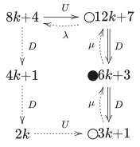

</div>
<div class="column">

**Case 2**

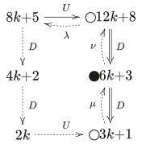

</div>
</div>

<div class="columns">
<div class="column">

**Case 3**

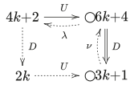

</div>
</div>

The ending of recitation $\boldsymbol{R}$ must correspond to one of the above diagrams. There are three possibilities:

- Case 1: $\boldsymbol{R}$ ends in $n = (n\mu\mu)D^2$. Since $12k+7$ is a white bead of height $h-2$, it must have a minimal recitation ending in *up*. Which produces a minimal recitation ending in $n = (n\mu\mu\lambda)D^2U$ – i.e., *down*–*down*–*up*.
- Case 2: $\boldsymbol{R}$ ends in $n = (n\mu\nu)D^2$. Since $12k+8$ is a white bead of height $h-2$, it must have a minimal recitation ending in *up*. Which produces another minimal recitation ending in $n = (n\mu\nu\lambda)D^2U$ – i.e., *down*–*down*–*up*.
- Case 3: $\boldsymbol{R}$ ends in $n = (n\nu)D$. Since $6k+4$ is a white bead of height $h-1,$ it must have a minimal recitation ending in *up*. Which produces another minimal recitation ending in $n = (n\nu\lambda)DU$ – i.e., *down*–*up*.

Each time there is a contradiction because a minimal recitation is produced, which is ending in an *up* move.

Next let’s deal with the case where $n = 3k+2$. The corresponding commutative diagrams are as follows:

<div class="columns">
<div class="column">

**Case 4**

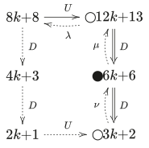

</div>
<div class="column">

**Case 5**

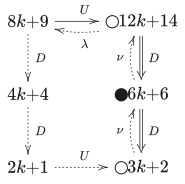

</div>
</div>

<div class="columns">
<div class="column">

**Case 6**

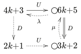

</div>
</div>

Again, we have a contradiction since in all cases we can construct a minimal recitation ending in an *up* move. This shows that property ($\ref{EndsInUp}$) holds for all white beads. $\qed$

### Minimal recitations ending in a black bead

An consequence of property ($\ref{EndsInUp}$) is that for any black bead $n>0, 3\mid n$: there exists a minimal recitation to $n$ that ends in an *up*–*down* sequence. In other words:, for all $n\in\mathbb{N}, n>0$:

$$\begin{align}
&\forall n\in 3\mathbb{N}, \quad n \gt 0 \implies \exists \big(M_i\big)_1^{h(n)-2}\in\{U, D\}^{h(n)-2},\label{EndsInUpDown}\\
&\qquad 0M_1M_2\dots M_{h(n)-2}UD \mbox{ is a minimal recitation to  }n\nonumber
\end{align}$$

The proof is similar as for the white beads, with the following two commutative diagrams.

<div class="columns">
<div class="column">

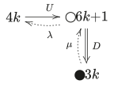

</div>
<div class="column">

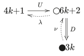

</div>
</div>

## Interlude: more names

> Hey, Louie. The man is dry. Give him one on the house, okay?
>
> Ridley Scott, Blade Runner (1982)

- **Eager recitation**: a recitation that only moves *up*.

- **Seed**: the seed of bead $n$ (denoted $\sigma(n)$) is the black bead from which $n$ can be reached via an eager recitation (only *up* moves).

- **Lambex**: the lambex of bead $n$ (denoted $\Lambda(n)$) is the number of *up* moves required to reach $n$ from its seed $\sigma(n)$. In other words: $n = \sigma(n)U^{\Lambda(n)}$ or equivalently $\sigma(n) = n\lambda^{\Lambda(n)}.$

- **Up-chains**: we call up-chain starting at bead $n$ (denoted $\uparrow\!(n)$) the set of beads reachable by an eager recitation (only *up* moves) from bead $n$:

  $$\begin{align}
  &\uparrow\!(n) \eqdef \{nU^i \mid i \in \mathbb{N}\}
  \end{align}$$

  Note that:

  $$\begin{align}
  \mathbb{N} = \biguplus_{n\in\mathbb{N}}\uparrow\!(3n)
  \end{align}$$

- **Down-chains**: we call down-chain starting at bead $n$ (denoted $\downarrow\!(n)$) the set of beads reachable by downwards recitation (only *down* moves) from bead $n$:

  $$\begin{align}
  &\downarrow\!(n) \eqdef \{nD^i \mid i \in \mathbb{N}\}
  \end{align}$$

  Note that every down-chain is finite and ends in $0$.

- **Jane’s reluctant recitation**: Jane starts the reluctant recitation at bead $0$ and always moves *down* rather than *up*, unless moving *down* would lead to a bead that Jane has already visited, in which case Jane reluctantly moves *up*. See [figure 9](#figure-9) for an illustration.

- **Rho**: $\rho(i)$ is the $i$<sup>th</sup> bead in Jane’s reluctant recitation. For instance, $\rho(0) = 0$, $\rho(5) = 3$, $\rho(13) = 12$. See [figure 10](#fig-reluctant-never-blocks) for an illustration.\
  By construction, $\rho$ is an injective function. And $\rho(i)$ is actually well defined for all $i\ge0$, as we will see later.

## The structure of Jane’s rosary

The partitioning of Jane’s rosary in up-chains produces an interesting one-to-one mapping $\gamma$ between $\mathbb{N}$ and $\mathbb{N}\times\mathbb{N}$:

$$\gamma(n) \stackrel{def}{=} \Big({\sigma(n)\over3}, \Lambda(n)\Big)$$

This is illustrated by [#rosary-structure](#rosary-structure).

<a id="fig-rosary-deconstructed"></a>



<a id="rosary-structure"></a>Jane’s rosary deconstructed (beads grouped by up-chains)

With this mapping, the beads’ heights have a clean representation:



<a id="rosary-structure-heights"></a>Jane’s rosary deconstructed (beads heights are shown)

## Theorem 1: minimal recitations ending in a black bead

Theorem 1 further studies the properties of minimal recitations ending in a black bead. Let $3n>0$ be a black bead.

The following properties hold:

$$\begin{align}
&\sigma(\mu(3n)) \neq \sigma(\nu(3n))\label{th1_sigma}\\
&\Lambda(\mu(3n)) \neq \Lambda(\nu(3n))\label{th1_lambda}\\
&\Lambda(\mu(3n))\gt\Lambda(\nu(3n)) \iff \sigma(\mu(3n)) \lt \sigma(\nu(3n))\label{th1_sigma_lambda}\\
&h(3n)\ge h(3n-1)\label{th1_minus_one}\\
&h(3n)\ge h(3n+1)\label{th1_plus_one}\\
&\Lambda(\mu(3n))\gt\Lambda(\nu(3n))\implies\label{th1_mu}\\
&\qquad\exists\mbox{ minimal recitation to }3n\mbox{ ending in }\sigma(\mu(3n))U^{\Lambda(\mu(3n))}D\nonumber\\
&\Lambda(\nu(3n))\gt\Lambda(\mu(3n))\implies\label{th1_nu}\\
&\qquad\exists\mbox{ minimal recitation to }3n\mbox{ ending in }\sigma(\nu(3n))U^{\Lambda(\nu(3n))}D\nonumber
\end{align}$$

In particular, this shows that which of $\mu(3n)$ or $\nu(3n)$ belongs to a minimal recitation to $3n$ is determined by which has the larger lambex (and the smaller seed).

This is illustrated in [figure 7](#figure-7): the solid arrows point to predecessors with lower lambex, the dashed arrows point to predecessors with larger lambex.

<a id="figure-7"></a>



<a id="when-in-doubt"></a>when in doubt, choose the predecessor with a lower lambex

Theorem 1 guarantees the correctness of the following improved algorithm for computing $h(n)$ with complexity $\log(n)$ in time and contant complexity in space:

```python
def height(n: int) -> int:
    if n < 0: raise 'param must be nonnegative'
    h = 0
    while True:
        if n == 0: return h
        h += 1
        match n%3:
            case 0:
                h += 1
                n=(4*n+2)//3
                while True:
                    h += 1
                    match n%3:
                        case 0:
                            n = (2*n)//3
                            break
                        case 1:
                            n = (2*n)//3
                        case 2:
                            n = (2*n)//3 + 1
                            break
            case _:
                n = (2*n)//3
```

($\ref{th1_sigma}$), ($\ref{th1_lambda}$) and ($\ref{th1_sigma_lambda}$) are easy.

The remainder of the proof is by induction on the height of $3n$.

We can easily check that ($\ref{th1_minus_one}$), ($\ref{th1_plus_one}$), ($\ref{th1_mu}$) and ($\ref{th1_nu}$), are true for all $n$ such that $h(3n)\le5$.

Now assume $h>0$ given, such that ($\ref{th1_minus_one}$), ($\ref{th1_plus_one}$), ($\ref{th1_mu}$) and ($\ref{th1_nu}$), are true for for all $n$ such that $h(3n)\lt h$. Further consider a black bead $3n$ of height $h$.

The following diagram (where $s$ is the successor function: $s(k) = k+1$) is well defined and commutes:

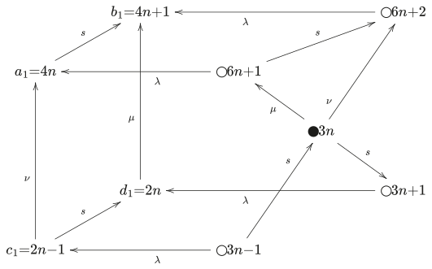

Observe that $c_1 = D(a_1)$, $d_1 = D(b_1)$, $b_1 = s(a_1)$, $d_1 = s(c_1)$. Also, depending on $n\bmod3$, the possibilities for $a_1$, $b_1$, $c_1$, $d_1$ are:

$$\begin{array}{c|cccc}
n\bmod3 & a_1\bmod3 & b_1\bmod3 & c_1\bmod3 & d_1\bmod3\\
\hline
0 & \black\;0 & \white\;1 & \white\;2 & \black\;0\\
1 & \white\;1 & \white\;2 & \white\;1 & \white\;2\\
2 & \white\;2 & \black\;0 & \black\;0 & \white\;1
\end{array}$$

So depending on $n\bmod3$, the « $\lambda$-step » either creates two black beads ($b_1$ and $c_1$ or $a_1$ and $d_1$), or it creates no black beads at all. When no black beads are created, the « $\lambda$ steps » can be applied again. Let’s see how it goes.

Assuming four white beads $a_i$, $b_i$, $c_i$, $d_i$ where $c_i = D(a_i)$, $d_i = D(b_i)$, $b_i = s(a_i)$ and $d_i = s(c_i)$, the only possible configuration is described by the following two diagrams:

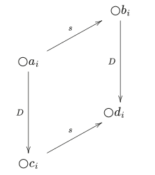

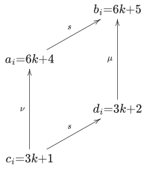

<div class="columns">
<div class="column">

Applying a « $\lambda$-step » to the left gives the following commutative diagram:

</div>
</div>

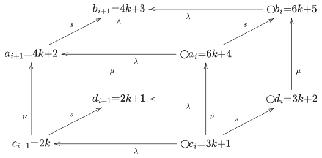

Where $c_{i+1} = D(a_{i+1})$, $d_{i+1} = D(b_{i+1})$, $b_{i+1} = s(a_{i+1})$, $d_{i+1} = s(c_{i+1})$, and depending on $k\bmod3$, the possibilities for $a_{i+1}$, $b_{i+1}$, $c_{i+1}$, $d_{i+1}$ are:

$$\begin{array}{c|cccc}
k\bmod3 & a_{i+1}\bmod3 & b_{i+1}\bmod3 & c_{i+1}\bmod3 & d_1{i+1}\bmod3\\
\hline
0 & \white\;2 & \black\;0 & \black\;0 & \white\;1\\
1 & \black\;0 & \white\;1 & \white\;2 & \black\;0\\
2 & \white\;1 & \white\;2 & \white\;1 & \white\;2
\end{array}$$

This shows that the « $\lambda$-step » can be repeatedly applied $i\gt0$ times until two black beads are created, either $b_i$ and $c_i$ or $a_i$ and $d_i$. Note that the « $\lambda$-steps » cannot be indefinitely applied, since this would result in an infinitely descending sequence $(c_i)$.

On the one hand, if $b_i$ and $c_i$ are the black beads, the configuration is summarized by the following commutative diagram:

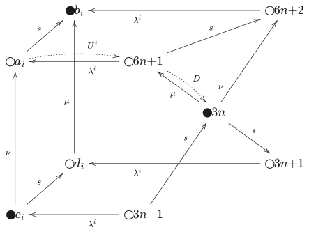

and the following deductions can be made:

- $\Lambda(\mu(3n))\gt\Lambda(\nu(3n))$,

- $a_i$ belongs to a minimal recitation to $3n$. If it did not, $b_i$ would belong to a minimal recitation to $3n$, we would have $h(b_i)=h(3n)-i-1\lt h$, and by induction hypothesis (\\ref{th1_minus_one}) we could write the following contradiction:

  $$h(a_i)+i+1 \gt h(3n) = h(b_i)+i+1 \ge h(a_i)+i+1,$$

- there is a minimal recitation to $3n$ ending in $a_i U^iD$,

- there is a minimal recitation to $3n$ ending in $\sigma(\mu(3n))U^{\Lambda(\mu(3n))}D$,

- $h(3n-1) \le h(a_i)+1+i = h(3n)$,

- $h(c_i)\le h(a_i)+1\lt h(3n) = h$, and by induction hypothesis (\\ref{th1_plus_one}) we can write: $h(3n+1) \le h(d_i)+i \le h(c_i)+i \le (h(a_i)+1)+i = h(3n)$.

On the other hand, if $a_i$ and $d_i$ are the black beads, the configuration is summarized by the following commutative diagram:

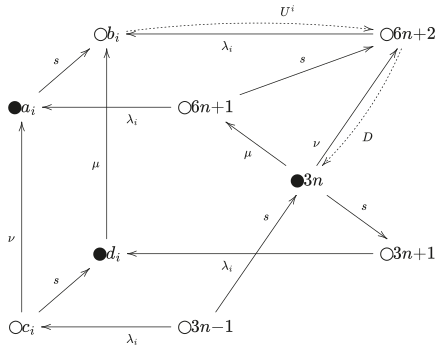

and similarly, the following deductions can be made:

- $\Lambda(\nu(3n))\gt\Lambda(\mu(3n))$,
- $b_i$ belongs to a minimal recitation to $3n$,
- there is a minimal recitation to $3n$ ending in $\sigma(\nu(3n))U^{\Lambda(\nu(3n))}D$,
- $h(3n-1) \le  h(3n)$,
- $h(3n+1) \le h(3n)$.

Overall, properties ($\ref{th1_minus_one}$), ($\ref{th1_plus_one}$), ($\ref{th1_mu}$) and ($\ref{th1_nu}$) hold for all $n$ such that $h(3n)=h.\qed$

## Jane’s reluctant recitation

The reluctant recitation was suggested by [Neal Gersh Tolunsky](https://oeis.org/wiki/User:Neal_Gersh_Tolunsky). The recitation starts at bead $0$ and Jane tells the beads, always preferring to move *down* rather than *up*, unless moving *down* would lead to a bead that Jane has already visited, in which case Jane reluctantly moves *up*.

The following figure illustrate the moves of the reluctant recitation.

<a id="figure-9"></a>



<a id="reluctant-recitation-positions"></a>Jane’s reluctant recitation (beads positions are shown)

The following algorithm computes $\rho(i)$:

```python
def rho(i: int) -> int:
    if i < 0: raise Exception("argument must be nonnegative")
    if i == 0: return 0
    visited = {0: 0}
    bead = 1
    for age in range(1, i):
        visited[bead] = age
        label = 1 + bead//2
        if not bead - label in visited:
            bead -= label  # moving down
        else:
            bead += label  # moving up
    return bead
```

## Theorem 2: Jane’s reluctant recitation never halts

While performing the reluctant recitation, Jane moving on to bead $n$ never causes a gap to appear in the rosary’s up-chains – i.e., a gap in the sequence $\sigma(n), \sigma(n)U, \cdots, \sigma(n)U^{\Lambda(n)}=n$.

This ensures that the reluctant-recitation never halts.

<a id="fig-reluctant-never-blocks"></a>



<a id="reluctant-never-halts"></a>Jane’s reluctant recitation never halts

The proof is by contradiction and by induction on the index $i$ or the first move that would create a gap.

Looking at [#reluctant-never-halts](#reluctant-never-halts), we see that moves up to the $20$<sup>th</sup> do not create a gap.

Now assume (by contradiction) the existence of $i\ge0$ such that none of Jane’s reluctant moves prior to $i$ has created a gap but Jane’s $i$<sup>th</sup> move creates a gap by reaching bead $n=\rho(i).$

Since an *up* move cannot create a gap in an up-chain, it holds that $n = \rho(i-1)D$.

Since a gap is created, $\rho(i)$ must be a white bead (non divisible by $3$) and there must be a gap $g$ just « to the left » of $n$ in the up-chain, at the moment $n$ is reached:

$$g = \lambda(n).$$

We must consider two cases: $n = 3k+1$ and $n = 3k+2$.

### Gap « to the left » of $3k + 1$

Consider the case $\rho(i) = 3k+1$.

If $\rho(i-1) = \rho(i)\nu$, then one of the two following commutative diagrams holds, where $\done_a$ indicates $\rho(i-a)$:

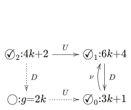

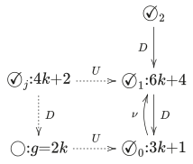

The left hand side diagram brings a contradiction, since from $\done_2$ Jane should have moved *down* to $g=\todo$, rather than *up* to $\done_1$.

The right hand side diagram also brings a contradiction: since $\done_1$ has not created a gap (induction hypothesis), $4k+2$ must have been visited at some earlier step $\done_j$, and from $\done_j$ Jane should have moved *down* to $\todo$.

Consequently $\rho(i-1) = \rho(i)\nu = 6k+3$ is a black bead, and we must consider two subcases: $\rho(i-2) = \rho(i-1)\mu$ and $\rho(i-2) = \rho(i-1)nu$

#### Subcase: $\rho(i-2) = \rho(i-1)\mu$

If $\rho(i-2) = \rho(i-1)\mu$, then one of the two following commutative diagrams holds:

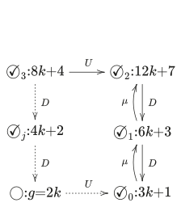

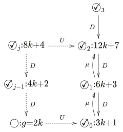

On the left hand side diagram, since after $\done_3$ Jane chose to move *up* to $\done_2$, $4k+2$ must have been visited at some earlier step $\done_j$. But there is a contradiction since from $\done_j$ Jane should have moved *down* to $g=\todo$.

On the right hand side diagram, since $\done_2$ has not created a gap (induction hypothesis), $8k+5$ must have been visited at some earlier step $\done_j$. After $\done_j$ Jane must have moved *down* to $\done_{j-1}$ and from $\done_{j-1}$ she should have moved *down* to $\todo$, again a contradiction.

#### Subcase: $\rho(i-2) = \rho(i-1)\nu$

If $\rho(n-2) = \rho(n-1)\nu$, then one of the two following commutative diagrams holds:

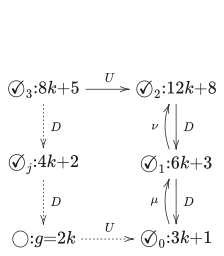

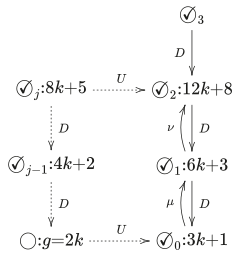

On the left hand side diagram, since after $\done_3$ Jane chose to move *up* to $\done_2$, $4k+2$ must have been visited at some earlier step $\done_j$. But there is a contradiction since from $\done_j$ Jane should have moved *down* to $g=\todo$.

On the right hand side diagram, since $\done_2$ has not created a gap (induction hypothesis), $8k+5$ must have been visited at some earlier step $\done_j$. After $\done_j$ Jane must have moved *down* to $\done_{j-1}$ and from $\done_{j-1}$ she should have moved *down* to $\todo$, again a contradiction.

At this point, we conclude that it is not possible that $\rho(n) = 3k+1$.

### Gap « to the left » of $3k + 2$

Consider now the case $\rho(i) = 3k+1$.

The same reasoning as previously brings contradictions.

If $\rho(i-1) = \rho(i)\mu$, the commutative diagrams to consider are:

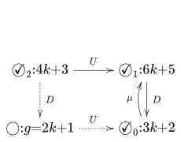

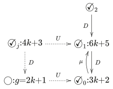

If $\rho(i-1) = \rho(i)\nu$ and $\rho(i-2) = \rho(n-1)\mu$, the commutative diagrams to consider are:

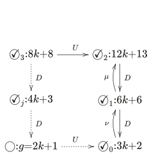

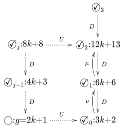

If $\rho(i-1) = \rho(i)\nu$ and $\rho(i-2) = \rho(i-1)\nu$, the commutative diagrams to consider are:

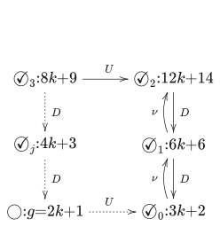

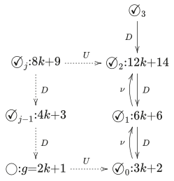

This concludes the proof that Jane’s reluctant recitation never halts. $\qed$

## Conjecture 3: Jane’s reluctant recitation tells all beads

We have demonstrated (just above) that Jane’s reluctant recitation is a well defined sequence $(\rho(n))_{n=0}^\infty$. By construction $\rho$ is injective, but more than that,

$$\begin{align}
\mbox{it seems that } \rho \mbox { is a permutation of }  \mathbb{N}.\label{ReluctantPermutation}
\end{align}$$

We have been able to check with a computer that $\rho$ reaches every integer up to $7884654$ ($\approx 7.8\cdot10^6$) but at the moment we cannot prove conjecture 3. We can however prove a lesser form of it, **theorem 3: either Jane’s reluctant recitation tells all beads, or there is a finite integer that bounds the number of times it visits every maximal up-chain $\uparrow\!(3n)$**.

### Lemma 1

Let $n\in\N$, then the down-chain $\downarrow\!(n)$ contains exactly the integers $m$ for which the binary representation of $m+1$ is a prefix of the binary representation of $n+1$:

$$\begin{align}
&\forall n, \quad \downarrow\!(n)\quad=\quad\{m\mid \exists k\ge0, m+1 = \floor{n+1\over2^k}\}
\end{align}$$

### Lemma 2

Let $m\in\N$. There exists a bound $b(m)\ge0$ such that given any $n\ge0$, $m$ belongs to the down-chain of a bead less than $b(m)$ up-moves away from $n$:

$$\begin{align}
&\forall m\in\N, \exists b\in\N,\quad \forall n\in\N, m\in\cup_{k=0}^{b}\downarrow\!(nU^k)
\end{align}$$

The proof requires a short detour via analysis. First observe the following inequalities, true for all $n\gt0$:

$$\begin{align}
&\floor{3n+1\over2} \le nU \le \floor{3n+2\over2}\\
&\log_2(n)+\log_2({3\over2})+\log_2(1+{1\over3n}) \le \log_2(nU)\nonumber\\
&\qquad\le \log_2(n)+\log_2({3\over2})+\log_2(1+{2\over3n})\\
&{1\over\ln(2)}{1\over1+3n} \le \log_2(1+{1\over3n}) \lt \log_2(1+{2\over3n}) \le {1\over\ln(2)}{2\over3n}\\
&{1\over\ln(2)}({2\over3n}-{1\over1+3n}) = {1\over\ln(2)}{3n+2\over 3n(3n+1)}
\end{align}$$

Further observe that since $\log_2(3)$ is irrational, then:

$$\begin{align}
\log_2({3\over2})\N \mbox{ is dense in the circle } \R/\Z
\end{align}$$



<a id="log2-3-is-dense"></a>$\log_2({3\over2})\N \mbox{ is dense in the circle } \R/\Z$

Now let’s assume $m\in\N$ given, and let $d$ be the number of digits in binary representation of $m+1$: $2^d\le m+1 \lt 2^{d+1}$.

Now perform the following:

- Choose $i$ such that $i\log_2({3\over2})$ is less than $1\over2^{d+1}$ away from $0$ in $\R/\Z$.

- Choose $e\gt d$ such that $i\log_2({3\over2})$ is more than $1\over2^{e+1}$ away from $0$ in $\R/\Z$.

- Choose $a\in\N$ such that:

  $$\forall n \ge a, \quad {1\over\ln(2)}{3n+2\over 3n(3n+1)} \lt {1\over 2^{e+1}i}\label{plus2}$$

Finally define the bound $b(m)$ as $a + 2^{e+1}i$.

Observe that for all $n\in\N$, $\{nU^k\mid k\le b\}$ must contain a point $nU^k$ that is less than $1\over2^{d+1}$ away from $log_2({\mu(m)+\nu(m)\over2})$. By lemma 1, it holds that $m\in\;\downarrow\!(nU^k).\qed$

### Proof of theorem 3

Assume that there is no finite bound on the number of times the reluctant recitation visits maximal up-chains $\uparrow\!(3n)$.

Take $m\in\N$. By lemma 2, there is a bound $b$ such that $\forall i\in\N, m\in\cup_{k=0}^{b}\downarrow\!(iU^k)$. By our assumption, we can pick an $n$ such that $\uparrow\!(3n)$ is visited more than $b$ times by the reluctant recitation.

Then there is a $k$, such that $(3n)U^k$ is visited by the reluctant recitation and $m\in\;\downarrow\!((3n)U^k)$. This proves that $m$ is visited by the reluctant recitation.[^2]$\qed$

## Interlude: for a few names more

> **Colonnello Mortimer**: Che succede ragazzo?\
> **Il Monco**: No, niente vecchio, non mi tornavano i conti. Ne mancava uno.
>
> Sergio Leone, Per qualche dollaro in più (1965)

- **Canonical recitation**: the canonical recitation to bead $n$ (denoted $\boldsymbol{C}(n)$)is the minimal recitation $0=a_0, a_1, \cdots, a_{h(n)} = n$, defined by:

  $$\begin{align}
  & 3\nmid a_i &\implies a_{i-1} = a_i\lambda\nonumber\\
  & 3\mid a_i \mbox{ and } \Lambda(a_i\mu)\gt\Lambda(a_i\nu) &\implies a_{i-1} = a_i\mu\nonumber\\
  & 3\mid a_i \mbox{ and } \Lambda(a_i\nu)\gt\Lambda(a_i\mu) &\implies a_{i-1} = a_i\nu\nonumber
  \end{align}$$

- **Jane’s onyx rosary**: Jane’s onyx rosary is obtained by removing all white beads from Jane’s full rosary. A bead in Jane’s onyx rosary is called an onyx bead, to distinguish it from the same bead in the Jane’s full rosary.

- **Onyx bead**: a bead in Jane’s onyx rosary. Onyx beads positions are numbered from $0$. Onyx bead $n$ is the same as (black) bead $3n$ in Jane’s full rosary.

- **Onyx ordering**: we define the partial ordering $\b{\preceq}$ on the set of onyx beads: given two onyx beads $m, n\in\mathbb{N}$,

  $$m\b{\preceq}n\iffdef 3m\mbox{ appears in the canonical recitation for }3n$$

- **Onyx height**: The onyx height of bead $n$ (denoted $\boldsymbol{h}(n)$) is defined as one less than the number of black beads in the canonical recitation of $3n$:

  $$\forall n,\quad\b{h}(n)\quad\eqdef\quad\card{\boldsymbol{C}(3n)\cap3\mathbb{N}}-1$$

- **Onyx down**: Onyx down on onyx bead $n$ (denoted $\b{D}(n)$ or $n\boldsymbol{D}$) is defined as:

  $$\boldsymbol{D}(n)\quad\eqdef\quad {1\over3}\sigma(D(3n))$$

- **Onyx mu**: Onyx mu on bead $n$ (denoted $\boldsymbol{\mu}(n)$ or $n\boldsymbol{\mu}$) is defined as:

  $$\boldsymbol{\mu}(n)\quad\eqdef\quad {1\over3}\sigma(\mu(3n))$$

- **Onyx nu**: Onyx nu on bead $n$ (denoted $\boldsymbol{\nu}(n)$ or $n\boldsymbol{\nu}$) is defined as:

  $$\boldsymbol{\nu}(n)\quad\eqdef\quad {1\over3}\sigma(\nu(3n))$$

## Jane’s onyx rosary

Jane’s onyx rosary is obtained by removing all white beads from Jane’s full rosary. We call a bead in Jane’s onyx rosary an *onyx bead*, to distinguish it from the same bead in Jane’s full rosary. Beads positions in Jane’s onyx rosary are numbered from $0$. In other words, onyx bead $n$ is the same as (black) bead $3n$ in Jane’s full rosary.

In this section, we leave the black beads aside and focus solely on onyx beads.

### Onyx ordering

Given two onyx beads $m, n\in\mathbb{N}$, we define the onyx (partial) ordering $\boldsymbol{\preceq}$ as:

$$m\boldsymbol{\preceq}n\iffdef 3m\mbox{ appears in the canonical recitation for }3n$$

The onyx ordering is a well founded partial order on $\N$ (i.e., there are no infinitely descending chains). $0$ is its only minimal element.

The Hasse diagram for the onyx partial order is a tree rooted in $0$ (see [#onyx-ordering](#onyx-ordering)). In this tree, every onyx bead $n$ is $\b{h}(n)$ edges away from $0$.



<a id="onyx-ordering"></a>Jane’s onyx partial ordering

In the onyx ordering, every non-zero element $n$ has a unique predecessor $p(n)$, which we denote $p(n)\lessdot n$.

By construction (and also as can be seen on [#onyx-ordering](#onyx-ordering)), the onyx ordering is embedded in $\N, \le$ in the sense that:

$$\begin{align}
m\b{\preceq}n\quad\implies\quad m\le n
\end{align}$$

### Theorem 4: every bead in the onyx ordering has infinitely many successors

Let us first establish a few lemmas that will help proving theorem 4.

#### Lemma 3

The following property holds:

$$\begin{align}
&\forall n, k \in \N, \quad 3\mid nU^{k+1}D \iff nU^k\mbox{ and }nU^{k+1}\mbox{ have the same parity}
\end{align}$$

The proof is achieved by considering the four cases for the respective parities of $nU^k$ and $nU^{k+1}.\qed$

#### Lemma 4

Let $n \in \N$, the up-chain $\uparrow\!(n)$ starting at $n$ cannot have constant parity:

$$\begin{align}
&\forall n \in \N, \quad (nU^k)_{k=0}^\infty\mbox{ does not have constant parity}
\end{align}$$

The proof is by contradiction.

Assume $(nU^k)_{k=0}^\infty$ is constantly even. Then:

$$\forall k \in \N, \quad nU^{k+1} = {3\over2}nU^k+1$$

This equation is solvable and the unique solution is:

$$\forall k \in \N, \quad nU^k = ({3\over2})^k(n+2)-2$$

This is a contradiction since $nU^k$ must be an integer for all $k$.

Conversely, assume $(nU^k)_{k=0}^\infty$ is constantly odd. Then:

$$\forall k \in \N, \quad nU^{k+1} = {3\over2}nU^k+{1\over2}$$

This equation is solvable and the unique solution is:

$$\forall k \in \N, \quad nU^k = ({3\over2})^k(n+1)-1$$

This is a contradiction since again, $nU^k$ must be an integer for all $k.\qed$

#### Lemma 5

For any $S\subseteq\N$ and any $n\in\N$, let $S+n$ denote the set $\{k+n\mid k\in S\}.$

$$\begin{align}
&\forall m, n\in\N,\quad \uparrow\!(n)\;\cap\;(\uparrow\!(m)+1) \mbox{ contains at most }2\mbox{ elements.}\\
&\forall m, n\in\N,\quad \uparrow\!(n)\;\cap\;(\uparrow\!(m)-1) \mbox{ contains at most }2\mbox{ elements.}\nonumber
\end{align}$$

#### Proof of theorem 4

The proof proceeds with the construction of subsets of (non-onyx) beads $S_n\subseteq\;\uparrow\!(n)$ for all $n\in\N$. $S_n$ is defined as:

$$\begin{align}
&S_n = \{k\in\;\uparrow\!(3n)\;\mid\; 3\mid kD\}
\end{align}$$

By lemma 3 and lemma 4 we know that $S_n$ is infinite.

Let $D(S_n)$, $D\mu(S_n)$, $D\nu(S_n)$ respectively denote the sets $\{kD \mid k\in S_n\}$, $\{kD\mu \mid k\in S_n\}$, and $\{kD\nu \mid k\in S_n\}.$

Now consider $m\lt n\in\N$.

- It holds that $(D\mu(S_m)\cup D\nu(S_m))\setminus S_m \;\subseteq\; (S_m+1)\cup(S_m-1)$.
- Thus by lemma 5, $(D\mu(S_m)\cup D\nu(S_m))\cap S_n$ contains at most $4$ elements.

To conclude, consider $n\in\N$ and $P_{3n}=S_{3n}\setminus\cup_{k\lt n}(D\mu(S_{3k})\cup D\nu(S_{3k}))$.

- $P_{3n}$ has infinitely many elements,
- For each $k\in P_{3n}$, $3\mid kD$, say $kD = 3m$,
- k is the lower of $kD\mu$ and $kD\nu$.

This designates $3m$ as the immediate predecessor of $kD$ in the canonical recitation to $kD$. In other words, $m$ (as an onyx bead) is the (immediate) predecessor of $n$ in the onyx ordering: $m \lessdot n.\qed$

### Corollary of theorem 4: canonical onyx mapping

Given any onyx bead $n\in\N$ and $k\in\N$, let $\b{s}_n(k)$ denote the $k$<sup>th</sup> cover of $n$ in the onyx ordering (i.e. immediate successor), where the covers are ordered by $\leq$.

Conversely, given a non-zero onyx bead $n\in\N^*$, let $\b{\pi}(n)$ denote the unique predecessor of $n$ in the onyx ordering, and let $\b{\iota}(n)$ denote the position of $n$ in the set of covers of $\b{\pi}(n)$.

For instance (refer to [#onyx-ordering](#onyx-ordering)): $\b{s}_0(2)=10$, $\b{s}_1(2)=5$, $\b{\iota}(38)=3$.

We define the canonical onyx mapping $C$ as:

$$\begin{align}
C:\;&\N\rightarrow\N^{\lt\omega}\nonumber\\
&n\mapsto(\b{\iota}(\b{\pi}^i(n)))_{i\lt \b{h}(n)}\nonumber
\end{align}$$

$C$ is a one-to-one mapping from $\N$ to the set $\N^{\lt\omega}$ of finite sequences of natural numbers. Furthermore:

$$\begin{align}
&\forall m, n\in\N, \quad m\preceq n\iff C(m) \mbox{ is a prefix of } C(n).
\end{align}$$

As an illustration, the following table gives $C_n$ for $n=0\cdots10$:

$$\begin{array}{c|c}
n & C(n)\\
\hline
0 & ()\\
1 & (0)\\
2 & (0, 0)\\
3 & (1, 0)\\
4 & (1)\\
5 & (2, 0)\\
6 & (0, 0, 0)\\
7 & (0, 1)\\
8 & (0, 0, 1)\\
9 & (0, 0, 0, 1)\\
10 & (2)
\end{array}$$

## Work in progress

### Jane’s onyx height sequence

### Jane’s onyx reluctant sequence

### Jane’s inverse onyx reluctant sequence

### Jane’s foraging sequence

Jane’s foraging sequence $(\boldsymbol{\Phi}(i))_{i=0}^\infty)$ is a sequence of onyx beads constructed from Jane’s reluctant recitation in the following way:

- each $\rho(i)$ is replaced with $\sigma(\rho(i))\over3$,
- then direct repetitions are removed.

The foraging sequence goes like this:

$$0, 1, 2, 4, 3, 13, 4, 7, 5, 0, 10, 40, 30, 4, 11, 8, 6, 16, 12, 9,\cdots$$

The foraging sequence is infinite. If conjecture $3$ is true, then the foraging sequence visits all natural numbers an infinite number of times.

The following algorithm computes $\boldsymbol{\Phi}(i)$:

```python
def Phi(n: int) -> int:
    import itertools
    if n < 0: raise Exception("argument must be nonnegative")
    visited = {0: 0}
    bead = 1
    res = 0
    for i in itertools.count(1):
        if n == 0: return res
        visited[bead] = i
        label = 1 + bead//2
        if not bead - label in visited:
            bead -= label  # moving down
        else:
            bead += label  # moving up
        nxt = bead
        while nxt%3: nxt = (2*nxt)//3  # compute seed
        nxt = nxt//3
        if nxt != res:
            res = nxt
            n -= 1
```

## References

Caruso, X. (2012). Application des fractions continues à la construction des gammes musicales. *Revue Des Mathématiques de l’Enseignement Supérieur*, *123*(1), 11.

[^1]: See also the [On-Line Encyclopedia of Integer Sequences](https://oeis.org/wiki/Welcome):
    
    - [OEIS sequence A358838](https://oeis.org/A358838): Minimum number of jumps needed to go from slab 0 to slab n in Jane Street’s infinite sidewalk,
    - [OEIS sequence A359005](https://oeis.org/A359005): Jane Street’s infinite sidewalk’s greedy walk,
    - [OEIS sequence A359008](https://oeis.org/A359008): Jane Street’s infinite sidewalk’s greedy walk inverse mapping.

[^2]: Since whenever the reluctant recitation visits a bead $l$, it also visits all beads in $\downarrow\!(l)$.
